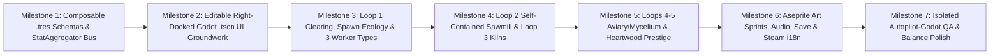

# Treecremental -- Step-by-Step Implementation & Development Roadmap (v0.6)

> **Project Status**: `planning` (Development paused until formal sign-off).
> **Purpose**: Chronological, milestone-gated rollout plan ensuring every system is built, integrated, and tested in strict accordance with our hyper-modular `StatAggregator` architecture, Right-Hand Docked `.tscn` UI groundwork, 3-worker-type rules, and zero-trace `Autopilot-Godot` Git hygiene.

---

## High-Level Milestone Dependency Flow

---

## Milestone 1: Composable Data Layer & `StatAggregator` Bus (Foundation)

**Goal**: Establish the 100% data-driven resource schemas and decoupled modifier evaluation bus before any gameplay loop or UI exists, guaranteeing that future design adjustments require zero GDScript refactoring.

1. **Step 1.1 -- Composable Resource Schemas (`src/core/data/`)**:
   - Create `WorkerArchetypeData` (`id`, `move_speed`, `attack_rate`, `base_damage`, `crit_chance`, `armor_penetration`, `synergy_weight`, `allowed_loop_ids: PackedStringArray`).
   - Extend `SpeciesData` with `base_hp`, `bark_hardness`, `base_coin_value`, `spawn_weight_curve: FormulaCurve`, `max_quantity_curve: FormulaCurve`, and `synergy_id: StringName`.
   - Create `UpgradeDefinitionData` and `StatModifierData` (`target_domain`, `stat_key`, `operation: ADD | MUL`, `curve: FormulaCurve`).
2. **Step 1.2 -- Central `StatAggregator` & Currency `WalletModule` (`src/core/`)**:
   - Implement `StatAggregator` (`register_modifier`, `remove_modifier`, `query(domain, stat_key)`) so no module ever reads another module's internal state.
   - Implement `WalletModule` supporting the 7 canonical currencies (`coins`, `processed_logs`, `charcoal`, `ash`, `birdseed`, `spores`, `sap`) via `EventBus` signals.
3. **Step 1.3 -- Full `.tres` Data Authoring (`data/`)**:
   - Generate `.tres` files for all 3 worker types (`data/workers/`), 9 tree species (`data/species/`), and 87 itemized upgrades (`data/upgrades/`), validated against `design/registry/entities.yaml`.
4. **Step 1.4 -- Milestone 1 Verification Gate**:
   - Run headless Godot smoke tests (`tests/smoke/`) confirming that modifying any `.tres` upgrade or `allowed_loop_ids` array updates `StatAggregator.query()` results with zero code dependencies.

---

## Milestone 2: Editable Right-Hand Docked Godot `.tscn` UI Groundwork

**Goal**: Deliver clean, flat, human-editable Godot `.tscn` Control-node wireframes early so the developer can visually inspect, move, resize, and skin all containers in the Godot 2D Editor without breaking any script bindings.

1. **Step 2.1 -- Shared Theme & Reusable Upgrade Row Prefab**:
   - Create `assets/ui/default_theme.tres` and `scenes/ui/components/upgrade_row_template.tscn` (`%Icon`, `%TitleLabel`, `%LevelPips`, `%EffectLabel`, `%BuyButton`).
2. **Step 2.2 -- Right-Hand Docked Main Screen (`scenes/ui/main_screen.tscn`)**:
   - Build the `640x360` `HBoxContainer` split:
     - **Left/Center Column (`432x360 px`)**: `TopResourceBar` (`432x28 px` with `%CoinsLabel`, `%ProcessedLogsLabel`, `%CharcoalLabel`, `%SapLabel`, `%BreakthroughProgressBar`) above `CompoundViewportContainer` (`432x332 px`).
     - **Right-Hand Docked HUD (`208x360 px`)**: `%LoopTabBar` (`Trees`, `Crew`, `Mill`, `Roots`), `%BulkBuyBar` (`x1`, `x10`, `MAX`), `%UpgradeScroll`, and `%DockFooter`.
3. **Step 2.3 -- Overlay Modal & Menu Wireframes (`scenes/ui/modals/`)**:
   - Create editable `.tscn` wireframes for `main_menu.tscn`, `modal_prestige.tscn` (Heartwood 3-ring constellation), `modal_achievements.tscn`, and `modal_settings.tscn` (Display, 4-bus `AudioServer` sliders, Accessibility toggles, Notation, and Locale selector).
4. **Step 2.4 -- Milestone 2 Verification Gate**:
   - Verify all `.tscn` scenes open cleanly in the Godot 2D Editor with zero procedural UI layout code, 100% `%UniqueNodeNames` bindings, and 100% `KEY_...` localization strings from `i18n/game_text.csv`.

---

## Milestone 3: Loop 1 -- 3/4 Logging Clearing, `TileMapLayer` Terrain, Poisson-Disc Random Spawning & 3 Worker Types

**Goal**: Bring the 3/4 top-down clearing (`432x332 px`, `y_sort_enabled = true`) to life with a modular Godot 4.7 `TileMapLayer` stack, grid-free continuous random tree spawning with minimum separation radius, Old-Growth maturity scaling, 9 species synergies, and the 3 autonomous worker types.

1. **Step 3.1 -- `TileMapLayer` Terrain Stack & Grid-Free Poisson-Disc Tree Spawner (`LoggingCampModule`)**:
   - Set up the 3-layer `TileMapLayer` stack (`%GroundBaseLayer`, `%TerrainDetailLayer` with 3x3 minimal terrain autotiling, and Y-sorted `%PerimeterTreelineLayer`) sharing `res://assets/tilesets/clearing_tileset.tres` (`16x16 px` tiles) with a boolean Custom Data Layer `can_spawn_tree`.
   - Implement the **Grid-Free Continuous Random Tree Spawner** (Poisson-disc / radius-rejection sampling): trees never spawn on fixed grid plots; instead, they spawn at random pixel-snapped `Vector2(x, y)` coordinates across `can_spawn_tree == true` tiles while enforcing a minimum separation distance $\|\mathbf{p} - \mathbf{p}_j\| \ge r_i + r_j$ (`trunk_clearance_radius` in `SpeciesData`) and rolling species via `prop_<species>` Spawn Probability Weight ($W_i$) and Max Concurrent Quantity Cap ($Q_i$).
2. **Step 3.2 -- Tree Durability (HP), Bark Hardness & Old-Growth Maturity Ranks**:
   - Implement tree instances with overhead world-space HP bars, Old-Growth Maturity Ranks ($m \in \{0..4\}$, scaling HP by $4.0^m$ and Coin Yield by $4.2^m$ to clamp fell time to $2.5\text{ s}$--$8.0\text{ s}$), Chip Yield ($30\%$) with floating `+$COINS` popups, and Timberfall Jackpot ($70\%$).
3. **Step 3.3 -- The 3 Autonomous Worker Archetypes**:
   - Implement autonomous pathfinding and chopping behaviors driven by `WorkerArchetypeData`:
     - **`simple_lumberjack`**: Balanced `1.0x` move/swing chopper.
     - **`heavy_sawyer`**: `0.75x` move, continuous sawing ticks, 100% Bark Hardness penetration, and armor shred (`camp_kerf_softening`).
     - **`swift_cleaver`**: `1.40x` move, `1.8 hits/s` flurry, $+20\%$ base crit, and $2.0\times$ synergy trigger weight.
4. **Step 3.4 -- The 9 Tree Species Ecological Synergies**:
   - Connect modular synergy handlers for all 9 species (including Sakura's *Cherry Petal Rain*, Pine's *Pitch Sap Splatter*, and Fir's *Boreal Frost Shatter*).
5. **Step 3.5 -- Milestone 3 Verification Gate**:
   - Verify that tree spawn frequencies match $P(\text{spawn } i)$, trees never get 1-frame insta-chopped at high DPS, and all 30 Loop 1 upgrades apply via `StatAggregator`.

---

## Milestone 4: Secondary Loops -- Self-Contained Sawmill (Loop 2) & Charcoal Kilns (Loop 3)

**Goal**: Connect the Sawmill value-amplification loop and the Charcoal Kiln thermal overclock loop without dual main-loop currencies or tight coupling.

1. **Step 4.1 -- Shared `Simple Lumberjack` Roster Dispatcher**:
   - Implement the worker assignment controller reading `allowed_loop_ids` from `WorkerArchetypeData`, allowing **only `simple_lumberjack`** units to be split between the Main Clearing and Sawmill stations (`+` / `-` controls), while `heavy_sawyer` and `swift_cleaver` remain Main Loop exclusive.
2. **Step 4.2 -- Self-Contained Sawmill Value-Amplification (`SawmillModule`)**:
   - Implement per-species Sawmill stations (`mill_pine` through `mill_giant_sequoia`) requiring **zero input materials**: assigned Simple Lumberjacks process that wood type to continuously raise its individual base coin value multiplier ($M_{\text{mill}, i}$) on `StatAggregator` and generate `processed_logs`.
   - Wire all 17 Sawmill upgrades (paid exclusively in `processed_logs`) that scale tree coin value, the quantity of Simple Lumberjacks sent to work (`mill_crew_quarters` + station slots), and their working speed (`mill_undershot_wheel`, etc.).
3. **Step 4.3 -- Brick Charcoal Kilns & Boiler Overclock (`KilnModule`)**:
   - Implement kiln carbonization cycles producing `charcoal` and `ash`, the Steam Boiler **Thermal Overclock Gauge** ($\times 1.50$ to $\times 2.00$ global working speed on `StatAggregator`), and the 8 Kiln upgrades.
4. **Step 4.4 -- Milestone 4 Verification Gate**:
   - Verify that assigning Simple Lumberjacks to a Sawmill station immediately increases that tree species' `coins` payout in the clearing without consuming raw materials.

---

## Milestone 5: Tertiary Isolated Loops (Loops 4 & 5) & Heartwood Ascension Prestige

**Goal**: Complete the 5-loop ecosystem and the 3-Act Plateau-Curve Breakthrough/Ascension progression.

1. **Step 5.1 -- Loop 4: Canopy Aviary (`AviaryModule`)**:
   - Implement active-session `birdseed` generation, the 5 bird roosts, and the 3 sanctuary upgrades (`aviary_seed_hopper`, `aviary_suet_cakes`, `aviary_gilded_weathervane`).
2. **Step 5.2 -- Loop 5: Mycelium Root Network (`MyceliumModule`)**:
   - Implement subterranean `spores` generation, `ash` composting, and the 8 symbiotic fungal upgrades (`myc_phosphorus_exchange` through `myc_mother_tree_nexus`).
3. **Step 5.3 -- 3-Act Breakthrough Gates & Heartwood Sap Constellation (`PrestigeModule`)**:
   - Implement the Act I (`$247K`), Act II (`$7.16M`), and Act III (`$46.2M`) Breakthrough Gates, the Lifetime Sap multiplier ($M_{\text{sap}} = 1 + 0.60 \cdot \text{LifetimeSap}^{0.5}$), and the 16 Constellation nodes across the Inner, Middle, and Outer rings.
4. **Step 5.4 -- Milestone 5 Verification Gate**:
   - Run a full 3-Act automated progression test verifying Act cap stabilization (Plateau phase), Breakthrough Ascension reset rules, and `sap_canopy_sanctuary_bond` persistence.

---

## Milestone 6: Aseprite Art Sprints, Audio, Save System, Achievements & Steam i18n

**Goal**: Replace wireframe placeholders with final Aseprite pixel art and complete all production systems.

1. **Step 6.1 -- 4-Sprint Aseprite Asset Integration (`assets/sprites/`)**:
   - **Sprint 1**: Clearing tileset, Act I trees (Pine, Birch, Oak across maturity ranks), the 3 Worker Types + 6 gear tier overlays, and Right-Hand Docked 9-slice UI skin.
   - **Sprint 2**: Lower-left Sawmill waterwheel & Brick Charcoal Kiln animations, Aviary birds, and Mycelium root nodes.
   - **Sprint 3**: Act II & III trees (Sakura to Giant Sequoia), species synergy VFX (*Cherry Petal Rain*, *Frost Shatter*, *Seismic Timberfall*), and Heartwood Constellation rings.
   - **Sprint 4**: ~80 pixel-art Achievement icons (`32x32` authored, `64x64` & `256x256` exported) and high-res hand-drawn Steam store capsules.
2. **Step 6.2 -- Save/Load Serialization & Achievement Tracker**:
   - Implement versioned save files (`user://save_slot_1.json`, strictly zero offline catchup) and the ~80 achievement unlock conditions feeding into `sap_ancient_harmony`.
3. **Step 6.3 -- Audio Buses, Accessibility & Steamworks Localization**:
   - Hook up `Master`, `Music`, `SFX`, and `UI` audio buses, pre-exported colorblind atlas swaps, screen-shake/motion reduction toggles, and `LocaleResolver` (`en`, `es_419`, `es_ES`).

---

## Milestone 7: Isolated `Autopilot-Godot` QA, Balance Tuning & Release Packaging

**Goal**: Validate gameplay end-to-end with zero repository pollution and lock final 3-to-4-hour pacing.

1. **Step 7.1 -- Zero-Trace `Autopilot-Godot` Playtest Suite (`tests/autopilot/`)**:
   - Mount `C:\Users\MrSeb\Downloads\Autopilot-Godot\addons\autopilot` via local NTFS junction and `override.cfg` (git-ignored) to stress-test UI navigation, bulk buying, worker Sawmill assignment, and multi-Act ascensions.
2. **Step 7.2 -- Human-Centric Balance Tuning Pass (`data/`)**:
   - Tune `.tres` curves in `data/` so Act I completes in ~40m, Act II in ~50m, Act III in ~84m (~2.90h main campaign), and 100% completion in ~4.0h.
3. **Step 7.3 -- Pre-Commit Sanitization & Release Build**:
   - Unmount `addons/autopilot`, run `project.godot` sanitization check, confirm `git status` is 100% clean of AI testing artifacts, run headless smoke tests, and package release builds.
