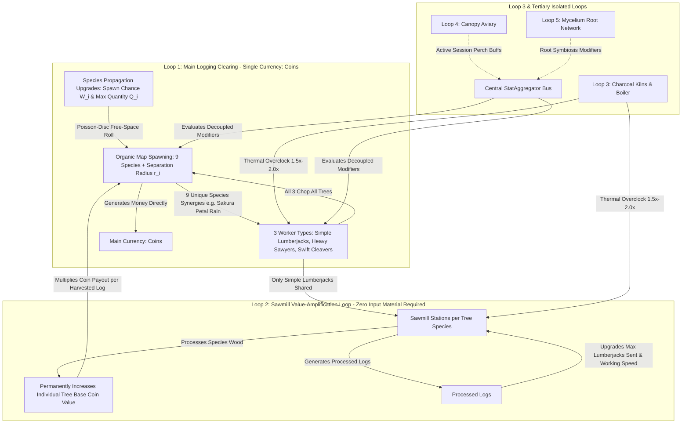

# Treecremental — Master Architecture, UI Mockups & Unabridged Upgrade Specification (v0.6)

> [!NOTE]
> **Project Status:** Planning Stage Only (Development Paused).
> **Workspace Path:** `C:\Users\MrSeb\GodotProjects\treecremental-game`
> **Target Engine:** Godot Engine 4.7.2 (`gl_compatibility` renderer, 2D pixel-art, 640x360 integer scaling).
> **Session Philosophy:** Pure active/semi-idle continuous session (~3.0 hours main campaign, ~4.0 hours 100% completion). **Zero offline progression mechanics.**

---

## 1. Executive Summary of v0.6 Architecture & Design Refinements

| Design Pillar | v0.6 Specification | Engineering & Design Rationale |
|---|---|---|
| **Single Main Currency & Sawmill Value Loop** | **`Coins` (Money) + Self-Contained Sawmill** | There is **no dual currency in the main loop**. Harvesting trees generates **Money (`coins`)** directly based on each tree species' individual log value. The **Sawmill requires no input material** to operate: assigning Simple Lumberjacks to process a specific wood type in the Sawmill permanently increases that tree species' base log value in the main loop, while **Processed Logs** are spent to upgrade **Sawmill worker capacity** and **Sawmill working speed**. |
| **Strict 3-Worker-Type Scope** | **Simple Lumberjacks, Heavy Sawyers & Swift Cleavers** | Artisan and non-chopping Hauler tiers are removed. All **3 worker types can chop all tree types** in the main loop, differentiated by stats/behaviors. **Only Simple Lumberjacks** can be shared between the Main Loop and the Sawmill; Heavy Sawyers and Swift Cleavers operate exclusively in the Main Loop. |
| **Hyper-Modular Decoupled Architecture** | **Composable Data + `StatAggregator` Bus** | Every worker type, tree species, loop station, and upgrade is a self-contained `.tres` Resource (`WorkerArchetypeData`, `UpgradeDefinitionData`, `StatModifierData`) queried through a central `StatAggregator`. Changing worker counts, allowed loop assignments (`allowed_loop_ids`), currencies, or formulas requires **zero GDScript refactoring**. |
| **Tree Progression via Spawn Chance & Quantity** | **Zero Direct Shop Unlocks (`prop_<species>`)** | New tree species are **never** bought as static items in a shop. Players level up **Species Propagation Upgrades** (`prop_<species>`) paid in `coins` that unlock and increase each species' **Spawn Probability Weight ($W_i$)** and **Maximum Concurrent Quantity ($Q_i$)** across the clearing's active plots. |
| **Durability vs. Yield & Tree Synergies** | **Old-Growth Maturity Ranks + 9 Species Events** | Trees scale in **Maturity Ranks ($m \in \{0..4\}$)** ($4.0^m$ HP vs. $4.2^m$ Value Yield) and **Bark Hardness** so late-game workers never 1-frame insta-chop trees (clamping fell time to $2.5\text{ s}$–$8.0\text{ s}$). Each of the 9 species triggers a unique ecological synergy (e.g., Sakura's *Cherry Petal Rain*). |
| **Right-Hand Docked HUD & Editable UI** | **Left 3/4 World (`432x360`) + Right UI Dock (`208x360`)** | The left ~68% displays the 3/4 top-down clearing beneath a `28 px` top resource bar, while the right ~32% houses a permanently docked Command Panel built as an easily editable Godot `.tscn` Control groundwork. |
| **Testing & Git Hygiene** | **Zero-Trace `Autopilot-Godot` Isolation** | Automated playtesting via `C:\Users\MrSeb\Downloads\Autopilot-Godot` is isolated through `.gitignore`, directory junctions, `override.cfg`, and `project.godot` sanitization so zero AI test scripts or plugin entries ever enter Git history. |

---

## 2. Right-Hand Docked UI Layout, Visual Mockups & Editable Godot Groundwork

> [!IMPORTANT]
> **Reference Image Usage Rule:** `reference_camera_and_hud_layout.jpg` is used **strictly as a camera-angle reference for the 3/4 top-down clearing perspective and roaming workers**—**NOT** for the HUD layout or art style. The HUD is **right-hand docked**, and the main loop uses a single primary currency (`Coins`).

````carousel

<!-- slide -->

<!-- slide -->

<!-- slide -->

<!-- slide -->

````

### 2.1 Right-Hand Docked HUD & 3/4 Clearing Split Specification (640x360 Base)

```text
+-----------------------------------------------------+----------------------------+
| TOP RESOURCE & GATE STRIP (432x28 px)               | RIGHT-HAND DOCKED HUD      |
| [Coins: $142.5K] [Proc.Logs: 8.4K] [Coal: 4.1K]     | (208x360 px)               |
| Act I Gate: [====================>        ] 68%     | [Trees][Crew][Mill][Roots] |
+-----------------------------------------------------+----------------------------+
| 3/4 TOP-DOWN LOGGING CLEARING (432x332 px)          | Bulk Buy: [x1] [x10] [MAX] |
|                                                     | +------------------------+ |
|    /\  /\ (Pine)          / \ (Birch)    /~~~\      | | Birch Propagation Lv.4 | |
|   /  \/  \ [==== ]       |   | [===  ]  (Sakura)    | | Spawn: 28% | Max: 6    | |
|   |  ||  | +$30          \ /   +$85     \   /       | | [ BUY: $850 Coins    ] | |
|   [Lb][Lb]                 |   *petal*    | |       | +------------------------+ |
|                           [Cl]  *rain*   [Cl][Sw]   | | Oak Propagation   Lv.2 | |
|      /~~~\ (Oak)                                    | | Spawn: 14% | Max: 3    | |
|     (     ) [======]       (Central Campfire        | | [ BUY: $2.4K Coins   ] | |
|      \   /  (Hard Bark)     & Spawn Hub)            | +------------------------+ |
|       | |   [Sw][Sw]         [Lb]  (*)  [Cl]        | | Heavy Sawyers  Lv.8/16 | |
|                                                     | | Armor-Piercing DPS     | |
|  +------------------------+                         | | [ BUY: $1.9K Coins   ] | |
|  | SAWMILL & KILN YARD    |                         | +------------------------+ |
|  | Shared SimpleJacks:[Lb]|                         | | Sawmill Crew Cap  Lv.3 | |
|  | Pine Value: x3.40      |                         | | Max Sent to Mill: +2   | |
|  +------------------------+                         | | [ BUY: 450 Proc.Logs ] | |
|  INCOME RATE: $4.8M / SEC          [Achv] [Settings]| [Ascend: Heartwood Tree]   |
+-----------------------------------------------------+----------------------------+
```

### 2.2 The 3 Distinct Worker Types & Loop Placement Rules

All **3 worker types can chop all 9 tree species** in the main clearing, but each has a distinct visual silhouette, stat profile, and loop assignment rule defined in its `WorkerArchetypeData` `.tres` resource:

| # | Worker ID | Display Name | Sprite & Silhouette | Loop Placement Rule (`allowed_loop_ids`) | Unique Chopping Stats & Behavioral Role |
|---:|---|---|---|---|---|
| **1** | `simple_lumberjack` | **Simple Lumberjack** (`[Lb]`) | `16x16 px` — Red flannel cap, standard felling axe. | **Shared (`logging_camp`, `sawmill`)**: The **ONLY** worker type that can be sent to the Sawmill or kept chopping in the Main Clearing. | **Balanced Versatile Chopper & Miller:** `1.0x` move speed, `0.8 hits/s`, `1.0x` base damage. Can be dynamically assigned via `+` / `-` controls between the Main Clearing and per-species Sawmill stations. |
| **2** | `heavy_sawyer` | **Heavy Sawyer** (`[Sw]`) | `20x16 px` — Leather apron, wide-brim hat, two-man / steam bucking saw. | **Main Loop Exclusive (`logging_camp` only)**: Cannot be assigned to the Sawmill. | **Armor-Piercing Durability Shredder:** `0.75x` move speed, continuous multi-tick sawing (`2.0x` sustained DPS), **100% Bark Hardness penetration**, and shreds target tree resistance so nearby workers deal bonus damage. |
| **3** | `swift_cleaver` | **Swift Cleaver** (`[Cl]`) | `16x16 px` — Green bandana, dual light hatchets, agile stance. | **Main Loop Exclusive (`logging_camp` only)**: Cannot be assigned to the Sawmill. | **High-Tempo Crit & Synergy Specialist:** `1.40x` move speed, rapid flurry swings (`1.44 hits/s`), **+20% Base Critical Strike Chance**, and **2.0x Synergy Trigger Weight** (accelerates on-hit chip payouts and on-fell events like Sakura *Cherry Petal Rain*). |

---

### 2.3 Editable Godot `.tscn` UI & `TileMapLayer` Groundwork Specification (Division of Labor)

When development begins, the AI will provide a clean, **human-editable Godot `.tscn` groundwork** using the right-hand docked layout and native Godot 4.7 `TileMapLayer` nodes so you can visually paint terrain, customize UI containers, and swap sprites in the Godot 2D Editor:

```text
MainScreen (Control - Full Rect 640x360) [scenes/ui/main_screen.tscn]
+-- MainSplit (HBoxContainer - Full Rect, separation = 0)
|   +-- LeftCompoundColumn (VBoxContainer - custom_minimum_size = Vector2(432, 360))
|   |   +-- TopResourceBar (PanelContainer - custom_minimum_size = Vector2(432, 28))
|   |   |   +-- ResourceRow (HBoxContainer) -> %CoinsLabel, %ProcessedLogsLabel, %CharcoalLabel, %SapLabel
|   |   |   +-- GateRow (HBoxContainer)     -> %ActTitleLabel, %BreakthroughProgressBar, %ActiveBuffsBox
|   |   +-- CompoundViewportContainer (SubViewportContainer - size = 432x332, stretch = true)
|   |       +-- CompoundViewport (SubViewport - size = 432x332, snap_2d_transforms_to_pixel = true)
|   |           +-- LoggingCompoundWorld (Node2D - y_sort_enabled = true)
|   |               +-- %GroundBaseLayer (TileMapLayer - 16x16 grass/soil base, z_index = -2)
|   |               +-- %TerrainDetailLayer (TileMapLayer - 3x3 minimal autotile dirt trails/edges, z_index = -1)
|   |               +-- %PerimeterTreelineLayer (TileMapLayer - Y-sorted outer forest border)
|   |               +-- %TreeSpawnZone (Polygon2D / Area2D - editable free-space spawn region)
|   |               +-- %TreeSpawner, %WorkerManager, %SawmillKilnCorner, %FloatingTextLayer
|   +-- RightDockedHUD (PanelContainer - custom_minimum_size = Vector2(208, 360))
|       +-- DockMargin (MarginContainer)
|           +-- DockVBox (VBoxContainer)
|               +-- %LoopTabBar (TabBar: Trees | Crew | Mill | Roots)
|               +-- %BulkBuyBar (HBoxContainer: %BtnBuy1, %BtnBuy10, %BtnBuyMax)
|               +-- %UpgradeScroll (ScrollContainer - SizeFlags: Expand Fill)
|               |   +-- %UpgradeListVBox (VBoxContainer -> instances of upgrade_row_template.tscn)
|               +-- %DockFooter (HBoxContainer: %BtnOpenPrestige, %BtnOpenAchievements, %BtnOpenSettings)
+-- ModalOverlayLayer (CanvasLayer - for full-art Prestige Tree, Achievements & Settings modals)
```

---

## 3. Core Gameplay Systems, Grid-Free Tree Spawning & Hyper-Modular Architecture



### 3.1 The Sawmill Economic Loop (Inspired by *Gambler's Table*)
1. **Zero Input Material Required**: The Sawmill does **not** consume raw logs or `coins` to run. Instead, it is powered by **Simple Lumberjacks** reassigned from the main clearing (`0` up to `MaxSawmillCrew`).
2. **Per-Species Value Amplification ($M_{\text{mill}, i}$)**:
   - Assigning Simple Lumberjacks to a specific tree species' station in the Sawmill fills that species' **Wood Processing Bar** and generates **Processed Logs (`processed_logs`)**.
   - As species $i$'s wood is processed in the Sawmill, its **Individual Base Value Multiplier ($M_{\text{mill}, i}$)** increases continuously:
     $$V_{\text{effective}, i} = V_{\text{base}, i} \cdot M_{\text{mill}, i} \cdot M_{\text{global}}$$
   - Every log of species $i$ chopped in the main clearing immediately awards more **`coins`**.
3. **Processed Logs Upgrade Loop**:
   - **Processed Logs (`processed_logs`)** accumulated in the Sawmill are spent exclusively on Sawmill upgrades to increase:
     1. **The Quantity of Simple Lumberjacks Sent to Work** in the Sawmill (`mill_<species>` slot caps and `mill_crew_quarters` global allocation cap), and
     2. **Their Working Speed & Value-Gain Rate** (`mill_undershot_wheel`, `mill_kerf_thinning`, `mill_gang_saw`, etc.).

### 3.2 `TileMapLayer` Terrain & Grid-Free Continuous Random Tree Spawning (Poisson-Disc Separation)
1. **Zero Grid-Locked Plots**: Trees do **not** spawn on fixed grid cells or rigid dirt squares. Instead, they emerge organically at **continuous random $(x, y)$ coordinates** (`Vector2` snapped to integer pixels) across the entire walkable clearing of Loop 1.
2. **Godot 4.7 `TileMapLayer` & `TileSet` Custom Data Mask**:
   - The Loop 1 map uses modular Godot 4.7 `TileMapLayer` nodes (`%GroundBaseLayer`, `%TerrainDetailLayer`, `%PerimeterTreelineLayer`) sharing `res://assets/tilesets/clearing_tileset.tres` (`16x16 px` tiles with 3x3 minimal terrain autotiling for dirt paths, grass transitions, and water edges).
   - The `TileSet` defines a boolean Custom Data Layer `can_spawn_tree` (`true` on open forest floor/grass tiles; `false` on the central campfire, water stream, Sawmill/Kiln corner, and outer border wall). You can freely paint or reshape the clearing in the Godot Editor and the spawner automatically respects your painted tiles.
3. **Poisson-Disc Minimum Separation Radius ($r_{\text{min}}$)**:
   - Each tree species defines a `trunk_clearance_radius` ($r_i$, e.g., $14\text{ px}$ for Pine/Birch, $20\text{ px}$ for Oak/Maple, $28\text{ px}$ for Baobab/Sequoia) in its `SpeciesData` `.tres` resource.
   - When the clearing is below its total canopy capacity ($N_{\text{current}} < N_{\text{max}}$, expandable from $12$ to $32$ via `camp_plot_expansion`), the spawner:
     1. Rolls species $i$ using its upgraded **Spawn Probability Weight ($W_i$)** among all species currently below their **Max Concurrent Quantity Cap ($Q_i$)**:
        $$P(\text{spawn } i) = \frac{W_i(L_i)}{\sum_{k \text{ where } c_k < Q_k(L_k)} W_k(L_k)}$$
     2. Samples a candidate point $\mathbf{p} = (x, y)$ on `can_spawn_tree == true` tiles that satisfies the **Minimum Separation Condition** against every active tree $j$ on the map:
        $$\|\mathbf{p} - \mathbf{p}_j\| \ge r_i + r_j \quad \forall j$$
   - This guarantees an organic, non-overlapping forest layout with enough clearance around every trunk for all 3 worker types to approach and chop cleanly.

### 3.3 Hyper-Modular Composable Architecture (Strict Zero-Refactor Design Guarantee)
To ensure that any future design adjustment (such as adding/removing a worker type, changing which loops a worker can enter, altering currencies, or reworking an upgrade's effect) never breaks existing code or requires refactoring:

1. **Data-Driven Entity Schemas (`src/core/data/`)**:
   - **`WorkerArchetypeData` (`data/workers/*.tres`)**: Exports `id`, `move_speed`, `attack_rate`, `base_damage`, `crit_chance`, `armor_penetration`, `synergy_weight`, and `allowed_loop_ids: PackedStringArray`. Because loop eligibility is a data array (`["logging_camp", "sawmill"]` for Simple Lumberjacks vs. `["logging_camp"]` for Heavy Sawyers and Swift Cleavers), changing worker placement rules is a 1-line `.tres` edit with zero code impact.
   - **`SpeciesData` (`data/species/*.tres`)**: Exports `id`, `base_hp`, `bark_hardness`, `base_coin_value`, `spawn_weight_curve: FormulaCurve`, `max_quantity_curve: FormulaCurve`, and `synergy_effect_id: StringName`.
   - **`UpgradeDefinitionData` & `StatModifierData` (`data/upgrades/*.tres`)**: Every upgrade is a standalone resource defining its `cost_currency_id`, `cost_curve: FormulaCurve`, and an array of `StatModifierData` entries (`target_domain`, `stat_key`, `operation: ADD | MUL`, `effect_curve: FormulaCurve`).
2. **Central `StatAggregator` Query Bus (`src/core/stat_aggregator.gd`)**:
   - Gameplay modules (`LoggingCampModule`, `SawmillModule`, `KilnModule`, `AviaryModule`, `MyceliumModule`) **never** reference each other or read specific upgrade IDs.
   - Instead, when any worker chops a tree of species $i$, the module queries `StatAggregator.query(&"species_coin_value", species_id)` and `StatAggregator.query(&"worker_chop_power", worker_id)`.
   - Removing or replacing an entire sub-loop, currency, or upgrade track simply removes its modifiers from the `StatAggregator`—zero compile errors, zero broken references, and zero refactoring.

---

## 4. Complete, Unabridged, Itemized Upgrade Catalog (All 87 Tracks / 535 Levels)

Every upgrade in *Treecremental* is itemized below with its canonical ID, max level, currency, cost formula, and exact mechanical effect.

### 4.1 The 9 Tree Species: Base Durability, Bark Hardness, Base Coin Value & Synergies

| Tier | Species ID | Display Name | Act | Base HP ($H_i$) | Bark Hardness | Base Value ($V_{\text{base}, i}$) | Unique Species Synergy / Ecological Event |
|---:|---|---|---|---:|---:|---:|---|
| **0** | `pine` | Pine | Act I | $20\text{ HP}$ | Tier 0 (Soft) | $\$1.00$ | **Pitch Sap Splatter (15% on fell):** Grants $+25\%$ Simple Lumberjack swing speed for $8\text{ s}$ and $+10\%$ Kiln burn time. |
| **1** | `birch` | Birch | Act I | $35\text{ HP}$ | Tier 1 | $\$2.20$ | **Silver-Bark Kindling (Every 10th felled):** Extends active Charcoal Boiler *Thermal Overclock* duration by $+4\text{ s}$ for free. |
| **2** | `oak` | Oak | Act I | $65\text{ HP}$ | Tier 2 (Hard) | $\$5.00$ | **Acorn Mast Shower (12% on fell):** Doubles `birdseed` drops for $10\text{ s}$ and boosts Canopy Aviary bird effects by $+50\%$. |
| **3** | `sakura` | Sakura | Act II | $120\text{ HP}$ | Tier 2 | $\$12.00$ | **Cherry Petal Rain (12% on fell / 100% every 12th):** Pink petals drift across the clearing for $12\text{ s}$, granting $+35\%$ Worker Move Speed and $+20\%$ Crit Chance camp-wide. |
| **4** | `canadian_maple` | Canadian Maple | Act II | $220\text{ HP}$ | Tier 3 (Hard) | $\$28.00$ | **Sugarbush Sap Flow (Active Aura):** While at least 1 Maple is being chopped, Sawmill working speed increases by $+25\%$. |
| **5** | `fir` | Fir | Act II | $400\text{ HP}$ | Tier 4 (Dense) | $\$65.00$ | **Boreal Frost Shatter (On fell):** Cold-brittle trunk shatters on impact, dealing $20\%$ splash chop damage to all adjacent trees. |
| **6** | `baobab` | Baobab | Act III | $750\text{ HP}$ | Tier 4 | $\$155.00$ | **Monsoon Reservoir Surge (On fell):** Floods the millrace for $15\text{ s}$, granting $2.0\times$ Sawmill Working Speed and $+50\%$ Mycelium `spores` rate. |
| **7** | `socotra_dragon_tree` | Socotra Dragon Tree | Act III | $1,400\text{ HP}$ | Tier 5 (Armored) | $\$370.00$ | **Cinnabar Dragon's Blood (On Crit):** Critical hits bleed resin that stacks $+2\%$ Global Coin Value (up to $+40\%$) while Dragon Trees are on-field. |
| **8** | `giant_sequoia` | Giant Sequoia | Act III | $2,800\text{ HP}$ | Tier 6 (Titan) | $\$900.00$ | **Seismic Timberfall (On fell):** Ground tremor knocks $15\%$ current HP off all active trees in the clearing and drops bonus `spores` & `birdseed`. |

---

### 4.2 Loop 1: Main Logging Clearing Upgrades (30 Upgrade Tracks / 247 Levels — All Paid in `coins`)

#### A. Species Propagation: Spawn Probability & Max Quantity Upgrades (9 Tracks × 10 Levels = 90 Levels)
- **Act Caps:** Capped at **Lv. 4** in Act I, **Lv. 7** in Act II, and **Lv. 10** in Act III.
- **Mechanical Effect:** New trees are never bought as shop stalls. Level 1 introduces the species into the clearing's spawn pool; Levels 2–10 increase both its **Spawn Probability Weight ($W_i$)** and **Max Concurrent Quantity ($Q_i$)** on the field, while adding $+10\%$ base coin value per level.

| Upgrade ID | Name | Target Species | Act Caps (I / II / III) | Cost Formula (Level $L \in \{0..9\}$, paid in `coins`) | Spawn Weight $W_i(L)$ & Max Concurrent Quantity $Q_i(L)$ |
|---|---|---|---|---|---|
| `prop_pine` | Pine Stand Management | Pine | 4 / 7 / 10 | $\$25 \cdot 2.1^L$ `coins` | Baseline $W_0 = 100$; adds $+1$ Max Pine Plot cap/Lv ($12 \rightarrow 22$) and $+15\%$ Pine Old-Growth chance/Lv. |
| `prop_birch` | Birch Catkin Dispersal | Birch | 4 / 7 / 10 | $\$120 \cdot 2.2^L$ `coins` | Lv. 1 unlocks Birch. $W_1 = 15 + 8 \cdot L$ ($23 \rightarrow 95$); Max Quantity $Q_1 = 1 + L$ ($2 \rightarrow 11$ trees). |
| `prop_oak` | Oak Acorn Afforestation | Oak | 4 / 7 / 10 | $\$450 \cdot 2.3^L$ `coins` | Lv. 1 unlocks Oak. $W_2 = 12 + 7 \cdot L$ ($19 \rightarrow 82$); Max Quantity $Q_2 = 1 + L$ ($2 \rightarrow 11$ trees). |
| `prop_sakura` | Sakura Blossom Grafting | Sakura | — / 7 / 10 | $\$2,200 \cdot 2.4^L$ `coins` | Lv. 1 unlocks Sakura. $W_3 = 10 + 7 \cdot L$ ($17 \rightarrow 80$); Max Quantity $Q_3 = 1 + L$ ($2 \rightarrow 11$ trees). |
| `prop_canadian_maple` | Maple Sugarbush Seeding | Canadian Maple | — / 7 / 10 | $\$9,500 \cdot 2.45^L$ `coins` | Lv. 1 unlocks Maple. $W_4 = 10 + 6 \cdot L$ ($16 \rightarrow 70$); Max Quantity $Q_4 = 1 + \lfloor 0.9 \cdot L \rfloor$ ($1 \rightarrow 10$ trees). |
| `prop_fir` | Boreal Fir Cone Dispersal | Fir | — / 7 / 10 | $\$42,000 \cdot 2.5^L$ `coins` | Lv. 1 unlocks Fir. $W_5 = 8 + 6 \cdot L$ ($14 \rightarrow 68$); Max Quantity $Q_5 = 1 + \lfloor 0.9 \cdot L \rfloor$ ($1 \rightarrow 10$ trees). |
| `prop_baobab` | Baobab Savanna Planting | Baobab | — / — / 10 | $\$190,000 \cdot 2.55^L$ `coins` | Lv. 1 unlocks Baobab. $W_6 = 8 + 5 \cdot L$ ($13 \rightarrow 58$); Max Quantity $Q_6 = 1 + \lfloor 0.8 \cdot L \rfloor$ ($1 \rightarrow 9$ trees). |
| `prop_socotra_dragon_tree` | Dragon Sapling Cultivation | Socotra Dragon Tree | — / — / 10 | $\$850,000 \cdot 2.6^L$ `coins` | Lv. 1 unlocks Dragon Tree. $W_7 = 6 + 5 \cdot L$ ($11 \rightarrow 56$); Max Quantity $Q_7 = 1 + \lfloor 0.7 \cdot L \rfloor$ ($1 \rightarrow 8$ trees). |
| `prop_giant_sequoia` | Sequoia Grove Sanctuary | Giant Sequoia | — / — / 10 | $\$3,800,000 \cdot 2.7^L$ `coins` | Lv. 1 unlocks Giant Sequoia. $W_8 = 5 + 4 \cdot L$ ($9 \rightarrow 45$); Max Quantity $Q_8 = 1 + \lfloor 0.5 \cdot L \rfloor$ ($1 \rightarrow 6$ titan trees). |

#### B. The 3 Worker Types: Roster Hiring & Equipment Tiers (6 Tracks = 82 Levels — Paid in `coins`)
- **Strict 3-Worker Scope:** Only **Simple Lumberjacks**, **Heavy Sawyers**, and **Swift Cleavers** exist. All 3 chop all tree species; **only Simple Lumberjacks** can also be assigned to the Sawmill.
- **Crew Milestones:** Reaching **10** and **20** workers in any archetype grants a $\times 1.50$ multiplicative output boost to that archetype ($\times 2.25$ at 20 workers; expandable via `camp_highland_crampons`).
- **Equipment Tiers (6 Levels Each):** Capped at **Lv. 3** in Act I, **Lv. 5** in Act II, and **Lv. 6** in Act III.

| Upgrade ID | Name | Worker Type | Max Lv (Act I / II / III) | Cost Formula (Paid in `coins`) | Exact Mechanical Effect |
|---|---|---|---|---|---|
| `hire_simple_lumberjack` | Hire Simple Lumberjack | 1. Simple Lumberjack (`[Lb]`) | 14 / 24 / 34 | $\$10 \cdot 1.15^n$ `coins` | $+1$ Simple Lumberjack (`1.0x` move, `0.8 hits/s`; can chop any tree OR be sent to the Sawmill). |
| `hire_heavy_sawyer` | Hire Heavy Sawyer | 2. Heavy Sawyer (`[Sw]`) | 6 / 12 / 18 | $\$45 \cdot 1.18^n$ `coins` | $+1$ Heavy Sawyer (`0.75x` move, `2.0 DPS` sawing, ignores Bark Hardness; Main Loop only). |
| `hire_swift_cleaver` | Hire Swift Cleaver | 3. Swift Cleaver (`[Cl]`) | 5 / 10 / 15 | $\$75 \cdot 1.20^n$ `coins` | $+1$ Swift Cleaver (`1.40x` move, `1.44 hits/s`, $+20\%$ base crit, $2.0\times$ synergy proc rate; Main Loop only). |
| `gear_simple_lumberjack` | Lumberjack Felling Axes | 1. Simple Lumberjack (`[Lb]`) | 3 / 5 / 6 | $\$120 \cdot 9^k$ `coins` | Upgrades axes (*Flint -> Iron -> Steel -> Broadaxe -> Steam-Axe -> Heartwood*); multiplies Simple Lumberjack chop power by $\times 2.0^k$ ($\times 64$ at Lv. 6). |
| `gear_heavy_sawyer` | Sawyer Bucking Blades | 2. Heavy Sawyer (`[Sw]`) | 3 / 5 / 6 | $\$260 \cdot 9^k$ `coins` | Upgrades saws (*Rip-Saw -> Crosscut -> Raker-Tooth -> Carbide -> Steam-Piston -> Resonance Blade*); multiplies Sawyer DPS by $\times 2.0^k$ and raises Armor Shred tier to $k+1$. |
| `gear_swift_cleaver` | Cleaver Twin Hatchets | 3. Swift Cleaver (`[Cl]`) | 3 / 5 / 6 | $\$380 \cdot 9^k$ `coins` | Upgrades twin hatchets (*Bronze -> Tempered -> Damascus -> Featherweight -> Wind-Steel -> Amber-Edge*); multiplies Cleaver damage by $\times 2.0^k$ and adds $+5\%$ crit damage/Lv. |

#### C. Clearing Plots, Old-Growth Maturity, Synergies & Camp Upgrades (15 Tracks = 75 Levels — Paid in `coins`)

| # | Upgrade ID | Name | Max Lv | Unlock Act | Cost Formula (Level $L \in \{0..4\}$, paid in `coins`) | Exact Mechanical Effect |
|---:|---|---|---:|---|---|---|
| 1 | `camp_plot_expansion` | Clearing Plot Survey | 5 | Act I | $\$60 \cdot 2.8^L$ `coins` | Expands the clearing by $+4$ concurrent Tree Spawn Plots per level (from $12$ plots up to $32$ active plots at Lv. 5). |
| 2 | `camp_old_growth_stewardship` | Old-Growth Maturity Stewardship | 5 | Act I | $\$250 \cdot 3.2^L$ `coins` | Unlocks Tree Maturity Ranks $m = 1..4$ and increases high-maturity spawn chance by $+15\%$/Lv (scales Tree HP by $4.0^m$ and Coin Yield by $4.2^m$, preventing insta-chopping). |
| 3 | `camp_synergy_resonator` | Canopy Ecological Harmony | 5 | Act I | $\$140 \cdot 2.7^L$ `coins` | Increases the trigger chance and buff duration of all 9 Species Synergy Events (including Sakura *Cherry Petal Rain*) by $+20\%$ per level ($+100\%$ at Lv. 5). |
| 4 | `camp_whetstone_bench` | Grindstone & Whetstone Bench | 5 | Act I | $\$50 \cdot 2.5^L$ `coins` | $+8\%$ global attack tempo for all 3 worker types per level ($+40\%$ at Lv. 5). |
| 5 | `camp_hickory_hafts` | Seasoned Hickory Hafts | 5 | Act I | $\$95 \cdot 2.6^L$ `coins` | $+8\%$ critical strike chance for all 3 worker types per level ($+40\%$ crit chance at Lv. 5). |
| 6 | `camp_felling_wedges` | Iron Felling Wedges | 5 | Act I | $\$180 \cdot 2.8^L$ `coins` | Reduces empty plot regrowth delay by $-0.15\text{ s}$/Lv (from $1.00\text{ s}$ to $0.25\text{ s}$) and boosts Timberfall Jackpot burst coin payout by $+10\%$/Lv. |
| 7 | `camp_skid_road` | Greased Corduroy Trails | 5 | Act I | $\$320 \cdot 2.5^L$ `coins` | $+12\%$ movement speed for all 3 worker types in the clearing and $+12\%$ Act I tree coin value per level. |
| 8 | `camp_kerf_softening` | Sawyer Kerf Wedge Technique | 5 | Act I | $\$550 \cdot 2.6^L$ `coins` | When a Heavy Sawyer is sawing a tree, its Bark Hardness is reduced by $-1$ tier and Simple Lumberjacks & Swift Cleavers deal $+15\%$ bonus damage/Lv to that tree. |
| 9 | `camp_cleaver_flurry` | Whirlwind Hatchet Cadence | 5 | Act II | $\$1,800 \cdot 2.7^L$ `coins` | Swift Cleavers have a $+10\%$ chance per level on every swing to strike twice and instantly drop double chip `coins`. |
| 10 | `camp_silk_cordage` | Braided Rigging Cordage | 5 | Act II | $\$3,600 \cdot 2.8^L$ `coins` | $+15\%$ base coin value for all Act II species (Sakura, Canadian Maple, Fir) per level ($+75\%$ at Lv. 5). |
| 11 | `camp_sap_lubrication` | Maple Sap Blade Coolant | 5 | Act II | $\$7,500 \cdot 2.9^L$ `coins` | Reduces all Worker Equipment (`gear_<type>`) coin costs by $-6\%$ per level ($-30\%$ at Lv. 5). |
| 12 | `camp_highland_crampons` | Spiked Climbing Spurs | 5 | Act II | $\$15,000 \cdot 3.0^L$ `coins` | Increases the per-threshold Worker Crew milestone multiplier from $\times 1.50$ to $\times (1.50 + 0.05 \cdot L)$ ($\times 1.75$ per milestone at Lv. 5). |
| 13 | `camp_block_and_tackle` | Heavy Block-and-Tackle Cranes | 5 | Act III | $\$65,000 \cdot 3.1^L$ `coins` | $+20\%$ base coin value for all Act III species (Baobab, Socotra Dragon Tree, Giant Sequoia) per level ($+100\%$ at Lv. 5). |
| 14 | `camp_crimson_varnish` | Dragon-Resin Temper Coating | 5 | Act III | $\$180,000 \cdot 3.2^L$ `coins` | Increases critical strike coin multiplier from $2.0\times$ to $(2.0 + 0.2 \cdot L)\times$ ($3.0\times$ coins per crit at Lv. 5). |
| 15 | `camp_skyline_yarder` | Steam Skyline Cable Yarder | 5 | Act III | $\$500,000 \cdot 3.4^L$ `coins` | $+10\%$ global coin income and $+5\%$ Breakthrough Gate progress credit per level ($+50\%$ income / $+25\%$ gate credit at Lv. 5). |

---

### 4.3 Loop 2: Water-Powered Sawmill Upgrades (17 Upgrade Tracks / 129 Levels — Paid in `processed_logs`)

- **Core Sawmill Rule:** The Sawmill requires **zero input materials** from the main loop. You assign **Simple Lumberjacks** (`simple_lumberjack`) from your roster to work at per-species Sawmill stations.
- **Value Amplification & Upgrade Currency:** As assigned Simple Lumberjacks process a tree species' wood in the Sawmill, they generate **`processed_logs`** and continuously raise that tree species' **Individual Base Value Multiplier ($M_{\text{mill}, i}$)** in the main loop. Accumulated `processed_logs` are spent on the 17 tracks below to increase **(1) the quantity of Simple Lumberjacks sent to the Sawmill**, **(2) their working speed**, and **(3) the per-species value multiplier**.

#### A. Per-Species Sawmill Value & Crew Station Upgrades (9 Tracks × 10 Levels = 90 Levels)
- **Act Caps:** Capped at **Lv. 4** in Act I, **Lv. 7** in Act II, and **Lv. 10** in Act III.
- **Mechanical Effect:** Each level permanently multiplies `<species>`'s base log value in the main loop by $+35\%$ per level (up to $+50\%$/Lv with `mill_flywheel_governor`) AND adds $+1$ **Simple Lumberjack Slot** to that species' Sawmill station.

| Upgrade ID | Name | Target Species | Act Caps (I / II / III) | Cost Formula (Level $L \in \{0..9\}$, paid in `processed_logs`) | Effect per Level (Tree Coin Value & Lumberjack Capacity) |
|---|---|---|---|---|---|
| `mill_pine` | Pine Value Grading Station | Pine | 4 / 7 / 10 | $15 \cdot 2.5^L$ `processed_logs` | $+35\%$ Pine base `coins` value/Lv & $+1$ Simple Lumberjack slot on Pine station. |
| `mill_birch` | Birch Value Grading Station | Birch | 4 / 7 / 10 | $35 \cdot 2.55^L$ `processed_logs` | $+35\%$ Birch base `coins` value/Lv & $+1$ Simple Lumberjack slot on Birch station. |
| `mill_oak` | Oak Value Grading Station | Oak | 4 / 7 / 10 | $80 \cdot 2.6^L$ `processed_logs` | $+35\%$ Oak base `coins` value/Lv & $+1$ Simple Lumberjack slot on Oak station. |
| `mill_sakura` | Sakura Value Grading Station | Sakura | — / 7 / 10 | $200 \cdot 2.65^L$ `processed_logs` | $+35\%$ Sakura base `coins` value/Lv & $+1$ Simple Lumberjack slot on Sakura station. |
| `mill_canadian_maple` | Maple Value Grading Station | Canadian Maple | — / 7 / 10 | $480 \cdot 2.7^L$ `processed_logs` | $+35\%$ Maple base `coins` value/Lv & $+1$ Simple Lumberjack slot on Maple station. |
| `mill_fir` | Fir Value Grading Station | Fir | — / 7 / 10 | $1,150 \cdot 2.75^L$ `processed_logs` | $+35\%$ Fir base `coins` value/Lv & $+1$ Simple Lumberjack slot on Fir station. |
| `mill_baobab` | Baobab Value Grading Station | Baobab | — / — / 10 | $2,800 \cdot 2.8^L$ `processed_logs` | $+35\%$ Baobab base `coins` value/Lv & $+1$ Simple Lumberjack slot on Baobab station. |
| `mill_socotra_dragon_tree` | Dragon Value Grading Station | Socotra Dragon Tree | — / — / 10 | $6,800 \cdot 2.85^L$ `processed_logs` | $+35\%$ Dragon Tree base `coins` value/Lv & $+1$ Simple Lumberjack slot on Dragon station. |
| `mill_giant_sequoia` | Sequoia Value Grading Station | Giant Sequoia | — / — / 10 | $16,500 \cdot 2.9^L$ `processed_logs` | $+35\%$ Giant Sequoia base `coins` value/Lv & $+1$ Simple Lumberjack slot on Sequoia station. |

#### B. Global Sawmill Workforce Capacity & Working Speed Upgrades (8 Tracks = 39 Levels)

| # | Upgrade ID | Name | Max Lv | Unlock Act | Cost Formula (Level $L$, paid in `processed_logs`) | Exact Mechanical Effect |
|---:|---|---|---:|---|---|---|
| 1 | `mill_crew_quarters` | Sawmill Bunkhouse & Dispatch | 5 | Act I | $25 \cdot 2.6^L$ `processed_logs` | Increases the **Max Quantity of Simple Lumberjacks** that can be sent to the Sawmill at once by $+2$ per level (from $2$ up to $12$ shared Simple Lumberjacks at Lv. 5). |
| 2 | `mill_undershot_wheel` | Undershot Millwheel Paddles | 5 | Act I | $30 \cdot 2.4^L$ `processed_logs` | Increases the **Working Speed** of all Simple Lumberjacks inside the Sawmill by $+15\%$ per level ($+75\%$ faster wood processing at Lv. 5). |
| 3 | `mill_kerf_thinning` | Thin-Kerf Precision Blades | 4 | Act I | $60 \cdot 3.0^L$ `processed_logs` | Each Simple Lumberjack working in the Sawmill generates $+25\%$ more `processed_logs` per cycle per level ($+100\%$ at Lv. 4). |
| 4 | `mill_roller_conveyor` | Iron-Roller Outfeed Table | 5 | Act I | $100 \cdot 2.6^L$ `processed_logs` | $+10\%$ chance per level on every Sawmill cycle to grant a double `processed_logs` payout and double species value step ($50\%$ chance at Lv. 5). |
| 5 | `mill_gang_saw` | Multi-Blade Gang Headsaws | 5 | Act II | $250 \cdot 2.8^L$ `processed_logs` | Increases Simple Lumberjack **Sawmill Working Speed** by $+20\%$ per level and allows each assigned lumberjack to boost $2$ adjacent species stations at $50\%$ efficiency. |
| 6 | `mill_flywheel_governor` | Cast-Iron Flywheel Governor | 5 | Act II | $550 \cdot 3.0^L$ `processed_logs` | Increases the per-level species coin value multiplier of all `mill_<species>` stations from $+35\%$ to $+(35 + 3 \cdot L)\%$ ($+50\%$ tree coin value per level at Lv. 5). |
| 7 | `mill_hydraulic_carriage` | High-Pressure Log Carriage | 5 | Act III | $1,400 \cdot 3.1^L$ `processed_logs` | Increases **Max Simple Lumberjacks Sent to Sawmill** by $+1$ per level ($+5$ extra capacity) and boosts Act III species Sawmill working speed by $+25\%$/Lv. |
| 8 | `mill_sawdust_briquetter` | Sawdust Compression Press | 5 | Act III | $3,200 \cdot 3.2^L$ `processed_logs` | Every 10 `processed_logs` produced in the Sawmill automatically generates $+1.0 \cdot L$ free `charcoal` for the Kiln Boiler. |

---

### 4.4 Loop 3: Brick Charcoal Kilns & Boiler Furnace Upgrades (8 Tracks = 38 Levels)

- **Base Kiln & Boiler Rules:** The kiln carbonizes wood trimmings in $5.0\text{ s}$ cycles to produce $2$ `charcoal` and $1$ `ash`. Feeding `charcoal` into the Steam Boiler fills the **Thermal Overclock Gauge**, granting a baseline $\times 1.50$ working speed multiplier to both the **Main Clearing Crews** and the **Sawmill** while lit.

| # | Upgrade ID | Name | Max Lv | Unlock Act | Cost Formula (Level $L$) | Exact Mechanical Effect |
|---:|---|---|---:|---|---|---|
| 1 | `kiln_clay_lining` | Firebrick & Clay Sealant | 5 | Act I | $\$200 \cdot 2.3^L$ `coins` | $+15\%$ `charcoal` output per kiln batch per level ($+75\%$ at Lv. 5). |
| 2 | `kiln_draft_vents` | Adjustable Basal Draft Vents | 5 | Act I | $40 \cdot 2.5^L$ `charcoal` | Reduces kiln carbonization cycle time by $-8\%$ per level (from $5.0\text{ s}$ down to $3.0\text{ s}$ at Lv. 5). |
| 3 | `kiln_boiler_manifold` | Copper Steam-Boiler Manifold | 5 | Act I | $75 \cdot 2.6^L$ `charcoal` + $\$400 \cdot 2.4^L$ `coins` | Increases the active Thermal Overclock working speed multiplier by $+0.10\times$ per level (from $\times 1.50$ up to $\times 2.00$ at Lv. 5). |
| 4 | `kiln_hardwood_retort` | Sealed Iron Retort Chamber | 5 | Act II | $200 \cdot 2.7^L$ `charcoal` + $\$2,500 \cdot 2.5^L$ `coins` | Increases `charcoal` and `ash` batch yields by $+25\%$ per level when Act II or Act III trees are unlocked. |
| 5 | `kiln_auto_stoker` | Chain-Grate Mechanical Stoker | 3 | Act II | $350 \cdot 3.5^L$ `charcoal` | Lv. 1: Auto-feeds charcoal into the boiler when heat drops below $90\%$; Lv. 2: $-15\%$ fuel burn rate; Lv. 3: $-30\%$ fuel burn rate. |
| 6 | `kiln_ash_sifter` | Rotary Potash Sifter | 5 | Act II | $500 \cdot 2.8^L$ `charcoal` | $+20\%$ `ash` byproduct extraction per kiln batch per level ($+100\%$ at Lv. 5). |
| 7 | `kiln_bellows_turbine` | Flue-Gas Recovery Turbine | 5 | Act III | $1,200 \cdot 3.0^L$ `charcoal` + $\$45,000 \cdot 2.8^L$ `coins` | While boiler heat is above $80\%$, all 3 worker types in the main clearing and Sawmill gain $+8\%$ working speed per level ($+40\%$ at Lv. 5). |
| 8 | `kiln_white_charcoal` | Binchotan White-Heat Mastering | 5 | Act III | $3,000 \cdot 3.2^L$ `charcoal` | While the boiler is lit, increases the individual coin value ($V_i$) of all 9 tree species by $+8\%$ per level ($+40\%$ at Lv. 5). |

---

### 4.5 Loop 4 (Tertiary Isolated A): Canopy Aviary & Bird Sanctuary (8 Tracks = 38 Levels)

- **Base Aviary Rules:** Operates on an isolated canopy plane. `birdseed` generates passively at $0.25\text{/s}$ during active play. All 5 bird tracks and 3 sanctuary upgrades register modifiers on the central `StatAggregator` (**zero offline mechanics**).

| # | Upgrade ID | Name | Max Lv | Unlock Act | Cost Formula (Level / Rank $R$) | Exact Mechanical Effect |
|---:|---|---|---:|---|---|---|
| 1 | `aviary_bird_woodpecker` | Pileated Woodpecker Roost | 5 | Act I | $15 \cdot 2.2^R$ `birdseed` | $+10\%$ Global Chopping Power for all 3 worker types per rank ($+50\%$ at Rank 5). |
| 2 | `aviary_bird_waxwing` | Cedar Waxwing Roost | 5 | Act I | $30 \cdot 2.3^R$ `birdseed` | $+8\%$ Base Coin Value across all 9 tree species per rank ($+40\%$ at Rank 5). |
| 3 | `aviary_bird_falcon` | Peregrine Falcon Eyrie | 5 | Act I | $60 \cdot 2.4^R$ `birdseed` | $+12\%$ Sawmill Working Speed for assigned Simple Lumberjacks per rank ($+60\%$ at Rank 5). |
| 4 | `aviary_bird_songbird` | Bluebird & Thrush Choir | 5 | Act I | $110 \cdot 2.5^R$ `birdseed` | $+8\%$ Worker Attack Tempo and $+5\%$ Critical Strike Chance per rank ($+40\%$ tempo / $+25\%$ crit at Rank 5). |
| 5 | `aviary_bird_phoenix` | Grove Phoenix Crest | 5 | Act II | $220 \cdot 2.6^R$ `birdseed` | $+15\%$ Kiln Thermal Output and $+10\%$ Breakthrough Gate fill rate per rank ($+75\%$ heat / $+50\%$ gate credit at Rank 5). |
| 6 | `aviary_seed_hopper` | Cedar Seed-Hopper Feeders | 5 | Act I | $25 \cdot 2.4^L$ `birdseed` | Increases passive `birdseed` generation by $+0.15\text{/s}$ per level (from $0.25\text{/s}$ to $1.00\text{/s}$ at Lv. 5). |
| 7 | `aviary_suet_cakes` | Rendered Berry & Suet Cakes | 5 | Act I | $80 \cdot 2.5^L$ `birdseed` | Every $60\text{ s}$ of active play, triggers a **Canopy Chorus** for $10 + 2 \cdot L$ seconds that multiplies all active bird bonuses by $\times 1.50$. |
| 8 | `aviary_gilded_weathervane` | Brass Canopy Weathervane | 3 | Act II | $250 \cdot 3.0^L$ `birdseed` | Each bird species that has reached Rank 5 grants an independent $\times (1.00 + 0.05 \cdot L)$ multiplier to total `coins` and `processed_logs` output. |

---

### 4.6 Loop 5 (Tertiary Isolated B): Mycelium Root Network (8 Tracks = 38 Levels)

- **Base Mycelium Rules:** Operates on an isolated subterranean root plane. `spores` generate passively at $0.20\text{/s}$ during active play plus $+1$ spore per $50$ felled trees. Combine `spores` with kiln `ash` to inoculate symbiotic root nodes via `StatAggregator`.

| # | Upgrade ID | Name | Max Lv | Unlock Act | Cost Formula (Level $L$) | Exact Mechanical Effect |
|---:|---|---|---:|---|---|---|
| 1 | `myc_phosphorus_exchange` | Chanterelle Phosphorus Exchange | 5 | Act I | $12 \cdot 2.2^L$ `spores` | Reduces the worker hiring exponential cost base $r$ for all 3 worker types by $-0.004$ per level. |
| 2 | `myc_spore_bloom` | Bioluminescent Mycena Bloom | 5 | Act I | $18 \cdot 2.3^L$ `spores` + $20 \cdot 2.2^L$ `ash` | Increases passive `spores` generation by $+0.16\text{/s}$ per level (from $0.20\text{/s}$ to $1.00\text{/s}$ at Lv. 5). |
| 3 | `myc_saprophyte_enzymes` | Oyster Saprophyte Enzymes | 5 | Act I | $35 \cdot 2.4^L$ `spores` | $+15\%$ faster plot regrowth per level, plus a $+6\%$ chance per level ($30\%$ at Lv. 5) for a felled tree plot to respawn with zero delay. |
| 4 | `myc_rhizomorph_conduit` | Rhizomorph Nutrient Conduit | 5 | Act I | $65 \cdot 2.5^L$ `spores` + $50 \cdot 2.4^L$ `ash` | Transfers $4\%$ per level ($20\%$ at Lv. 5) of Species $i$'s Sawmill Value Multiplier ($M_{\text{mill}, i}$) as a free bonus to Species $i+1$. |
| 5 | `myc_truffle_symbiosis` | Black Truffle Heartwood Symbiosis | 5 | Act II | $120 \cdot 2.6^L$ `spores` | Increases the base coin value ($V_{\text{base}, i}$) of all 9 tree species by $+12\%$ per level ($+60\%$ at Lv. 5). |
| 6 | `myc_alkaline_mulch` | Potash & Wood-Ash Composting | 5 | Act II | $180 \cdot 2.6^L$ `spores` + $200 \cdot 2.5^L$ `ash` | Each unit of unspent `ash` boosts all Mycelium node effects by $+0.05\%$ per level (capped at $+50\%$ total boost). |
| 7 | `myc_fairy_ring_pulse` | Harmonic Fairy-Ring Pulse | 5 | Act II | $300 \cdot 2.7^L$ `spores` | Every $45\text{ s}$, a root pulse adds $+0.4\% \cdot L$ ($+2.0\%$ at Lv. 5) of the last minute's total coin income directly to the Breakthrough Gate. |
| 8 | `myc_mother_tree_nexus` | The Mother-Tree Mycorrhizal Nexus | 3 | Act III | $600 \cdot 3.2^L$ `spores` + $500 \cdot 3.0^L$ `ash` | Grants $+10\%$ global `coins` and `processed_logs` output per propagated tree species per level ($+270\%$ at 9 species and Lv. 3). |

---

### 4.7 Prestige Layer: Heartwood Ascension — The Sap Constellation (16 Tracks = 45 Levels)

- **Baseline Sap Formula:** Upon completing an Act's Breakthrough Gate, the player banks $\Delta \text{Sap} = \lfloor (\text{RunCoinsEarned} / 2000)^{0.5} \rfloor$.
- **Non-Punitive Spending Rule:** The global Sap multiplier $M_{\text{sap}} = 1 + 0.60 \cdot (\text{LifetimeSap})^{0.5}$ scales with **Lifetime Earned Sap**, so spending banked Sap on Constellation nodes never reduces $M_{\text{sap}}$.

| Ring | # | Upgrade ID | Name | Max Lv | Exact Sap Cost per Level | Exact Permanent Effect |
|---|---:|---|---|---:|---|---|
| **Inner Ring** *(Act I Ascension)* | 1 | `sap_heartwood_resonance_1` | Heartwood Resonance I | 3 | `5, 10, 20` Sap *(35 total)* | $+25\%$ Global Chopping Power for all 3 worker types per level ($+75\%$ at Lv. 3). |
| **Inner Ring** | 2 | `sap_pioneer_charter` | Pioneer's Charter | 3 | `4, 8, 16` Sap *(28 total)* | Starts each run with $+1 \cdot L$ free starting levels in `prop_birch` and $+3 \cdot L$ free Simple Lumberjacks. |
| **Inner Ring** | 3 | `sap_amber_distillation` | Amber Sap Distillation | 3 | `6, 12, 24` Sap *(42 total)* | $+15\%$ Sap earned from all Breakthrough Ascensions per level ($+45\%$ at Lv. 3). |
| **Inner Ring** | 4 | `sap_seasoned_joinery` | Seasoned Timber Joinery | 3 | `5, 10, 20` Sap *(35 total)* | Retains $1 \cdot L$ starting levels on all `mill_<species>` value stations after Ascension. |
| **Inner Ring** | 5 | `sap_eternal_embers` | Eternal Kiln Embers | 2 | `8, 18` Sap *(26 total)* | Lv. 1: Starts run with 100 Charcoal & $50\%$ boiler heat; Lv. 2: Boiler heat never falls below $50\%$. |
| **Inner Ring** | 6 | `sap_canopy_sanctuary_bond` | Sanctuary Homing Bond | 1 | `12` Sap *(12 total)* | Canopy Aviary ranks and Mycelium Root Network levels persist permanently across Ascensions. |
| **Middle Ring** *(Act II Ascension)* | 7 | `sap_heartwood_resonance_2` | Heartwood Resonance II | 5 | `25, 50, 85, 130, 190` Sap *(480 total)* | $+30\%$ Global Chopping Speed and $+20\%$ Sawmill Working Speed per level ($+150\%$ / $+100\%$ at Lv. 5). |
| **Middle Ring** | 8 | `sap_guild_headquarters` | Lumberjack Guild Hall | 3 | `40, 90, 160` Sap *(290 total)* | Raises the per-Act Roster Cap of all 3 Worker Types by $+4$ per level ($+12$ per worker type at Lv. 3). |
| **Middle Ring** | 9 | `sap_bulk_contracting` | Automated Guild Quartermaster | 2 | `35, 75` Sap *(110 total)* | Lv. 1: Unlocks `x10` and `MAX` bulk buy buttons; Lv. 2: Unlocks toggleable auto-buyers for Propagation, Workers, and Sawmill Stations. |
| **Middle Ring** | 10 | `sap_cambium_overflow` | Cambium Pressure Overflow | 4 | `30, 65, 110, 170` Sap *(375 total)* | Reduces all Species Propagation (`prop_<species>`) coin costs by $-12\%$ per level ($-48\%$ at Lv. 4). |
| **Middle Ring** | 11 | `sap_mycorrhizal_awakening` | Mycorrhizal Awakening | 3 | `45, 95, 165` Sap *(305 total)* | Increases `birdseed` and `spores` generation rates by $+33.3\%$ per level ($\times 2.00$ at Lv. 3). |
| **Middle Ring** | 12 | `sap_crucible_steel` | Damascus Crucible Metallurgy | 3 | `50, 110, 190` Sap *(350 total)* | Increases the per-tier Worker Equipment (`gear_<type>`) multiplier by $+0.15\times$ per level. |
| **Outer Ring** *(Act III & 100%)* | 13 | `sap_titan_feller` | Titan-Feller's Creed | 3 | `150, 300, 500` Sap *(950 total)* | Multiplies base coin value and spawn weight of Baobab, Socotra Dragon Tree, and Giant Sequoia by $\times 1.50$ per level ($\times 3.375$ at Lv. 3). |
| **Outer Ring** | 14 | `sap_golden_bough` | The Golden Bough | 3 | `200, 400, 700` Sap *(1,300 total)* | Increases the exponent of the lifetime Sap formula from $0.50$ to $0.50 + 0.02 \cdot L$ ($0.56$ at Lv. 3). |
| **Outer Ring** | 15 | `sap_ancient_harmony` | Harmony of the Ancient Grove | 3 | `180, 360, 600` Sap *(1,140 total)* | Each unlocked Achievement grants $+1.0\%$ per level ($+3.0\%$ per achievement at Lv. 3) to global production. |
| **Outer Ring** | 16 | `sap_world_tree_crown` | Crown of the World Tree | 1 | `1,000` Sap *(1,000 total)* | Doubles all Breakthrough Gate progress and unlocks the completionist Golden Sequoia visual crown. |

---

### 4.8 Total Upgrade Inventory & Playthrough Duration Budget

| Loop / Upgrade Category | Track Count | Total Purchasable Levels | Currency Spent | Average Completion Window |
|---|---:|---:|---|---|
| **Loop 1A:** Species Propagation (Spawn Chance & Max Qty) | 9 | 90 *(9 × 10 levels)* | `coins` | Lv. 1–4 (Act I), 5–7 (Act II), 8–10 (Act III) |
| **Loop 1B:** 3 Worker Types (Hiring + 6 Gear Tiers each) | 6 | 85 *(67 hire + 18 gear)* | `coins` | Gear Tiers 1–3 (Act I), 4–5 (Act II), 6 (Act III) |
| **Loop 1C:** Clearing Plots, Maturity & Synergy Upgrades | 15 | 75 *(15 × 5 levels)* | `coins` | Continuous across Acts I–III |
| **Loop 2A:** Per-Species Sawmill Value & Slot Stations | 9 | 90 *(9 × 10 levels)* | `processed_logs` | Lv. 1–4 (Act I), 5–7 (Act II), 8–10 (Act III) |
| **Loop 2B:** Sawmill Workforce Capacity & Working Speed | 8 | 39 | `processed_logs` | Continuous across Acts I–III |
| **Loop 3:** Charcoal Kilns & Boiler | 8 | 38 | `charcoal`, `coins` | 3 in Act I, 3 in Act II, 2 in Act III |
| **Loop 4:** Canopy Aviary (Tertiary A) | 8 | 38 | `birdseed` | Active during Climb & Plateau phases |
| **Loop 5:** Mycelium Network (Tertiary B) | 8 | 38 | `spores`, `ash` | Active during Climb & Plateau phases |
| **Prestige:** Heartwood Sap Constellation | 16 | 45 | `sap` | Inner (38 Sap), Middle (720 Sap), Outer (Post-Finale) |
| **TOTAL** | **87 Tracks** | **538 Levels** | **7 Currencies (1 Main Loop: `coins`)** | **~2.90h Campaign / ~4.00h 100% Run** |

#### How Upgrade Density Shapes the 3-to-4-Hour Duration
1. **Act I: The Temperate Woods (0:00 to ~0:40 — ~40 minutes)**:
   - Player starts with Pine plots and spends `coins` on `prop_birch` and `prop_oak` to increase their Spawn Probability Weight and Max Concurrent Quantity on the field, while hiring the 3 Worker Types (**Simple Lumberjacks**, **Heavy Sawyers** to pierce Oak's harder bark, and **Swift Cleavers** for rapid crits and synergy procs).
   - A subset of **Simple Lumberjacks** is assigned to the **Sawmill**, processing Pine, Birch, and Oak without consuming input materials to raise their base `coins` value and generate `processed_logs` (spent on `mill_crew_quarters` and `mill_undershot_wheel` to send more Simple Lumberjacks to work and boost their working speed).
   - Completing the **$\$247,000$ `coins`** Act I Breakthrough Gate after the ~16.7-minute plateau banks **+38 Sap**.
2. **Act II: Blossom & Boreal (0:40 to ~1:30 — ~50 minutes)**:
   - Player propagates **Sakura** (triggering camp-wide *Cherry Petal Rain*), **Canadian Maple**, and **Fir**, expands clearing plots (`camp_plot_expansion`), raises Tree Maturity Ranks (`camp_old_growth_stewardship` so trees scale in HP and Coin Value together without insta-chopping), and upgrades Worker Gear to Tiers 4–5.
   - Completing the **$\$7.16\text{M}$ `coins`** Act II Breakthrough Gate banks **+722 Sap** (~760 total), unlocking the Middle Ring (`sap_bulk_contracting` auto-buyers, `sap_heartwood_resonance_2`, `sap_crucible_steel`).
3. **Act III: The Ancient Grove (1:30 to ~2:54 — ~84 minutes)**:
   - Player propagates **Baobab**, **Socotra Dragon Tree**, and **Giant Sequoia**, pushes Worker Gear to Tier 6, Sawmill value stations to Lv. 10, and completes **$\$46.2\text{M}$ `coins`** for **The Great Felling** (campaign credits at **~2.90 hours**).
4. **Completionist Post-Game (2:54 to ~4:00 — ~66 minutes)**:
   - One optional post-campaign Ascension banks **2,500+ Sap** to max out the Outer Ring and finish all ~80 achievements in a relaxed **~4.0-hour** total window.

---

## 5. Repository Navigation, Continuity & `Autopilot-Godot` Testing Isolation

| File Path | Role in Project Navigation & Continuity |
|---|---|
| [`CLAUDE.md`](file:///C:/Users/MrSeb/GodotProjects/treecremental-game/CLAUDE.md) & [`AGENTS.md`](file:///C:/Users/MrSeb/GodotProjects/treecremental-game/AGENTS.md) | Master AI entrypoint. Defines the tech stack, active stage (`planning`), cold-start reading order, and non-negotiable rules (zero hardcoding, hyper-modular `StatAggregator`, zero offline mechanics, zero emojis/AI artifacts). |
| [`docs/NAVIGATION.md`](file:///C:/Users/MrSeb/GodotProjects/treecremental-game/docs/NAVIGATION.md) | Step-by-step cold-start onboarding guide, complete directory tree with ownership boundaries, and exact CLI verification commands. |
| [`production/session-state/active.md`](file:///C:/Users/MrSeb/GodotProjects/treecremental-game/production/session-state/active.md) | File-backed session memory (`STATUS` + `<25-line CHECKPOINT` + decision log). Any returning developer or AI reads this first to see the exact state of work. |
| [`project.yaml`](file:///C:/Users/MrSeb/GodotProjects/treecremental-game/project.yaml) & [`production/stage.txt`](file:///C:/Users/MrSeb/GodotProjects/treecremental-game/production/stage.txt) | Machine-readable project configuration pinning engine version (`4.7.2`), viewport settings, paths, and the `planning` stage gate. |
| [`design/registry/entities.yaml`](file:///C:/Users/MrSeb/GodotProjects/treecremental-game/design/registry/entities.yaml) | Canonical registry of all 3 Acts, 9 tree species, 3 worker types, 7 currencies, 6 loop IDs, and all 87 upgrade IDs. |
| [`docs/architecture/implementation_roadmap.md`](file:///C:/Users/MrSeb/GodotProjects/treecremental-game/docs/architecture/implementation_roadmap.md) | Chronological 7-milestone step-by-step development, asset integration, and isolated testing roadmap. |
| [`.claude/rules/`](file:///C:/Users/MrSeb/GodotProjects/treecremental-game/.claude/rules) | Path-scoped rule files (`gameplay-code.md`, `ui-code.md`, `data-files.md`, `design-docs.md`) enforcing architectural boundaries automatically. |
| [`docs/engine-reference/godot/VERSION.md`](file:///C:/Users/MrSeb/GodotProjects/treecremental-game/docs/engine-reference/godot/VERSION.md) | Pinned Godot 4.7.2 reference notes covering post-cutoff GDScript behaviors. |

### 5.1 `Autopilot-Godot` Testing Environment & Zero-Trace Git Hygiene Architecture
When gameplay validation begins using `C:\Users\MrSeb\Downloads\Autopilot-Godot`, its [`addons/autopilot/plugin.gd`](file:///C:/Users/MrSeb/Downloads/Autopilot-Godot/addons/autopilot/plugin.gd) script injects three entries into `project.godot` (`AutopilotPlaytest="*res://addons/autopilot/playtest.gd"`, `autopilot/project_id`, and `editor_plugins/enabled`). To guarantee that AI-assisted testing can be enabled/disabled effortlessly and **never leaks into Git history**:
1. **Untracked Directory Junction Mounting**: `C:\Users\MrSeb\Downloads\Autopilot-Godot\addons\autopilot` is mounted into `addons/autopilot` via a local NTFS junction only during active test sessions and unmounted prior to commits.
2. **Strict `.gitignore` Rules**: `.gitignore` permanently excludes `addons/autopilot/`, `.autopilot/`, `tests/autopilot/`, and `override.cfg`.
3. **`override.cfg` Runtime Injection & `project.godot` Sanitization**: Automated headless/playtest runs load `AutopilotPlaytest` via an untracked `override.cfg` file so `project.godot` is never modified; if enabled inside the Godot Editor, a pre-commit sanitization step strips all `autopilot` keys from `project.godot` before staging.
4. **Modular Test Separation**: Pure deterministic math/resource smoke tests reside in `tests/smoke/` (tracked), whereas all AI navigation and `Autopilot-Godot` playtest harnesses reside exclusively in `tests/autopilot/` (untracked).

---

## 6. Chronological Step-by-Step Implementation & Development Roadmap

When the project transitions from `planning` to `production`, development will proceed strictly across the **7 sequential milestones** below. Every milestone is designed so its components can be verified in isolation without coupling or breaking prior stages.


### Milestone 1: Composable Data Layer & `StatAggregator` Bus (Foundation)
- **Objective**: Build the 100% data-driven backbone before creating any gameplay scene or UI node.
- **Step 1.1 — Composable Resource Schemas (`src/core/data/`)**:
  - Define `WorkerArchetypeData` (`id`, `move_speed`, `attack_rate`, `base_damage`, `crit_chance`, `armor_penetration`, `synergy_weight`, `allowed_loop_ids: PackedStringArray`), `UpgradeDefinitionData`, and `StatModifierData` (`target_domain`, `stat_key`, `operation: ADD | MUL`, `curve: FormulaCurve`), and extend `SpeciesData` with `base_hp`, `bark_hardness`, `base_coin_value`, `spawn_weight_curve`, `max_quantity_curve`, and `synergy_id`.
- **Step 1.2 — Central `StatAggregator` & Currency `WalletModule` (`src/core/`)**:
  - Implement `StatAggregator` (`register_modifier`, `remove_modifier`, `query(domain, stat_key)`) and the decoupled `WalletModule` managing the 7 canonical currencies (`coins`, `processed_logs`, `charcoal`, `ash`, `birdseed`, `spores`, `sap`) via `EventBus`.
- **Step 1.3 — Full `.tres` Data Generation (`data/`)**:
  - Author all `.tres` resources for the 3 worker types (`data/workers/`), 9 tree species (`data/species/`), and 87 upgrade tracks (`data/upgrades/`), cross-checked against `design/registry/entities.yaml`.
- **Step 1.4 — Verification Gate**:
  - Headless Godot test (`tests/smoke/smoke_stat_aggregator.tscn`) verifying that purchasing/removing any `.tres` upgrade or editing `allowed_loop_ids` dynamically updates `StatAggregator.query()` with zero code coupling.

### Milestone 2: Editable Right-Hand Docked Godot `.tscn` UI Groundwork
- **Objective**: Lay down clean, human-editable Godot `.tscn` Control-node wireframes so you can freely adjust, rearrange, and skin the UI inside the Godot 2D Editor while scripts bind solely via `%UniqueNodeNames`.
- **Step 2.1 — Shared Theme & Reusable Upgrade Row Prefab**:
  - Author `assets/ui/default_theme.tres` and `scenes/ui/components/upgrade_row_template.tscn` (`%Icon`, `%TitleLabel`, `%LevelPips`, `%EffectLabel`, `%BuyButton`).
- **Step 2.2 — Right-Hand Docked Main Screen (`scenes/ui/main_screen.tscn`)**:
  - Construct the `640x360` `HBoxContainer` split:
    - **Left/Center Column (`432x360 px`)**: `TopResourceBar` (`432x28 px`) + `CompoundViewportContainer` (`432x332 px`).
    - **Right-Hand Docked HUD (`208x360 px`)**: `%LoopTabBar` (`Trees`, `Crew`, `Mill`, `Roots`), `%BulkBuyBar` (`x1`, `x10`, `MAX`), `%UpgradeScroll`, and `%DockFooter`.
- **Step 2.3 — Modal & Menu Wireframes (`scenes/ui/modals/`)**:
  - Create editable `.tscn` wireframes for `main_menu.tscn`, `modal_prestige.tscn`, `modal_achievements.tscn`, and `modal_settings.tscn` (Display, 4-channel `AudioServer` sliders, Accessibility toggles, Notation, and Locale selector).
- **Step 2.4 — Verification Gate**:
  - Open every `.tscn` in the Godot Editor to verify clean container hierarchy, `%UniqueNodeNames` bindings, keyboard/gamepad focus neighbors, and `KEY_...` string resolution from `i18n/game_text.csv`.

### Milestone 3: Loop 1 — 3/4 Logging Clearing, Dynamic Tree Propagation & 3 Worker Types
- **Objective**: Implement the primary 3/4 top-down clearing (`432x332 px`, `y_sort_enabled = true`), weighted plot spawning, tree durability scaling, and the 3 autonomous worker types.
- **Step 3.1 — Plot Manager & Weighted Spawn Ecology (`LoggingCampModule`)**:
  - Implement active clearing plots ($12 \rightarrow 32$ via `camp_plot_expansion`) and the weighted plot spawn roll driven by `prop_<species>` Spawn Probability Weight ($W_i$) and Max Concurrent Quantity Cap ($Q_i$).
- **Step 3.2 — Tree Durability (HP), Bark Hardness & Old-Growth Maturity Ranks**:
  - Implement tree instances with overhead world-space HP bars, Old-Growth Maturity Ranks ($m \in \{0..4\}$, scaling HP by $4.0^m$ and Coin Yield by $4.2^m$ to clamp fell time to $2.5\text{ s}$–$8.0\text{ s}$), Chip Yield ($30\%$) with floating `+$COINS` popups, and Timberfall Jackpot ($70\%$).
- **Step 3.3 — The 3 Worker Archetype Agents**:
   - Implement autonomous movement and chopping for `simple_lumberjack` (`1.0x` balanced), `heavy_sawyer` (`0.75x` move, continuous sawing, 100% Bark Hardness penetration & armor shred), and `swift_cleaver` (`1.40x` move, `1.44 hits/s` flurry, $+20\%$ crit, $2.0\times$ synergy proc rate).
- **Step 3.4 — The 9 Tree Species Ecological Synergies**:
  - Register modular synergy listeners on `EventBus` for all 9 species (including Sakura's *Cherry Petal Rain* camp-wide buff and Fir's *Boreal Frost Shatter* splash damage).
- **Step 3.5 — Verification Gate**:
  - Verify in headless simulation and live clearing playtest that tree spawn frequencies match $P(\text{spawn } i)$, high-maturity trees never get 1-frame insta-chopped, and all 30 Loop 1 upgrades apply via `StatAggregator`.

### Milestone 4: Secondary Loops — Self-Contained Sawmill (Loop 2) & Charcoal Kilns (Loop 3)
- **Objective**: Integrate the Sawmill value-amplification loop and the Charcoal Kiln thermal overclock loop.
- **Step 4.1 — Shared `Simple Lumberjack` Roster Dispatcher**:
  - Implement the worker allocation controller reading `allowed_loop_ids` from `WorkerArchetypeData`, allowing **only `simple_lumberjack`** units to be split between the Main Clearing and Sawmill stations (`+` / `-` buttons), while `heavy_sawyer` and `swift_cleaver` remain Main Loop exclusive.
- **Step 4.2 — Self-Contained Sawmill Value-Amplification (`SawmillModule`)**:
  - Implement per-species Sawmill stations (`mill_pine` through `mill_giant_sequoia`) operating with **zero input materials**: assigned Simple Lumberjacks process that species' wood to permanently raise its individual base coin value multiplier ($M_{\text{mill}, i}$) on `StatAggregator` and generate `processed_logs`.
  - Wire all 17 Sawmill upgrades (paid exclusively in `processed_logs`) that scale tree coin value, the quantity of Simple Lumberjacks sent to work (`mill_crew_quarters` + station slots), and their working speed (`mill_undershot_wheel`, etc.).
- **Step 4.3 — Brick Charcoal Kilns & Boiler Overclock (`KilnModule`)**:
  - Implement kiln carbonization cycles producing `charcoal` and `ash`, the Steam Boiler **Thermal Overclock Gauge** ($\times 1.50$ to $\times 2.00$ global working speed on `StatAggregator`), and the 8 Kiln upgrades.
- **Step 4.4 — Verification Gate**:
  - Verify that assigning Simple Lumberjacks to a Sawmill station immediately increases that tree species' `coins` payout in the clearing without consuming raw materials.

### Milestone 5: Tertiary Isolated Loops (Loops 4 & 5) & Heartwood Ascension Prestige
- **Objective**: Complete the 5-loop ecosystem and the 3-Act Plateau-Curve Breakthrough/Ascension progression.
- **Step 5.1 — Loop 4: Canopy Aviary (`AviaryModule`)**:
  - Implement active-session `birdseed` generation, the 5 bird roosts, and the 3 sanctuary upgrades (`aviary_seed_hopper`, `aviary_suet_cakes`, `aviary_gilded_weathervane`).
- **Step 5.2 — Loop 5: Mycelium Root Network (`MyceliumModule`)**:
  - Implement subterranean `spores` generation, `ash` composting, and the 8 symbiotic fungal upgrades (`myc_phosphorus_exchange` through `myc_mother_tree_nexus`).
- **Step 5.3 — 3-Act Breakthrough Gates & Heartwood Sap Constellation (`PrestigeModule`)**:
  - Implement the Act I (`$247K`), Act II (`$7.16M`), and Act III (`$46.2M`) Breakthrough Gates, the Lifetime Sap multiplier ($M_{\text{sap}} = 1 + 0.60 \cdot \text{LifetimeSap}^{0.5}$), and the 16 Constellation nodes across the Inner, Middle, and Outer rings.
- **Step 5.4 — Verification Gate**:
  - Run a full 3-Act automated progression test verifying Act cap stabilization (Plateau phase), Breakthrough Ascension reset rules, and `sap_canopy_sanctuary_bond` persistence.

### Milestone 6: Aseprite Art Sprints, Audio, Save System, Achievements & Steam i18n
- **Objective**: Replace wireframe placeholders with final Aseprite pixel art and complete all production systems.
- **Step 6.1 — 4-Sprint Aseprite Asset Integration (`assets/sprites/`)**:
  - **Sprint 1**: Clearing tileset, Act I trees (Pine, Birch, Oak across maturity ranks), the 3 Worker Types + 6 gear tier overlays, and Right-Hand Docked 9-slice UI skin.
  - **Sprint 2**: Lower-left Sawmill waterwheel & Brick Charcoal Kiln animations, Aviary birds, and Mycelium root nodes.
  - **Sprint 3**: Act II & III trees (Sakura to Giant Sequoia), species synergy VFX (*Cherry Petal Rain*, *Frost Shatter*, *Seismic Timberfall*), and Heartwood Constellation rings.
  - **Sprint 4**: ~80 pixel-art Achievement icons (`32x32` authored, `64x64` & `256x256` exported) and high-res hand-drawn Steam store capsules.
- **Step 6.2 — Save/Load Serialization & Achievement Tracker**:
  - Implement versioned save files (`user://save_slot_1.json`, strictly zero offline catchup) and the ~80 achievement unlock conditions feeding into `sap_ancient_harmony`.
- **Step 6.3 — Audio Buses, Accessibility & Steamworks Localization**:
  - Hook up `Master`, `Music`, `SFX`, and `UI` audio buses, pre-exported colorblind atlas swaps, screen-shake/motion reduction toggles, and `LocaleResolver` (`en`, `es_419`, `es_ES`).

### Milestone 7: Isolated `Autopilot-Godot` QA, Balance Tuning & Release Packaging
- **Objective**: Validate gameplay end-to-end with zero repository pollution and lock final 3-to-4-hour pacing.
- **Step 7.1 — Zero-Trace `Autopilot-Godot` Playtest Suite (`tests/autopilot/`)**:
  - Mount `C:\Users\MrSeb\Downloads\Autopilot-Godot\addons\autopilot` via local NTFS junction and `override.cfg` (git-ignored) to stress-test UI navigation, bulk buying, worker Sawmill assignment, and multi-Act ascensions.
- **Step 7.2 — Human-Centric Balance Tuning Pass (`data/`)**:
  - Tune `.tres` curves in `data/` so Act I completes in ~40m, Act II in ~50m, Act III in ~84m (~2.90h main campaign), and 100% completion in ~4.0h.
- **Step 7.3 — Pre-Commit Sanitization & Release Build**:
  - Unmount `addons/autopilot`, run `project.godot` sanitization check, confirm `git status` is 100% clean of AI testing artifacts, run headless smoke tests, and package release builds.
