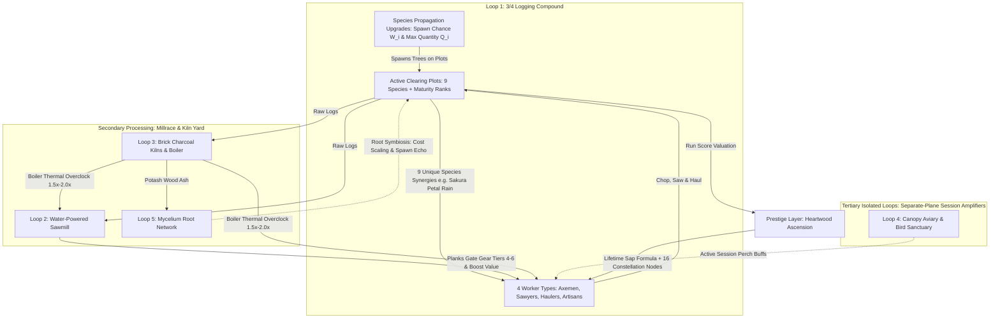

# Treecremental — Master Architecture, UI Mockups & Unabridged Upgrade Specification (v0.5)

> [!NOTE]
> **Project Status:** Planning Stage Only (Development Paused).
> **Workspace Path:** `C:\Users\MrSeb\GodotProjects\treecremental-game`
> **Target Engine:** Godot Engine 4.7.2 (`gl_compatibility` renderer, 2D pixel-art, 640x360 integer scaling).
> **Session Philosophy:** Pure active/semi-idle continuous session (~3.0 hours main campaign, ~4.0 hours 100% completion). **Zero offline progression mechanics.**

---

## 1. Executive Summary of v0.5 Architecture & Design Refinements

| Design Pillar | v0.5 Specification | Engineering & Design Rationale |
|---|---|---|
| **Right-Hand Docked HUD & 3/4 Compound** | **Left 3/4 World (`432x360`) + Right UI Dock (`208x360`)** | The forest does not occupy 100% of the screen. The left ~68% displays the 3/4 top-down Logging Compound (divided into Timber Plots, Central Stockpile, and the Millrace/Kiln Yard) beneath a `28 px` top resource bar, while the right ~32% houses a permanently docked Command Panel so players see immediate in-world feedback as they buy upgrades. |
| **Tree Progression via Spawn Chance & Quantity** | **Zero Direct Shop Unlocks (`prop_<species>`)** | New tree species are **never** bought as static items in a shop. Instead, players level up **Species Propagation Upgrades** that unlock and increase each species' **Spawn Probability Weight ($W_i$)** and **Maximum Concurrent Quantity ($Q_i$)** across the clearing's active growth plots. |
| **Strict 4-Worker-Type Scope** | **Axemen, Sawyers, Haulers & Artisans** | Limited strictly to **4 visually and mechanically distinct worker types**: **1. Axemen** (fast choppers), **2. Sawyers** (heavy armor-piercing saws), **3. Haulers** (skid-team logistics carriers), and **4. Artisans** (Sawmill & Kiln operatives in the compound's Millrace corner). |
| **Durability vs. Yield & Tree Synergies** | **Old-Growth Maturity Ranks + 9 Species Events** | Trees scale in **Maturity Ranks ($m \in \{0..4\}$)** ($4.0^m$ HP vs. $4.2^m$ Log Yield) and **Bark Hardness** so late-game workers never 1-frame insta-chop trees (clamping fell time to $2.5\text{ s}$–$8.0\text{ s}$). Each of the 9 species also triggers a unique ecological synergy (e.g., Sakura's *Cherry Petal Rain*). |
| **Editable UI Groundwork** | **Modular Godot `.tscn` Control Wireframes** | During future development, the AI will deliver clean, human-editable Godot `.tscn` mockup scenes (`HBoxContainer`, `MarginContainer`, `VBoxContainer`, `PanelContainer`, `%UniqueNodeNames`) so you can visually rearrange and skin the UI inside the Godot 2D Editor. |
| **Session Model (Zero Offline)** | **100% Active / In-Session Play** | All offline progression (`offline_step`, away-from-keyboard catchup, and offline bird buffs) is eliminated. Every upgrade rewards active session play across the 3-to-4-hour run. |
| **Testing & Git Hygiene** | **Zero-Trace `Autopilot-Godot` Isolation** | Automated playtesting via `C:\Users\MrSeb\Downloads\Autopilot-Godot` is isolated through `.gitignore`, directory junctions, `override.cfg`, and `project.godot` sanitization so zero AI test scripts or plugin entries ever enter Git history. |

---

## 2. Right-Hand Docked UI Layout, Visual Mockups & Editable Godot Groundwork

> [!IMPORTANT]
> **Reference Image Usage Rule:** `reference_camera_and_hud_layout.jpg` is used **strictly as a camera-angle reference for the 3/4 top-down clearing perspective and roaming workers**—**NOT** for the HUD layout or art style. The HUD is **right-hand docked**, and the 3/4 world includes distinct compound zones and 4 worker types.

````carousel

<!-- slide -->

<!-- slide -->

<!-- slide -->

<!-- slide -->

````

### 2.1 Right-Hand Docked HUD & 3/4 Compound Split Specification (640x360 Base)

```text
+-----------------------------------------------------+----------------------------+
| TOP RESOURCE & GATE STRIP (432x28 px)               | RIGHT-HAND DOCKED HUD      |
| [Logs: 142.5K] [Planks: 19.2K] [Coal: 4.1K] [Sap:38]| (208x360 px)               |
| Act I Gate: [====================>        ] 68%     | [Trees][Crew][Mill][Roots] |
+-----------------------------------------------------+----------------------------+
| 3/4 TOP-DOWN LOGGING COMPOUND (432x332 px)          | Bulk Buy: [x1] [x10] [MAX] |
|                                                     | +------------------------+ |
|    /\  /\ (Pine)          / \ (Birch)    /~~~\      | | Birch Propagation Lv.4 | |
|   /  \/  \ [==== ]       |   | [===  ]  (Sakura)    | | Spawn: 28% | Max: 6    | |
|   |  ||  | +30 LOGS       \ /  +45 LOGS  \   /      | | [ BUY: 850 Pine Logs ] | |
|   [Ax][Ax]                 |   *petal*    | |       | +------------------------+ |
|                           [Ax]  *rain*   [Sw][Sw]   | | Oak Propagation   Lv.2 | |
|      /~~~\ (Oak)                                    | | Spawn: 14% | Max: 3    | |
|     (     ) [======]       [Hl] --> (Stockpile)     | | [ BUY: 2.4K Birch ]    | |
|      \   /  (Hard Bark)    (Hauler carrying logs)   | +------------------------+ |
|       | |   [Sw][Sw]                                | | Hire Sawyers   Lv.8/16 | |
|                                                     | | Heavy Armor-Piercing   | |
|  +------------------------+                         | | [ BUY: 1.9K Oak Logs ] | |
|  | MILLRACE & KILN YARD   |    (Campfire &          | +------------------------+ |
|  | [Waterwheel] [Kilns]   |     Spawn Trail)        | | Old-Growth Rank Lv.2/5 | |
|  |   [Ar]        [Ar]     |                         | | Tree HP x4 / Yield x4.2| |
|  +------------------------+                         | +------------------------+ |
|  LOGGING RATE: 4.8M / SEC          [Achv] [Settings]| [Ascend: Heartwood Tree]   |
+-----------------------------------------------------+----------------------------+
```

1. **Left/Center Column (`432x360 px` — 67.5% Width)**:
   - **Top Resource & Breakthrough Strip (`432x28 px`)**: Displays live formatted counts for Logs, Planks, Charcoal, Ash, and Sap alongside the current Act's Breakthrough Gate progress bar and active Synergy Buff icons (e.g., *Petal Rain 8s*).
   - **3/4 Top-Down Compound Viewport (`432x332 px`, `y_sort_enabled = true`)**: Divided into three readable spatial zones so the world feels like a living operation rather than just uniform trees:
     1. **Dynamic Forest Plots (Upper & Center-Right Arc)**: Up to 32 dirt growth plots where unlocked tree species dynamically spawn according to their upgraded **Spawn Probability Weight ($W_i$)** and **Max Concurrent Quantity Cap ($Q_i$)**.
     2. **Central Skid Yard & Stockpile (Center)**: Where **Haulers (`[Hl]`)** deliver felled timber bundles from stumps to multiply batch log value.
     3. **Millrace & Kiln Yard (Lower-Left Compound Corner)**: Visible in-world Water-Powered Sawmill wheel and smoking Brick Charcoal Kilns tended by **Artisans (`[Ar]`)**.
2. **Right-Hand Docked Command Panel (`208x360 px` — 32.5% Width)**:
   - Permanently docked on the right edge so purchasing an upgrade immediately shows new workers or higher tree spawn density in the compound on the left.
   - Top navigation tabs switch the scrollable drawer between **`[Trees]`** (Species Spawn Chance & Quantity upgrades + Clearing/Maturity upgrades), **`[Crew]`** (the 4 Worker Types, Tool Tiers, and Masteries), **`[Mill]`** (Sawmill & Charcoal Kiln upgrades), and **`[Roots]`** (Canopy Aviary & Mycelium Root Network), with a footer button to open the **Heartwood Prestige Constellation** modal.
3. **The 4 Visually Distinct Worker Types in the 3/4 Compound**:
   - **`[Ax]` Axemen (`16x16 px`)**: Red flannel cap & axe swing arc; fast front-line choppers (`1.0x` move/swing speed) that excel at chipping standard bark and proccing critical/on-hit effects.
   - **`[Sw]` Sawyers (`20x16 px`)**: Brown leather apron, wide-brim hat & heavy two-man/steam crosscut saw; slower walk (`0.75x`) but high *Armor Penetration* that shreds high-hardness trees (Oak, Maple, Fir, Sequoia).
   - **`[Hl]` Haulers (`24x16 px`)**: Heavy timber backpack frame / ox-skid; patrol between felled stumps and the Central Stockpile without chopping, collecting dropped log bundles for a batch value multiplier.
   - **`[Ar]` Artisans (`16x16 px`)**: Canvas vest, goggles & coal shovel; stationed in the **Millrace & Kiln Yard** corner, operating the Sawmill carriages and stoking the Charcoal Steam Boiler.

---

### 2.2 Editable Godot `.tscn` UI Groundwork Specification (Division of Labor)

When development begins, the AI will provide a clean, **human-editable Godot `.tscn` Control groundwork** using the right-hand docked layout so you can visually customize, resize, and skin all containers in the Godot 2D Editor:

```text
MainScreen (Control - Full Rect 640x360) [scenes/ui/main_screen.tscn]
+-- MainSplit (HBoxContainer - Full Rect, separation = 0)
|   +-- LeftCompoundColumn (VBoxContainer - custom_minimum_size = Vector2(432, 360))
|   |   +-- TopResourceBar (PanelContainer - custom_minimum_size = Vector2(432, 28))
|   |   |   +-- ResourceRow (HBoxContainer) -> %LogsLabel, %PlanksLabel, %CharcoalLabel, %SapLabel
|   |   |   +-- GateRow (HBoxContainer)     -> %ActTitleLabel, %BreakthroughProgressBar, %ActiveBuffsBox
|   |   +-- CompoundViewportContainer (SubViewportContainer - size = 432x332, stretch = true)
|   |       +-- CompoundViewport (SubViewport - size = 432x332, snap_2d_transforms_to_pixel = true)
|   |           +-- LoggingCompoundWorld (Node2D - y_sort_enabled = true)
|   |               +-- %PlotManager, %WorkerManager, %MillKilnYard, %FloatingTextLayer
|   +-- RightDockedHUD (PanelContainer - custom_minimum_size = Vector2(208, 360))
|       +-- DockMargin (MarginContainer)
|           +-- DockVBox (VBoxContainer)
|               +-- %LoopTabBar (TabBar: Trees | Crew | Mill | Roots)
|               +-- %BulkBuyBar (HBoxContainer: %BtnBuy1, %BtnBuy10, %BtnBuyMax)
|               +-- %UpgradeScroll (ScrollContainer - SizeFlags: Expand Fill)
|               |   +-- %UpgradeListVBox (VBoxContainer -> instances of upgrade_row_template.tscn)
|               +-- %DockFooter (HBoxContainer: %BtnOpenPrestige, %BtnOpenAchievements, %BtnOpenSettings)
+-- ModalOverlayLayer (CanvasLayer - for full-art Prestige Tree, Achievements & Settings modals)
```

---

## 3. Core Gameplay Mechanics: Tree Spawn Ecology, Durability Scaling & Loops



### 3.1 Dynamic Tree Unlocking via Spawn Probability ($W_i$) & Quantity Caps ($Q_i$)
1. **No Shop-Bought Tree Stalls**: The clearing starts with $N_{\text{plots}} = 12$ active dirt plots (expandable up to $32$ via `camp_plot_expansion`). At the start of a run, only **Pine (`pine`)** can grow ($W_0 = 100$).
2. **Weighted Plot Spawn Formula**:
   - Purchasing Level 1 of a species' **Propagation Upgrade (`prop_<species>`)** introduces that species into the clearing's ecological pool with an initial **Spawn Weight $W_i(1)$** and **Max Concurrent Quantity Cap $Q_i(1)$**.
   - Whenever an empty plot finishes its regrowth timer, it filters for all unlocked species whose current on-field count $c_i$ is strictly below their cap ($c_i < Q_i(L)$), and rolls species $i$ with probability:
     $$P(\text{spawn } i) = \frac{W_i(L_i)}{\sum_{k \text{ where } c_k < Q_k(L_k)} W_k(L_k)}$$
   - Leveling up `prop_<species>` (Lv. 1 to 10) simultaneously raises $W_i(L)$ (so the tree appears much more frequently) and raises $Q_i(L)$ (allowing more trees of that species to coexist in the clearing at once).

### 3.2 Durability (HP / Bark Hardness) vs. Yield Scaling (Anti-Insta-Chop Model)
To prevent high-level workers from 1-shotting trees in a single frame late-game:
1. **Old-Growth Maturity Ranks ($m \in \{0, 1, 2, 3, 4\}$)**:
   - Unlocked via `camp_old_growth_stewardship` and `prop_<species>` milestones, spawning trees at 5 visual maturity tiers: *Sapling ($m=0$)*, *Young ($m=1$)*, *Mature ($m=2$)*, *Old-Growth ($m=3$)*, and *Ancient Titan ($m=4$)*.
   - Rank $m$ multiplies **Tree Durability (HP)** by $4.0^m$ and **Total Log Yield** by $4.2^m$ (giving a net $+5\%$ efficiency bonus per rank while compressing hit frequency so every tree takes a satisfying **$2.5\text{ s}$ to $8.0\text{ s}$** to fell across all 3 Acts).
2. **Bark Hardness vs. Sawyer Armor Penetration**:
   - Each tree species has a **Bark Hardness Rating ($B_i$)**. Standard Axemen deal $100\%$ damage when their Gear Tier meets or exceeds $B_i$, but suffer a glancing-blow penalty ($-50\%$ damage) against harder bark unless a **Sawyer (`[Sw]`)** is sawing the trunk (Sawyers bypass Bark Hardness and shred armor for nearby Axemen).
3. **Chip Yield ($30\%$) + Timberfall Jackpot ($70\%$)**:
   - $30\%$ of a tree's log yield is awarded steadily on each axe/saw hit (`+LOGS` popups), while bringing the tree's HP bar to $0$ triggers the **Timberfall Jackpot** ($70\%$ burst + species synergy proc roll).

---

## 4. Complete, Unabridged, Itemized Upgrade Catalog (All 87 Tracks / 552 Levels)

Every upgrade in *Treecremental* is itemized below with its canonical ID, max level, cost formula, and exact mechanical effect.

### 4.1 The 9 Tree Species: Base Durability, Bark Hardness & Unique Synergies

| Tier | Species ID | Display Name | Act | Base HP ($H_i$) | Bark Hardness | Sap Weight ($V_i$) | Unique Species Synergy / Ecological Event |
|---:|---|---|---|---:|---:|---:|---|
| **0** | `pine` | Pine | Act I | $20\text{ HP}$ | Tier 0 (Soft) | $1.00$ | **Pitch Sap Splatter (15% on fell):** Grants $+25\%$ Axemen swing speed for $8\text{ s}$ and $+10\%$ Kiln burn time. |
| **1** | `birch` | Birch | Act I | $35\text{ HP}$ | Tier 1 | $1.90$ | **Silver-Bark Kindling (Every 10th felled):** Extends active Charcoal Boiler *Thermal Overclock* duration by $+4\text{ s}$ for free. |
| **2** | `oak` | Oak | Act I | $65\text{ HP}$ | Tier 2 (Hard) | $3.61$ | **Acorn Mast Shower (12% on fell):** Doubles `birdseed` drops for $10\text{ s}$ and boosts Canopy Aviary bird effects by $+50\%$. |
| **3** | `sakura` | Sakura | Act II | $120\text{ HP}$ | Tier 2 | $6.86$ | **Cherry Petal Rain (12% on fell / 100% every 12th):** Pink petals drift across the clearing for $12\text{ s}$, granting $+35\%$ Worker Move Speed and $+20\%$ Crit Chance camp-wide. |
| **4** | `canadian_maple` | Canadian Maple | Act II | $220\text{ HP}$ | Tier 3 (Hard) | $13.03$ | **Sugarbush Sap Flow (Active Aura):** While at least 1 Maple is being chopped, Haulers and Artisans gain $+25\%$ Plank conversion yield. |
| **5** | `fir` | Fir | Act II | $400\text{ HP}$ | Tier 4 (Dense) | $24.76$ | **Boreal Frost Shatter (On fell):** Cold-brittle trunk shatters on impact, dealing $20\%$ splash chop damage to all adjacent trees. |
| **6** | `baobab` | Baobab | Act III | $750\text{ HP}$ | Tier 4 | $47.05$ | **Monsoon Reservoir Surge (On fell):** Floods the millrace for $15\text{ s}$, granting $2.0\times$ Sawmill Overdrive Speed and $+50\%$ Mycelium `spores` rate. |
| **7** | `socotra_dragon_tree` | Socotra Dragon Tree | Act III | $1,400\text{ HP}$ | Tier 5 (Armored) | $89.39$ | **Cinnabar Dragon's Blood (On Crit):** Critical hits bleed resin that stacks $+2\%$ Global Log Value (up to $+40\%$) while Dragon Trees are on-field. |
| **8** | `giant_sequoia` | Giant Sequoia | Act III | $2,800\text{ HP}$ | Tier 6 (Titan) | $169.84$ | **Seismic Timberfall (On fell):** Ground tremor knocks $15\%$ current HP off all active trees in the clearing and drops bonus `spores` & `birdseed`. |

---

### 4.2 Loop 1: Logging Compound Upgrades (30 Upgrade Tracks / 243 Levels)

#### A. Species Propagation: Spawn Probability & Max Quantity Upgrades (9 Tracks × 10 Levels = 90 Levels)
- **Act Caps:** Capped at **Lv. 4** in Act I, **Lv. 7** in Act II, and **Lv. 10** in Act III.
- **Mechanical Effect:** New trees are unlocked and scaled strictly through these ecological propagation tracks. Buying Level 1 introduces the species into the clearing's spawn pool; each subsequent level increases both its **Spawn Weight ($W_i$)** and **Max Concurrent Quantity ($Q_i$)** on the field, while adding $+10\%$ species maturity yield per level.

| Upgrade ID | Name | Target Species | Act Caps (I / II / III) | Cost Formula (Level $L \in \{0..9\}$, paid in Tier $i-1$ Logs) | Spawn Weight $W_i(L)$ & Max Concurrent Quantity $Q_i(L)$ |
|---|---|---|---|---|---|
| `prop_pine` | Pine Stand Management | Pine | 4 / 7 / 10 | $25 \cdot 2.1^L$ `logs_pine` | Baseline $W_0 = 100$; adds $+1$ Max Pine Plot cap/Lv ($12 \rightarrow 22$) and $+15\%$ Pine Old-Growth chance/Lv. |
| `prop_birch` | Birch Catkin Dispersal | Birch | 4 / 7 / 10 | $120 \cdot 2.2^L$ `logs_pine` | Lv. 1 unlocks Birch. $W_1 = 15 + 8 \cdot L$ ($23 \rightarrow 95$); Max Quantity $Q_1 = 1 + L$ ($2 \rightarrow 11$ trees). |
| `prop_oak` | Oak Acorn Afforestation | Oak | 4 / 7 / 10 | $280 \cdot 2.3^L$ `logs_birch` | Lv. 1 unlocks Oak. $W_2 = 12 + 7 \cdot L$ ($19 \rightarrow 82$); Max Quantity $Q_2 = 1 + L$ ($2 \rightarrow 11$ trees). |
| `prop_sakura` | Sakura Blossom Grafting | Sakura | — / 7 / 10 | $650 \cdot 2.4^L$ `logs_oak` | Lv. 1 unlocks Sakura. $W_3 = 10 + 7 \cdot L$ ($17 \rightarrow 80$); Max Quantity $Q_3 = 1 + L$ ($2 \rightarrow 11$ trees). |
| `prop_canadian_maple` | Maple Sugarbush Seeding | Canadian Maple | — / 7 / 10 | $1,450 \cdot 2.45^L$ `logs_sakura` | Lv. 1 unlocks Maple. $W_4 = 10 + 6 \cdot L$ ($16 \rightarrow 70$); Max Quantity $Q_4 = 1 + \lfloor 0.9 \cdot L \rfloor$ ($1 \rightarrow 10$ trees). |
| `prop_fir` | Boreal Fir Cone Dispersal | Fir | — / 7 / 10 | $3,200 \cdot 2.5^L$ `logs_canadian_maple` | Lv. 1 unlocks Fir. $W_5 = 8 + 6 \cdot L$ ($14 \rightarrow 68$); Max Quantity $Q_5 = 1 + \lfloor 0.9 \cdot L \rfloor$ ($1 \rightarrow 10$ trees). |
| `prop_baobab` | Baobab Savanna Planting | Baobab | — / — / 10 | $7,200 \cdot 2.55^L$ `logs_fir` | Lv. 1 unlocks Baobab. $W_6 = 8 + 5 \cdot L$ ($13 \rightarrow 58$); Max Quantity $Q_6 = 1 + \lfloor 0.8 \cdot L \rfloor$ ($1 \rightarrow 9$ trees). |
| `prop_socotra_dragon_tree` | Dragon Sapling Cultivation | Socotra Dragon Tree | — / — / 10 | $16,000 \cdot 2.6^L$ `logs_baobab` | Lv. 1 unlocks Dragon Tree. $W_7 = 6 + 5 \cdot L$ ($11 \rightarrow 56$); Max Quantity $Q_7 = 1 + \lfloor 0.7 \cdot L \rfloor$ ($1 \rightarrow 8$ trees). |
| `prop_giant_sequoia` | Sequoia Grove Sanctuary | Giant Sequoia | — / — / 10 | $35,000 \cdot 2.7^L$ `logs_socotra_dragon_tree` | Lv. 1 unlocks Giant Sequoia. $W_8 = 5 + 4 \cdot L$ ($9 \rightarrow 45$); Max Quantity $Q_8 = 1 + \lfloor 0.5 \cdot L \rfloor$ ($1 \rightarrow 6$ titan trees). |

#### B. The 4 Worker Types: Roster Hiring & Equipment Tiers (8 Tracks = 88 Levels)
- **Strict 4-Worker Scope:** Only 4 worker archetypes exist in the game (**Axemen**, **Sawyers**, **Haulers**, **Artisans**).
- **Crew Milestones:** Reaching **10** and **20** workers in any archetype grants a $\times 1.50$ multiplicative efficiency boost to that archetype ($\times 2.25$ at 20 workers; expandable with `camp_highland_crampons`).
- **Equipment Tiers (6 Levels Each):** Capped at **Lv. 3** in Act I, **Lv. 5** in Act II, and **Lv. 6** in Act III (Levels 4–6 require `planks`).

| Upgrade ID | Name | Worker Type | Max Lv (Act I / II / III) | Cost Formula | Exact Mechanical Effect |
|---|---|---|---|---|---|
| `hire_axemen` | Hire Axemen Crew | 1. Axemen (`[Ax]`) | 12 / 20 / 28 | $10 \cdot 1.16^n$ Logs | Spawns $+1$ Axeman in the clearing ($1.0\text{ hits/s}$, fast front-line chopper). |
| `hire_sawyers` | Hire Sawyer Crew | 2. Sawyers (`[Sw]`) | 6 / 12 / 18 | $35 \cdot 1.18^n$ Logs | Spawns $+1$ Heavy Sawyer ($2.5\text{ DPS}$ continuous sawing; ignores Bark Hardness). |
| `hire_haulers` | Hire Skid-Team Haulers | 3. Haulers (`[Hl]`) | 4 / 8 / 12 | $60 \cdot 1.20^n$ Logs | Spawns $+1$ Logistics Hauler; collects felled timber bundles and multiplies delivered log value by $+15\%$ per Hauler. |
| `hire_artisans` | Hire Mill & Kiln Artisans | 4. Artisans (`[Ar]`) | 4 / 8 / 12 | $80 \cdot 1.22^n$ Logs | Spawns $+1$ Compound Artisan in the Millrace & Kiln Yard ($+20\%$ Sawmill & Kiln cycle speed per Artisan). |
| `gear_axemen` | Axemen Felling Axes | 1. Axemen (`[Ax]`) | 3 / 5 / 6 | $120 \cdot 9^k$ Logs (+ Planks $k \ge 3$) | Upgrades axes (*Flint -> Iron -> Steel -> Double-Bit -> Steam-Assisted -> Heartwood*); multiplies Axemen chop power by $\times 2.0^k$ ($\times 64$ at Lv. 6). |
| `gear_sawyers` | Sawyer Bucking Blades | 2. Sawyers (`[Sw]`) | 3 / 5 / 6 | $250 \cdot 9^k$ Logs (+ Planks $k \ge 3$) | Upgrades saws (*Rip-Saw -> Crosscut -> Raker-Tooth -> Carbide -> Steam-Piston -> Resonance Blade*); multiplies Sawyer DPS by $\times 2.0^k$ and raises Armor Penetration tier to $k+1$. |
| `gear_haulers` | Hauler Skid Rigging | 3. Haulers (`[Hl]`) | 3 / 5 / 6 | $180 \cdot 8.5^k$ Logs (+ Planks $k \ge 3$) | Upgrades hauling gear (*Hemp Ropes -> Cant Hooks -> Logging Arch -> Oxen Yoke -> Steam Donkey Sled -> Skyline Rig*); multiplies Hauler capacity & value bonus by $\times 1.65^k$. |
| `gear_artisans` | Artisan Millwright Kit | 4. Artisans (`[Ar]`) | 3 / 5 / 6 | $220 \cdot 8.5^k$ Logs (+ Planks $k \ge 3$) | Upgrades compound tools (*Calipers -> Brass Gauges -> Tempered Setworks -> Pressure Valves -> Bimetallic Governors -> Master Chronometer*); multiplies Artisan output by $\times 1.75^k$. |

#### C. Clearing Plots, Old-Growth Maturity, Synergies & Camp Upgrades (13 Tracks = 65 Levels)

| # | Upgrade ID | Name | Max Lv | Unlock Act | Cost Formula (Level $L \in \{0..4\}$) | Exact Mechanical Effect |
|---:|---|---|---:|---|---|---|
| 1 | `camp_plot_expansion` | Clearing Plot Survey | 5 | Act I | $60 \cdot 2.8^L$ `logs_pine` | Expands the clearing by $+4$ concurrent Tree Spawn Plots per level (from $12$ plots up to $32$ active plots at Lv. 5). |
| 2 | `camp_old_growth_stewardship` | Old-Growth Maturity Stewardship | 5 | Act I | $150 \cdot 3.2^L$ `logs_oak` | Unlocks Tree Maturity Ranks $m = 1..4$ and increases high-maturity spawn chance by $+15\%$/Lv (scales Tree HP by $4.0^m$ and Log Yield by $4.2^m$, preventing insta-chopping). |
| 3 | `camp_synergy_resonator` | Canopy Ecological Harmony | 5 | Act I | $90 \cdot 2.7^L$ `logs_birch` | Increases the trigger chance and buff duration of all 9 Species Synergy Events (including Sakura *Cherry Petal Rain*) by $+20\%$ per level ($+100\%$ at Lv. 5). |
| 4 | `camp_whetstone_bench` | Grindstone & Whetstone Bench | 5 | Act I | $50 \cdot 2.5^L$ `logs_pine` | $+8\%$ global swing/saw speed for Axemen and Sawyers per level ($+40\%$ at Lv. 5). |
| 5 | `camp_hickory_hafts` | Seasoned Hickory Hafts | 5 | Act I | $80 \cdot 2.6^L$ `logs_birch` | $+10\%$ critical strike chance per level (critical hits deal $2.0\times$ damage and double chip log drops; $50\%$ crit at Lv. 5). |
| 6 | `camp_felling_wedges` | Iron Felling Wedges | 5 | Act I | $120 \cdot 2.8^L$ `logs_oak` | Reduces empty plot regrowth delay by $-0.15\text{ s}$/Lv (from $1.00\text{ s}$ to $0.25\text{ s}$) and boosts Timberfall Jackpot burst yield by $+10\%$/Lv. |
| 7 | `camp_skid_road` | Greased Corduroy Skid Trails | 5 | Act I | $40 \cdot 2.4^L$ `planks_pine` | $+12\%$ movement speed for all 4 worker types in the clearing and $+12\%$ Act I log value per level. |
| 8 | `camp_kerf_softening` | Sawyer Kerf Wedge Technique | 5 | Act I | $95 \cdot 2.6^L$ `planks_birch` | When a Sawyer is actively sawing a tree, its Bark Hardness is reduced by $-1$ tier and Axemen deal $+12\%$ bonus damage per level to that tree. |
| 9 | `camp_silk_cordage` | Braided Rigging Cordage | 5 | Act II | $200 \cdot 2.8^L$ `planks_sakura` | $+15\%$ log yield for all Act II species (Sakura, Maple, Fir) and $+15\%$ Hauler bundle pickup radius per level. |
| 10 | `camp_sap_lubrication` | Maple Sap Blade Coolant | 5 | Act II | $350 \cdot 2.9^L$ `planks_canadian_maple` | Reduces all Worker Equipment (`gear_<type>`) log and plank costs by $-6\%$ per level ($-30\%$ at Lv. 5). |
| 11 | `camp_highland_crampons` | Spiked Climbing Spurs | 5 | Act II | $600 \cdot 3.0^L$ `planks_fir` | Increases the per-threshold Worker Crew milestone multiplier from $\times 1.50$ to $\times (1.50 + 0.05 \cdot L)$ ($\times 1.75$ per milestone at Lv. 5). |
| 12 | `camp_crimson_varnish` | Dragon-Resin Temper Coating | 5 | Act III | $2,500 \cdot 3.2^L$ `planks_socotra_dragon_tree` | Increases critical strike damage and log multiplier from $2.0\times$ to $(2.0 + 0.2 \cdot L)\times$ ($3.0\times$ per crit at Lv. 5). |
| 13 | `camp_skyline_yarder` | Steam Skyline Cable Yarder | 5 | Act III | $5,000 \cdot 3.4^L$ `planks_giant_sequoia` | $+20\%$ Act III log yield and $+5\%$ Breakthrough Gate progress credit per level ($+100\%$ Act III yield / $+25\%$ gate credit at Lv. 5). |

---

### 4.3 Loop 2: Water-Powered Sawmill Upgrades (17 Upgrade Tracks / 129 Levels)

#### A. Per-Species Sawmill Carriages (9 Tracks — 1 per Species)
- **Act Caps:** Capped at **Lv. 4** in Act I, **Lv. 7** in Act II, and **Lv. 10** in Act III.
- **Cost Formula:** $C(L) = \lfloor 200 \cdot 3.2^L \rfloor$ paid in `logs_<species>`.
- **Mechanical Effect:** Each level adds $+20\%$ base harvest yield to `<species>` (up to $+30\%$ per level with `mill_flywheel_governor`) and adds $+1$ Miller slot capable of sawing $4$ `logs_<species>` into $1$ `planks_<species>` every $2.0\text{ s}$.

| Upgrade ID | Name | Target Species | Act Caps (I / II / III) | Cost Formula (Level $L$) | Effect per Level |
|---|---|---|---|---|---|
| `mill_pine` | Pine Sawmill Carriage | Pine | 4 / 7 / 10 | $200 \cdot 3.2^L$ `logs_pine` | $+20\%$ Pine log yield (+$30\%$ w/ governor) & $+1$ Pine plank miller slot. |
| `mill_birch` | Birch Sawmill Carriage | Birch | 4 / 7 / 10 | $200 \cdot 3.2^L$ `logs_birch` | $+20\%$ Birch log yield & $+1$ Birch plank miller slot. |
| `mill_oak` | Oak Sawmill Carriage | Oak | 4 / 7 / 10 | $200 \cdot 3.2^L$ `logs_oak` | $+20\%$ Oak log yield & $+1$ Oak plank miller slot. |
| `mill_sakura` | Sakura Sawmill Carriage | Sakura | — / 7 / 10 | $200 \cdot 3.2^L$ `logs_sakura` | $+20\%$ Sakura log yield & $+1$ Sakura plank miller slot. |
| `mill_canadian_maple` | Maple Sawmill Carriage | Canadian Maple | — / 7 / 10 | $200 \cdot 3.2^L$ `logs_canadian_maple` | $+20\%$ Maple log yield & $+1$ Maple plank miller slot. |
| `mill_fir` | Fir Sawmill Carriage | Fir | — / 7 / 10 | $200 \cdot 3.2^L$ `logs_fir` | $+20\%$ Fir log yield & $+1$ Fir plank miller slot. |
| `mill_baobab` | Baobab Sawmill Carriage | Baobab | — / — / 10 | $200 \cdot 3.2^L$ `logs_baobab` | $+20\%$ Baobab log yield & $+1$ Baobab plank miller slot. |
| `mill_socotra_dragon_tree` | Dragon Sawmill Carriage | Socotra Dragon Tree | — / — / 10 | $200 \cdot 3.2^L$ `logs_socotra_dragon_tree` | $+20\%$ Dragon log yield & $+1$ Dragon plank miller slot. |
| `mill_giant_sequoia` | Sequoia Sawmill Carriage | Giant Sequoia | — / — / 10 | $200 \cdot 3.2^L$ `logs_giant_sequoia` | $+20\%$ Sequoia log yield & $+1$ Sequoia plank miller slot. |

#### B. Global Sawmill Engineering Upgrades (8 Tracks = 39 Levels)

| # | Upgrade ID | Name | Max Lv | Unlock Act | Cost Formula (Level $L$) | Exact Mechanical Effect |
|---:|---|---|---:|---|---|---|
| 1 | `mill_undershot_wheel` | Undershot Millwheel Paddles | 5 | Act I | $30 \cdot 2.4^L$ `planks_pine` | $+12\%$ plank sawing cycle speed across all sawmills per level ($+60\%$ at Lv. 5). |
| 2 | `mill_kerf_thinning` | Thin-Kerf Band Blades | 4 | Act I | $60 \cdot 3.0^L$ `planks_birch` | Reduces log input required per plank by $-0.25$ logs per level (from $4.0$ logs down to $3.0$ logs per plank at Lv. 4). |
| 3 | `mill_roller_conveyor` | Iron-Roller Outfeed Table | 5 | Act I | $100 \cdot 2.6^L$ `planks_oak` | $+10\%$ chance per level for a saw cut to yield $2$ planks instead of $1$ ($50\%$ double-plank chance at Lv. 5). |
| 4 | `mill_gang_saw` | Multi-Blade Gang Headsaws | 5 | Act II | $180 \cdot 2.8^L$ `planks_sakura` | Each assigned miller processes $+0.20$ additional cuts per cycle per level ($+1.0$ extra cut per cycle at Lv. 5). |
| 5 | `mill_kiln_drying_rack` | Heated Plank Seasoning Racks | 5 | Act II | $320 \cdot 2.9^L$ `planks_canadian_maple` + $150 \cdot 2.5^L$ `charcoal` | Increases the Sap score weight ($V_i$) of all species by $+4\%$ per level ($+20\%$ at Lv. 5). |
| 6 | `mill_flywheel_governor` | Cast-Iron Flywheel Governor | 5 | Act II | $550 \cdot 3.0^L$ `planks_fir` | Increases the per-level yield bonus of all `mill_<species>` carriages from $+20\%$ to $+(20 + 2 \cdot L)\%$ ($+30\%$ per level at Lv. 5). |
| 7 | `mill_hydraulic_carriage` | High-Pressure Log Carriage | 5 | Act III | $1,100 \cdot 3.1^L$ `planks_baobab` | $+20\%$ sawing speed and $+10\%$ plank yield per level for all Act III species. |
| 8 | `mill_sawdust_briquetter` | Sawdust Compression Press | 5 | Act III | $2,200 \cdot 3.2^L$ `planks_socotra_dragon_tree` | Every 10 planks milled across the camp automatically generates $+1.0 \cdot L$ free `charcoal` without burning logs. |

---

### 4.4 Loop 3: Brick Charcoal Kilns & Boiler Furnace Upgrades (8 Tracks = 38 Levels)

- **Base Kiln & Boiler Rules:** A kiln batch carbonizes $10$ logs in $5.0\text{ s}$ to produce $2$ `charcoal` and $1$ `ash` (higher-tier woods yield $+20\%$ more per tier). Feeding `charcoal` into the Steam Boiler fills the **Thermal Overclock Gauge**, granting a baseline $\times 1.50$ speed multiplier to all Sawmills and Logging Crews while lit.

| # | Upgrade ID | Name | Max Lv | Unlock Act | Cost Formula (Level $L$) | Exact Mechanical Effect |
|---:|---|---|---:|---|---|---|
| 1 | `kiln_clay_lining` | Firebrick & Clay Sealant | 5 | Act I | $150 \cdot 2.3^L$ `logs_pine` + $20 \cdot 2.2^L$ `planks_pine` | $+15\%$ `charcoal` output per kiln batch per level ($+75\%$ at Lv. 5). |
| 2 | `kiln_draft_vents` | Adjustable Basal Draft Vents | 5 | Act I | $40 \cdot 2.5^L$ `charcoal` | Reduces kiln carbonization cycle time by $-8\%$ per level (from $5.0\text{ s}$ down to $3.0\text{ s}$ at Lv. 5). |
| 3 | `kiln_boiler_manifold` | Copper Steam-Boiler Manifold | 5 | Act I | $75 \cdot 2.6^L$ `charcoal` + $60 \cdot 2.5^L$ `planks_oak` | Increases the active Thermal Overclock speed multiplier by $+0.10\times$ per level (from $\times 1.50$ up to $\times 2.00$ at Lv. 5). |
| 4 | `kiln_hardwood_retort` | Sealed Iron Retort Chamber | 5 | Act II | $200 \cdot 2.7^L$ `charcoal` + $120 \cdot 2.6^L$ `planks_sakura` | Carbonizing Act II or Act III logs yields $+25\%$ bonus `charcoal` and $+25\%$ bonus `ash` per level. |
| 5 | `kiln_auto_stoker` | Chain-Grate Mechanical Stoker | 3 | Act II | $350 \cdot 3.5^L$ `charcoal` | Lv. 1: Auto-feeds charcoal into the boiler when heat drops below $90\%$; Lv. 2: $-15\%$ fuel burn rate; Lv. 3: $-30\%$ fuel burn rate. |
| 6 | `kiln_ash_sifter` | Rotary Potash Sifter | 5 | Act II | $500 \cdot 2.8^L$ `charcoal` | $+20\%$ `ash` byproduct extraction per kiln batch per level ($+100\%$ at Lv. 5). |
| 7 | `kiln_bellows_turbine` | Flue-Gas Recovery Turbine | 5 | Act III | $1,200 \cdot 3.0^L$ `charcoal` + $800 \cdot 2.8^L$ `planks_baobab` | While boiler heat is above $80\%$, all lumberjacks gain $+8\%$ chop speed per level ($+40\%$ at Lv. 5). |
| 8 | `kiln_white_charcoal` | Binchotan White-Heat Mastering | 5 | Act III | $3,000 \cdot 3.2^L$ `charcoal` | While the boiler is lit, increases the Sap score weight ($V_i$) of all harvested logs by $+6\%$ per level ($+30\%$ at Lv. 5). |

---

### 4.5 Loop 4 (Tertiary Isolated A): Canopy Aviary & Bird Sanctuary (8 Tracks = 38 Levels)

- **Base Aviary Rules:** Operates on an isolated canopy plane. `birdseed` generates passively at $0.25\text{/s}$ during active play. All 5 bird tracks and 3 sanctuary upgrades grant active in-session bonuses (**zero offline mechanics**).

| # | Upgrade ID | Name | Max Lv | Unlock Act | Cost Formula (Level / Rank $R$) | Exact Mechanical Effect |
|---:|---|---|---:|---|---|---|
| 1 | `aviary_bird_woodpecker` | Pileated Woodpecker Roost | 5 | Act I | $15 \cdot 2.2^R$ `birdseed` | $+10\%$ Global Chopping Power per rank ($+50\%$ at Rank 5). |
| 2 | `aviary_bird_waxwing` | Cedar Waxwing Roost | 5 | Act I | $30 \cdot 2.3^R$ `birdseed` | $+6\%$ Sap Score Weight on all felled trees per rank ($+30\%$ at Rank 5). |
| 3 | `aviary_bird_falcon` | Peregrine Falcon Eyrie | 5 | Act I | $60 \cdot 2.4^R$ `birdseed` | $+12\%$ Sawmill Cutting Speed per rank ($+60\%$ at Rank 5). |
| 4 | `aviary_bird_songbird` | Bluebird & Thrush Choir | 5 | Act I | $110 \cdot 2.5^R$ `birdseed` | $+8\%$ Worker Swing Tempo and $+5\%$ Critical Strike Chance per rank ($+40\%$ tempo / $+25\%$ crit at Rank 5). |
| 5 | `aviary_bird_phoenix` | Grove Phoenix Crest | 5 | Act II | $220 \cdot 2.6^R$ `birdseed` | $+15\%$ Kiln Thermal Output and $+10\%$ Breakthrough Gate fill rate per rank ($+75\%$ heat / $+50\%$ gate credit at Rank 5). |
| 6 | `aviary_seed_hopper` | Cedar Seed-Hopper Feeders | 5 | Act I | $20 \cdot 2.4^L$ `birdseed` + $25 \cdot 2.4^L$ `planks_pine` | Increases passive `birdseed` generation by $+0.15\text{/s}$ per level (from $0.25\text{/s}$ to $1.00\text{/s}$ at Lv. 5). |
| 7 | `aviary_suet_cakes` | Rendered Berry & Suet Cakes | 5 | Act I | $80 \cdot 2.5^L$ `birdseed` | Every $60\text{ s}$ of active play, triggers a **Canopy Chorus** for $10 + 2 \cdot L$ seconds that multiplies all active bird bonuses by $\times 1.50$. |
| 8 | `aviary_gilded_weathervane` | Brass Canopy Weathervane | 3 | Act II | $250 \cdot 3.0^L$ `birdseed` | Each bird species that has reached Rank 5 grants an independent $\times (1.00 + 0.05 \cdot L)$ multiplier to total camp production. |

---

### 4.6 Loop 5 (Tertiary Isolated B): Mycelium Root Network (8 Tracks = 38 Levels)

- **Base Mycelium Rules:** Operates on an isolated subterranean root plane. `spores` generate passively at $0.20\text{/s}$ during active play plus $+1$ spore per $50$ felled trees. Combine `spores` with kiln `ash` to inoculate symbiotic root nodes.

| # | Upgrade ID | Name | Max Lv | Unlock Act | Cost Formula (Level $L$) | Exact Mechanical Effect |
|---:|---|---|---:|---|---|---|
| 1 | `myc_phosphorus_exchange` | Chanterelle Phosphorus Exchange | 5 | Act I | $12 \cdot 2.2^L$ `spores` | Reduces the worker hiring exponential cost base $r$ from $1.150$ by $-0.004$ per level (down to $1.130$ at Lv. 5). |
| 2 | `myc_spore_bloom` | Bioluminescent Mycena Bloom | 5 | Act I | $18 \cdot 2.3^L$ `spores` + $20 \cdot 2.2^L$ `ash` | Increases passive `spores` generation by $+0.16\text{/s}$ per level (from $0.20\text{/s}$ to $1.00\text{/s}$ at Lv. 5). |
| 3 | `myc_saprophyte_enzymes` | Oyster Saprophyte Enzymes | 5 | Act I | $35 \cdot 2.4^L$ `spores` | $+15\%$ faster tree regrowth per level, plus a $+6\%$ chance per level ($30\%$ at Lv. 5) for a felled tree to regrow with zero delay. |
| 4 | `myc_rhizomorph_conduit` | Rhizomorph Nutrient Conduit | 5 | Act I | $65 \cdot 2.5^L$ `spores` + $50 \cdot 2.4^L$ `ash` | Echoes $4\%$ per level ($20\%$ at Lv. 5) of Species $i$'s log harvest rate as free bonus logs into Species $i+1$. |
| 5 | `myc_truffle_symbiosis` | Black Truffle Heartwood Symbiosis | 5 | Act II | $120 \cdot 2.6^L$ `spores` | Adds $+0.20$ base logs per chop to every unlocked species per level ($+1.00$ full extra log per chop at Lv. 5). |
| 6 | `myc_alkaline_mulch` | Potash & Wood-Ash Composting | 5 | Act II | $180 \cdot 2.6^L$ `spores` + $200 \cdot 2.5^L$ `ash` | Each unit of unspent `ash` boosts all Mycelium node effects by $+0.05\%$ per level (capped at $+50\%$ total boost). |
| 7 | `myc_fairy_ring_pulse` | Harmonic Fairy-Ring Pulse | 5 | Act II | $300 \cdot 2.7^L$ `spores` | Every $45\text{ s}$, a root pulse adds $+0.4\% \cdot L$ ($+2.0\%$ at Lv. 5) of the last minute's total log production directly to the Breakthrough Gate. |
| 8 | `myc_mother_tree_nexus` | The Mother-Tree Mycorrhizal Nexus | 3 | Act III | $600 \cdot 3.2^L$ `spores` + $500 \cdot 3.0^L$ `ash` | Grants $+10\%$ global log and plank output per unlocked tree species per level ($+270\%$ at 9 species and Lv. 3). |

---

### 4.7 Prestige Layer: Heartwood Ascension — The Sap Constellation (16 Tracks = 45 Levels)

- **Baseline Sap Formula:** Upon completing an Act's Breakthrough Gate, the player banks $\Delta \text{Sap} = \lfloor (\text{RunScore} / 2000)^{0.5} \rfloor$.
- **Non-Punitive Spending Rule:** The global Sap multiplier $M_{\text{sap}} = 1 + 0.60 \cdot (\text{LifetimeSap})^{0.5}$ scales with **Lifetime Earned Sap**, so spending banked Sap on Constellation nodes never reduces $M_{\text{sap}}$.

| Ring | # | Upgrade ID | Name | Max Lv | Exact Sap Cost per Level | Exact Permanent Effect |
|---|---:|---|---|---:|---|---|
| **Inner Ring** *(Act I Ascension)* | 1 | `sap_heartwood_resonance_1` | Heartwood Resonance I | 3 | `5, 10, 20` Sap *(35 total)* | $+25\%$ Global Chopping Speed per level ($+75\%$ at Lv. 3). |
| **Inner Ring** | 2 | `sap_pioneer_charter` | Pioneer's Charter | 3 | `4, 8, 16` Sap *(28 total)* | Starts each run with $+1 \cdot L$ free starting levels in `prop_birch` and $+3 \cdot L$ starting Axemen. |
| **Inner Ring** | 3 | `sap_amber_distillation` | Amber Sap Distillation | 3 | `6, 12, 24` Sap *(42 total)* | $+15\%$ Sap earned from all Breakthrough Ascensions per level ($+45\%$ at Lv. 3). |
| **Inner Ring** | 4 | `sap_seasoned_joinery` | Seasoned Timber Joinery | 3 | `5, 10, 20` Sap *(35 total)* | Retains $1 \cdot L$ starting levels on all `mill_<species>` carriages after Ascension. |
| **Inner Ring** | 5 | `sap_eternal_embers` | Eternal Kiln Embers | 2 | `8, 18` Sap *(26 total)* | Lv. 1: Starts run with 100 Charcoal & $50\%$ boiler heat; Lv. 2: Boiler heat never falls below $50\%$. |
| **Inner Ring** | 6 | `sap_canopy_sanctuary_bond` | Sanctuary Homing Bond | 1 | `12` Sap *(12 total)* | Canopy Aviary ranks and Mycelium Root Network levels persist permanently across Ascensions. |
| **Middle Ring** *(Act II Ascension)* | 7 | `sap_heartwood_resonance_2` | Heartwood Resonance II | 5 | `25, 50, 85, 130, 190` Sap *(480 total)* | $+30\%$ Global Chopping Speed and $+15\%$ Sawmill Speed per level ($+150\%$ / $+75\%$ at Lv. 5). |
| **Middle Ring** | 8 | `sap_guild_headquarters` | Lumberjack Guild Hall | 3 | `40, 90, 160` Sap *(290 total)* | Raises the per-Act Roster Cap of all 4 Worker Types by $+3$ per level ($+9$ per worker type at Lv. 3). |
| **Middle Ring** | 9 | `sap_bulk_contracting` | Automated Guild Quartermaster | 2 | `35, 75` Sap *(110 total)* | Lv. 1: Unlocks `x10` and `MAX` bulk buy buttons; Lv. 2: Unlocks toggleable auto-buyers for Propagation, Workers, and Sawmills. |
| **Middle Ring** | 10 | `sap_cambium_overflow` | Cambium Pressure Overflow | 4 | `30, 65, 110, 170` Sap *(375 total)* | Reduces all Species Propagation (`prop_<species>`) log costs by $-12\%$ per level ($-48\%$ at Lv. 4). |
| **Middle Ring** | 11 | `sap_mycorrhizal_awakening` | Mycorrhizal Awakening | 3 | `45, 95, 165` Sap *(305 total)* | Increases `birdseed` and `spores` generation rates by $+33.3\%$ per level ($\times 2.00$ at Lv. 3). |
| **Middle Ring** | 12 | `sap_crucible_steel` | Damascus Crucible Metallurgy | 3 | `50, 110, 190` Sap *(350 total)* | Increases the per-tier Worker Equipment (`gear_<type>`) multiplier by $+0.15\times$ per level. |
| **Outer Ring** *(Act III & 100%)* | 13 | `sap_titan_feller` | Titan-Feller's Creed | 3 | `150, 300, 500` Sap *(950 total)* | Multiplies log yield and spawn weight of Baobab, Socotra Dragon Tree, and Giant Sequoia by $\times 1.50$ per level ($\times 3.375$ at Lv. 3). |
| **Outer Ring** | 14 | `sap_golden_bough` | The Golden Bough | 3 | `200, 400, 700` Sap *(1,300 total)* | Increases the exponent of the lifetime Sap formula from $0.50$ to $0.50 + 0.02 \cdot L$ ($0.56$ at Lv. 3). |
| **Outer Ring** | 15 | `sap_ancient_harmony` | Harmony of the Ancient Grove | 3 | `180, 360, 600` Sap *(1,140 total)* | Each unlocked Achievement grants $+1.0\%$ per level ($+3.0\%$ per achievement at Lv. 3) to global production. |
| **Outer Ring** | 16 | `sap_world_tree_crown` | Crown of the World Tree | 1 | `1,000` Sap *(1,000 total)* | Doubles all Breakthrough Gate progress and unlocks the completionist Golden Sequoia visual crown. |

---

### 4.8 Total Upgrade Inventory & Playthrough Duration Budget

| Loop / Upgrade Category | Track Count | Total Purchasable Levels | Primary Currencies Spent | Average Completion Window |
|---|---:|---:|---|---|
| **Loop 1A:** Species Propagation (Spawn Chance & Max Qty) | 9 | 90 *(9 × 10 levels)* | `logs_<species>` | Lv. 1–4 (Act I), 5–7 (Act II), 8–10 (Act III) |
| **Loop 1B:** 4 Worker Types (Hiring + 6 Gear Tiers each) | 8 | 88 *(64 hire + 24 gear)* | `logs_<species>`, `planks_<species>` | Gear Tiers 1–3 (Act I), 4–5 (Act II), 6 (Act III) |
| **Loop 1C:** Clearing Plots, Maturity & Synergy Upgrades | 13 | 65 *(13 × 5 levels)* | `logs_<species>`, `planks_<species>` | Continuous across Acts I–III |
| **Loop 2A:** Per-Species Sawmill Carriages | 9 | 90 *(9 × 10 levels)* | `logs_<species>` | Lv. 1–4 (Act I), 5–7 (Act II), 8–10 (Act III) |
| **Loop 2B:** Global Sawmill Upgrades | 8 | 39 | `planks_<species>`, `charcoal` | 3 in Act I, 3 in Act II, 2 in Act III |
| **Loop 3:** Charcoal Kilns & Boiler | 8 | 38 | `charcoal`, `planks_<species>` | 3 in Act I, 3 in Act II, 2 in Act III |
| **Loop 4:** Canopy Aviary (Tertiary A) | 8 | 38 | `birdseed`, `planks_pine` | Active during Climb & Plateau phases |
| **Loop 5:** Mycelium Network (Tertiary B) | 8 | 38 | `spores`, `ash` | Active during Climb & Plateau phases |
| **Prestige:** Heartwood Sap Constellation | 16 | 45 | `sap` | Inner (38 Sap), Middle (720 Sap), Outer (Post-Finale) |
| **TOTAL** | **87 Tracks** | **531 Levels** | **All 7 Currency Families** | **~2.90h Campaign / ~4.00h 100% Run** |

#### How Upgrade Density Shapes the 3-to-4-Hour Duration
1. **Act I: The Temperate Woods (0:00 to ~0:40 — ~40 minutes)**:
   - Player starts with Pine plots and upgrades `prop_birch` and `prop_oak` to increase their Spawn Probability Weight and Max Concurrent Quantity on the field, while hiring the 4 Worker Types (**Axemen**, **Sawyers** to pierce Oak's harder bark, **Haulers** to collect felled bundles, and **Artisans** for the Sawmill/Kilns).
   - During the **16.7-minute Act I Plateau**, primary Act I caps are full; the player fires the Charcoal Boiler, ranks up Woodpecker/Waxwing/Chanterelle nodes, and completes the **247,000 Oak Logs** gate to bank **+38 Sap**.
2. **Act II: Blossom & Boreal (0:40 to ~1:30 — ~50 minutes)**:
   - Player propagates **Sakura** (triggering camp-wide *Cherry Petal Rain* speed/crit buffs), **Canadian Maple**, and **Fir**, expands clearing plots (`camp_plot_expansion`), raises Tree Maturity Ranks (`camp_old_growth_stewardship` so trees scale in HP and Yield together without insta-chopping), and upgrades Worker Gear to Tiers 4–5 using planks.
   - Completing the **7.16M Fir Logs** plateau gate banks **+722 Sap** (~760 total), unlocking the Middle Ring (`sap_bulk_contracting` auto-buyers, `sap_heartwood_resonance_2`, `sap_crucible_steel`).
3. **Act III: The Ancient Grove (1:30 to ~2:54 — ~84 minutes)**:
   - Player propagates **Baobab**, **Socotra Dragon Tree**, and **Giant Sequoia**, pushes Worker Gear to Tier 6, Sawmills to Lv. 10, and completes **46.2M Giant Sequoia Logs** for **The Great Felling** (campaign credits at **~2.90 hours**).
4. **Completionist Post-Game (2:54 to ~4:00 — ~66 minutes)**:
   - One optional post-campaign Ascension banks **2,500+ Sap** to max out the Outer Ring and finish all ~80 achievements in a relaxed **~4.0-hour** total window.

---

## 5. Repository Navigation, Continuity & `Autopilot-Godot` Testing Isolation

To ensure that any human developer or AI agent can pick up the project cold at any point without losing context, the workspace at `C:\Users\MrSeb\GodotProjects\treecremental-game` implements the full *Claude-Code-Game-Studios* navigation architecture:

| File Path | Role in Project Navigation & Continuity |
|---|---|
| [`CLAUDE.md`](file:///C:/Users/MrSeb/GodotProjects/treecremental-game/CLAUDE.md) & [`AGENTS.md`](file:///C:/Users/MrSeb/GodotProjects/treecremental-game/AGENTS.md) | Master AI entrypoint. Defines the tech stack, active stage (`planning`), cold-start reading order, and non-negotiable rules (zero hardcoding, zero offline mechanics, zero emojis/AI artifacts). |
| [`docs/NAVIGATION.md`](file:///C:/Users/MrSeb/GodotProjects/treecremental-game/docs/NAVIGATION.md) | Step-by-step cold-start onboarding guide, complete directory tree with ownership boundaries, and exact CLI verification commands. |
| [`production/session-state/active.md`](file:///C:/Users/MrSeb/GodotProjects/treecremental-game/production/session-state/active.md) | File-backed session memory (`STATUS` + `<25-line CHECKPOINT` + decision log). Any returning developer or AI reads this first to see the exact state of work. |
| [`project.yaml`](file:///C:/Users/MrSeb/GodotProjects/treecremental-game/project.yaml) & [`production/stage.txt`](file:///C:/Users/MrSeb/GodotProjects/treecremental-game/production/stage.txt) | Machine-readable project configuration pinning engine version (`4.7.2`), viewport settings, paths, and the `planning` stage gate. |
| [`design/registry/entities.yaml`](file:///C:/Users/MrSeb/GodotProjects/treecremental-game/design/registry/entities.yaml) | Canonical registry of all 3 Acts, 9 tree species, 4 worker types, 7 currency families, 6 loop IDs, and all 87 upgrade IDs. |
| [`.claude/rules/`](file:///C:/Users/MrSeb/GodotProjects/treecremental-game/.claude/rules) | Path-scoped rule files (`gameplay-code.md`, `ui-code.md`, `data-files.md`, `design-docs.md`) enforcing architectural boundaries automatically. |
| [`docs/engine-reference/godot/VERSION.md`](file:///C:/Users/MrSeb/GodotProjects/treecremental-game/docs/engine-reference/godot/VERSION.md) | Pinned Godot 4.7.2 reference notes covering post-cutoff GDScript behaviors. |

### 5.1 `Autopilot-Godot` Testing Environment & Zero-Trace Git Hygiene Architecture
When gameplay validation begins using `C:\Users\MrSeb\Downloads\Autopilot-Godot`, its [`addons/autopilot/plugin.gd`](file:///C:/Users/MrSeb/Downloads/Autopilot-Godot/addons/autopilot/plugin.gd) script injects three entries into `project.godot` (`AutopilotPlaytest="*res://addons/autopilot/playtest.gd"`, `autopilot/project_id`, and `editor_plugins/enabled`). To guarantee that AI-assisted testing can be enabled/disabled effortlessly and **never leaks into Git history**:
1. **Untracked Directory Junction Mounting**: `C:\Users\MrSeb\Downloads\Autopilot-Godot\addons\autopilot` is mounted into `addons/autopilot` via a local NTFS junction only during active test sessions and unmounted prior to commits.
2. **Strict `.gitignore` Rules**: `.gitignore` permanently excludes `addons/autopilot/`, `.autopilot/`, `tests/autopilot/`, and `override.cfg`.
3. **`override.cfg` Runtime Injection & `project.godot` Sanitization**: Automated headless/playtest runs load `AutopilotPlaytest` via an untracked `override.cfg` file so `project.godot` is never modified; if enabled inside the Godot Editor, a pre-commit sanitization step strips all `autopilot` keys from `project.godot` before staging.
4. **Modular Test Separation**: Pure deterministic math/resource smoke tests reside in `tests/smoke/` (tracked), whereas all AI navigation and `Autopilot-Godot` playtest harnesses reside exclusively in `tests/autopilot/` (untracked).
