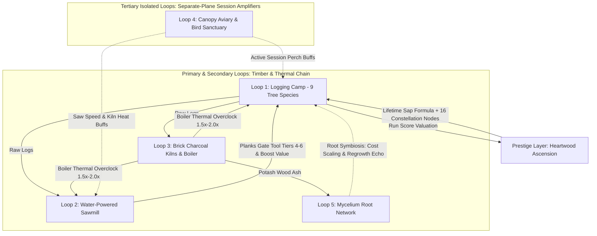

# Treecremental — Master Architecture, UI Mockups & Unabridged Upgrade Specification (v0.4)

> [!NOTE]
> **Project Status:** Planning Stage Only (Development Paused).
> **Workspace Path:** `C:\Users\MrSeb\GodotProjects\treecremental-game`
> **Target Engine:** Godot Engine 4.7.2 (`gl_compatibility` renderer, 2D pixel-art, 640x360 integer scaling).
> **Session Philosophy:** Pure active/semi-idle continuous session (~3.0 hours main campaign, ~4.0 hours 100% completion). **Zero offline progression mechanics.**

---

## 1. Executive Summary of v0.4 Architecture & Design Refinements

| Design Pillar | v0.4 Specification | Engineering & Design Rationale |
|---|---|---|
| **Camera & Spatial Layout** | **Oblique 3/4 Top-Down Clearing + Perimeter HUD** | Modeled on the user's reference layout (`reference_camera_and_hud_layout.jpg` — strictly for camera angle and HUD placement, **not** art style). The forest clearing fills 100% of the `640x360` viewport (`y_sort_enabled = true`) with a central campfire hub, radial tree clusters, roaming lumberjacks, floating `+LOGS` popups, and a minimalist perimeter HUD with toggleable modal overlays. |
| **Editable UI Groundwork** | **Modular Godot `.tscn` Control Wireframes** | During future development, the AI will not build heavy, rigid UIs from scratch. Instead, it will deliver clean, human-editable Godot `.tscn` mockup scenes (`MarginContainer`, `VBoxContainer`, `HBoxContainer`, `PanelContainer`, `%UniqueNodeNames`) so you can visually rearrange, resize, and skin the UI directly inside the Godot 2D Editor. |
| **Session Model (Zero Offline)** | **100% Active / In-Session Play** | Because the game is a tight 3-to-4-hour experience, all offline progression (`offline_step`, away-from-keyboard catchup, and offline bird buffs) has been eliminated. Every upgrade rewards active session play. |
| **Loop Architecture** | **5 Loops + Heartwood Prestige** | **Loop 1:** Logging Camp (Primary). **Loop 2:** Water-Powered Sawmill (Secondary A). **Loop 3:** Brick Charcoal Kilns & Boiler (Secondary B). **Loop 4:** Canopy Aviary (Tertiary Isolated A). **Loop 5:** Mycelium Root Network (Tertiary Isolated B — replaces the derivative slot-machine / generic bonsai concepts). |
| **Unabridged Upgrade Catalog** | **87 Upgrade Tracks (552 Levels)** | Every single upgrade in the game is itemized below with its canonical ID, max level, currency, cost scaling formula, and exact per-level mechanical effect. No summaries or placeholders. |
| **Duration & Purchase Pacing** | **~2.90h Campaign / ~4.0h 100%** | Purchasing 552 upgrade levels across 180 minutes yields an average cadence of ~3.0 meaningful upgrade purchases per minute (~1 every 15–20s during Climb phases, ~1 every 45–60s during Plateau phases). |
| **Repository Navigation** | **CCGS File-Backed Handoff System** | Built on the *Claude-Code-Game-Studios* foundation (`CLAUDE.md`, `project.yaml`, `docs/NAVIGATION.md`, `production/session-state/active.md`, `design/registry/entities.yaml`, and `.claude/rules/`). |
| **Code & Doc Hygiene** | **Strict ASCII, Zero AI Artifacts** | Emojis, decorative Unicode symbols, and conversational AI comments are prohibited across all scripts, data files, and documentation. |

---

## 2. Camera Reference, Interface Visuals & Editable Godot UI Groundwork

> [!IMPORTANT]
> **Reference Image Usage Rule:** The first slide below (`reference_camera_and_hud_layout.jpg`) is used **strictly as the reference for the 3/4 top-down camera angle, central forest clearing composition, roaming worker behavior, and minimalist perimeter HUD placement**—**NOT** for art style. Our in-game art style follows our crisp `640x360` Aseprite pixel-art direction shown in the subsequent mockups.

````carousel

<!-- slide -->

<!-- slide -->

<!-- slide -->

<!-- slide -->

````

### 2.1 3/4 Top-Down Clearing & Minimalist Perimeter HUD Layout (640x360 Base)

Unlike a split-screen layout with a permanently docked side panel, the primary gameplay viewport is an **oblique 3/4 top-down forest arena** occupying 100% of the `640x360` screen, framed by a dense treeline border and a lightweight perimeter HUD:

```text
+----------------------------------------------------------------------------------+
| (O) 10,277,711              LOGGING CAMP - ACT I              [ACHIEVEMENTS] [=] |
|     181.9K/S             [=========>          ] 48%                              |
| [ UPGRADES        ]                                                              |
| [ SAWMILL & KILNS ]       /\  /\                         / \   / \               |
| [ AVIARY & ROOTS  ]      /  \/  \   +25 LOGS            |   | |   |              |
| [ PRESTIGE        ]      |  ||  |   [====  ]            \ /   \ /               |
|                          [W][W]       /\                  |     |                |
|                                      /  \    (Campfire)   [W] [W]  +50 LOGS      |
|       /~~~\  /~~~\                   |  |      [W]  (*)    Birch Grove           |
|      (     )(     )                  [W]              [W]                        |
|       \   /  \   /                Pine Stand                                     |
|        | |    | |                                         /~~~\                  |
|      +50 LOGS [W][W]                                     (     ) [===   ]        |
|        Oak Stand                 /\  /\                   \   /  +25 LOGS        |
|                                 /  \/  \                   | |   [W][W]          |
|                                 |  ||  |                                         |
|                                 /\ /\ /\ /\ /\ /\                                |
|                            4.8M / SEC LOGGING RATE                               |
|                         /\ /\ /\ /\ /\ /\ /\ /\ /\ /\                            |
+----------------------------------------------------------------------------------+
```

1. **Full-Viewport 3/4 Top-Down Clearing (`Node2D` World with `y_sort_enabled = true`)**:
   - **Central Campfire & Spawn Hub**: Hired lumberjacks spawn around the central campfire clearing and autonomously pathfind outward along dirt trails to unlocked tree groves.
   - **Radial Tree Groves**: Each unlocked tree species in the current Act spawns in distinct spatial clusters around the clearing (e.g., *Pine Stand* to the north-west/center, *Birch Grove* to the east, *Oak Stand* to the south-west), encircled by a dense outer forest boundary.
   - **World-Space Feedback**: Active trees display compact overhead green health/chop-progress bars (`TextureProgressBar`), while each axe/saw strike spawns a rising pixel-art floating text label (`+25 LOGS`, `+50 LOGS`) with slight horizontal jitter.
2. **Minimalist Perimeter HUD (`CanvasLayer` Overlay)**:
   - **Top-Left Cluster**: Primary resource icon + total count (`10,277,711`), sub-label showing secondary/passive rate (`181.9K/S`), and vertically stacked quick-toggle buttons (`[UPGRADES]`, `[SAWMILL & KILNS]`, `[AVIARY & ROOTS]`, `[PRESTIGE]`).
   - **Top-Center Header**: Zone title (`LOGGING CAMP`), current Act/Stage subtitle (`ACT I - TEMPERATE WOODS`), and a compact Breakthrough Gate progress bar.
   - **Top-Right Cluster**: `[ACHIEVEMENTS]` button and `[SETTINGS]` button (`[=]`).
   - **Bottom-Center Readout**: Large, high-contrast live throughput counter (`4.8M / SEC` over `LOGGING RATE`) centered above the bottom treeline.
3. **Toggleable Overlay Modals (Closed by Default)**:
   - Clicking `[UPGRADES]`, `[SAWMILL & KILNS]`, `[AVIARY & ROOTS]`, `[PRESTIGE]`, `[ACHIEVEMENTS]`, or `[SETTINGS]` opens a centered, toggleable modal window (`mockup_subloops_panel.jpg`, `mockup_prestige_tree.jpg`, `mockup_settings_i18n.jpg`) over the live clearing without leaving the main scene.

---

### 2.2 Editable Godot `.tscn` UI Groundwork Specification (Division of Labor)

When the project transitions from planning into development, **the AI will not build over-engineered, rigidly styled UIs**. Instead, the AI will lay down a clean, **human-editable Godot `.tscn` UI groundwork** so you can open the scenes in the Godot 2D Editor and freely move, resize, restyle, and skin every element yourself.

```text
MainHUD (CanvasLayer) [scenes/ui/hud_main.tscn]
+-- PerimeterHUD (MarginContainer - Full Rect, mouse_filter = IGNORE)
|   +-- TopBar (HBoxContainer)
|   |   +-- TopLeftCluster (VBoxContainer)
|   |   |   +-- CurrencyBox (HBoxContainer) -> %PrimaryIcon, %PrimaryAmountLabel, %PassiveRateLabel
|   |   |   +-- NavButtons (VBoxContainer)  -> %BtnUpgrades, %BtnSubLoops, %BtnTertiary, %BtnPrestige
|   |   +-- TopCenterHeader (VBoxContainer - SizeFlags: Expand Fill, Align Center)
|   |   |   +-- %ZoneTitleLabel ("KEY_HUD_LOGGING_CAMP")
|   |   |   +-- %ActSubtitleLabel ("KEY_ACT_I_SUBTITLE")
|   |   |   +-- %BreakthroughProgressBar (ProgressBar)
|   |   +-- TopRightCluster (HBoxContainer) -> %BtnAchievements, %BtnSettings
|   +-- BottomCenterFooter (VBoxContainer - Anchor: Bottom Wide, Align Center)
|       +-- %LoggingRateValueLabel ("4.8M / SEC")
|       +-- %LoggingRateTitleLabel ("KEY_HUD_LOGGING_RATE")
+-- ModalLayer (Control - Full Rect, mouse_filter = IGNORE)
    +-- %DimmerBackdrop (ColorRect - visible = false)
    +-- %UpgradesModal (PanelContainer - visible = false, instance of scenes/ui/modals/modal_upgrades.tscn)
    +-- %SubLoopsModal (PanelContainer - visible = false, instance of scenes/ui/modals/modal_subloops.tscn)
    +-- %PrestigeModal (PanelContainer - visible = false, instance of scenes/ui/modals/modal_prestige.tscn)
    +-- %AchievementsModal (PanelContainer - visible = false, instance of scenes/ui/modals/modal_achievements.tscn)
    +-- %SettingsModal (PanelContainer - visible = false, instance of scenes/ui/modals/modal_settings.tscn)
```

#### Rules Governing the Editable Godot UI Groundwork
1. **Standard Godot `Control` Containers Only**: Every UI mockup scene will be built strictly out of native `MarginContainer`, `VBoxContainer`, `HBoxContainer`, `GridContainer`, `ScrollContainer`, `TabContainer`, and `PanelContainer` nodes—never hardcoded pixel coordinates inside scripts.
2. **Decoupled `%UniqueNodeNames` Binding**: Scripts will reference UI controls exclusively via scene-unique names (`%PrimaryAmountLabel`, `%LoggingRateValueLabel`, `%BtnUpgrades`). This allows you to drag nodes into different containers or rearrange layouts in the Godot Editor without breaking a single line of GDScript.
3. **Single Shared Theme Resource (`assets/ui/theme_default.tres`)**: All colors, 9-slice `StyleBoxTexture` boxes, and pixel fonts will live in one Godot `Theme` resource attached to the root `Control` node, allowing you to restyle the entire game UI in one place.
4. **Reusable Upgrade Row Prefab (`scenes/ui/components/upgrade_row_template.tscn`)**: A single clean `.tscn` card template (`%Icon`, `%TitleLabel`, `%LevelPips`, `%EffectLabel`, `%BuyButton`) that you can visually style once in the Godot Editor and have automatically populated by the `.tres` upgrade data.

---

## 3. Gameplay Loops & Replacement of the Derivative Third Loop



### Why the Mycelium Root Network Replaces the Previous Third Loop
- **Problem with the previous design:** The *Resin Wheel* was a direct reskin of *Gambler's Table*'s slot machine, and a generic *Bonsai watering timer* adds repetitive chore friction.
- **The Mycelium Root Network (`mycelium_network`) Solution:**
  - Grounded in real forest ecology (*"the Wood Wide Web"*), underground fungal hyphae connect the root systems of all 9 tree species on a separate subterranean map layer.
  - Felling trees above ground shakes loose **Spore Clusters** (`spores`), while burning logs in the Charcoal Kilns produces **Wood Ash** (`ash`) that acts as alkaline soil fertilizer.
  - Inoculating root nodes with symbiotic fungi (*Chanterelle*, *Bioluminescent Mycena*, *Oyster Saprophyte*, *Black Truffle*, *Mother-Tree Nexus*) alters structural rules of the forest—lowering worker cost scaling exponents, echoing a percentage of harvest from one tree species into the next, and pulsing periodic progress into the Breakthrough Gate.
  - Like the **Canopy Aviary**, Mycelium upgrades operate on an isolated plane and can be permanently bonded via the Heartwood Constellation so they never reset on Ascension.

---

## 4. Complete, Unabridged, Itemized Upgrade Catalog (All 87 Tracks / 542 Levels)

Every upgrade in *Treecremental* is specified below. Nothing is summarized.

### 4.1 Tree Species Progression & Unlock Table (9 Species)

| Tier | Species ID | Display Name | Act | Base Chop Time ($t_i$) | Unlock Cost (Paid in Tier $i-1$ Logs) | Sap Score Weight ($V_i$) |
|---|---|---|---:|---:|---:|---:|
| **0** | `pine` | Pine | Act I | $2.00\text{ s}$ | $0$ (Starter Tree) | $1.00$ |
| **1** | `birch` | Birch | Act I | $3.10\text{ s}$ | $150$ `logs_pine` | $1.90$ |
| **2** | `oak` | Oak | Act I | $4.81\text{ s}$ | $330$ `logs_birch` | $3.61$ |
| **3** | `sakura` | Sakura | Act II | $7.45\text{ s}$ | $726$ `logs_oak` | $6.86$ |
| **4** | `canadian_maple` | Canadian Maple | Act II | $11.54\text{ s}$ | $1,597$ `logs_sakura` | $13.03$ |
| **5** | `fir` | Fir | Act II | $17.89\text{ s}$ | $3,514$ `logs_canadian_maple` | $24.76$ |
| **6** | `baobab` | Baobab | Act III | $27.73\text{ s}$ | $7,730$ `logs_fir` | $47.05$ |
| **7** | `socotra_dragon_tree` | Socotra Dragon Tree | Act III | $42.98\text{ s}$ | $17,007$ `logs_baobab` | $89.39$ |
| **8** | `giant_sequoia` | Giant Sequoia | Act III | $66.62\text{ s}$ | $37,415$ `logs_socotra_dragon_tree` | $169.84$ |

---

### 4.2 Loop 1: Logging Camp Upgrades (30 Upgrade Tracks / 243 Levels)

#### A. Per-Species Lumberjack Crew Hiring (9 Tracks — 1 per Species)
- **Act Caps:** Capped at **30 workers** in Act I, **50 workers** in Act II, and **70 workers** in Act III (expandable up to 85 via `sap_guild_headquarters`).
- **Crew Milestones:** Reaching **10**, **25**, and **50** workers on a species grants a multiplicative $\times 1.50$ output boost at each threshold ($\times 1.50^3 = \times 3.375$ at 50 workers; expandable to $\times 1.70^3 = \times 4.913$ via `log_highland_crampons`).
- **Cost Formula:** $C(n) = \lfloor 10 \cdot r^n \rfloor$ where base growth $r = 1.150$ (reducible down to $1.130$ via `myc_phosphorus_exchange`), paid in that species' own logs.

| Upgrade ID | Name | Target Species | Act Caps (I / II / III) | Cost Formula (Level $n$) | Effect per Level & Milestone Thresholds |
|---|---|---|---|---|---|
| `hire_pine` | Pine Lumberjack Crew | Pine | 30 / 50 / 70 | $10 \cdot 1.15^n$ `logs_pine` | $+1$ Pine worker ($+0.500\text{ base logs/s}$); $\times 1.5$ at 10, 25, 50 workers. |
| `hire_birch` | Birch Lumberjack Crew | Birch | 30 / 50 / 70 | $10 \cdot 1.15^n$ `logs_birch` | $+1$ Birch worker ($+0.323\text{ base logs/s}$); $\times 1.5$ at 10, 25, 50 workers. |
| `hire_oak` | Oak Lumberjack Crew | Oak | 30 / 50 / 70 | $10 \cdot 1.15^n$ `logs_oak` | $+1$ Oak worker ($+0.208\text{ base logs/s}$); $\times 1.5$ at 10, 25, 50 workers. |
| `hire_sakura` | Sakura Lumberjack Crew | Sakura | — / 50 / 70 | $10 \cdot 1.15^n$ `logs_sakura` | $+1$ Sakura worker ($+0.134\text{ base logs/s}$); $\times 1.5$ at 10, 25, 50 workers. |
| `hire_canadian_maple` | Maple Lumberjack Crew | Canadian Maple | — / 50 / 70 | $10 \cdot 1.15^n$ `logs_canadian_maple` | $+1$ Maple worker ($+0.087\text{ base logs/s}$); $\times 1.5$ at 10, 25, 50 workers. |
| `hire_fir` | Fir Lumberjack Crew | Fir | — / 50 / 70 | $10 \cdot 1.15^n$ `logs_fir` | $+1$ Fir worker ($+0.056\text{ base logs/s}$); $\times 1.5$ at 10, 25, 50 workers. |
| `hire_baobab` | Baobab Lumberjack Crew | Baobab | — / — / 70 | $10 \cdot 1.15^n$ `logs_baobab` | $+1$ Baobab worker ($+0.036\text{ base logs/s}$); $\times 1.5$ at 10, 25, 50 workers. |
| `hire_socotra_dragon_tree` | Dragon Tree Crew | Socotra Dragon Tree | — / — / 70 | $10 \cdot 1.15^n$ `logs_socotra_dragon_tree` | $+1$ Dragon worker ($+0.023\text{ base logs/s}$); $\times 1.5$ at 10, 25, 50 workers. |
| `hire_giant_sequoia` | Sequoia Titan Crew | Giant Sequoia | — / — / 70 | $10 \cdot 1.15^n$ `logs_giant_sequoia` | $+1$ Sequoia worker ($+0.015\text{ base logs/s}$); $\times 1.5$ at 10, 25, 50 workers. |

#### B. Per-Species Felling Tool Tiers (9 Tracks × 6 Named Tiers = 54 Levels)
- **Act Caps:** Capped at **Lv. 3** in Act I, **Lv. 5** in Act II, and **Lv. 6** in Act III.
- **Tier Names & Exact Costs (identical structure per species $i$, paid in `logs_i` plus `planks_i` for Tiers 4–6):**
  - **Lv. 1 (Flint Hatchet):** Cost $120$ `logs_i` $\rightarrow \times 2.0$ harvest rate.
  - **Lv. 2 (Wrought Iron Axe):** Cost $1,080$ `logs_i` $\rightarrow \times 4.0$ cumulative harvest rate.
  - **Lv. 3 (Tempered Steel Broadaxe — Act I Cap):** Cost $9,720$ `logs_i` $\rightarrow \times 8.0$ cumulative harvest rate.
  - **Lv. 4 (Two-Man Crosscut Saw):** Cost $87,480$ `logs_i` + $250$ `planks_i` $\rightarrow \times 16.0$ cumulative harvest rate.
  - **Lv. 5 (Steam-Piston Bucking Saw — Act II Cap):** Cost $787,320$ `logs_i` + $1,500$ `planks_i` $\rightarrow \times 32.0$ cumulative harvest rate.
  - **Lv. 6 (Heartwood Resonance Blade — Act III Cap):** Cost $7,085,880$ `logs_i` + $9,000$ `planks_i` $\rightarrow \times 64.0$ cumulative harvest rate (up to $\times 216.0$ with `sap_crucible_steel`).

| Upgrade ID | Name | Target Species | Max Lv (Act I / II / III) | Cost Formula (Level $k \in \{0..5\}$) | Effect per Level |
|---|---|---|---|---|---|
| `tool_pine` | Pine Felling Tools | Pine | 3 / 5 / 6 | $120 \cdot 9^k$ `logs_pine` (+ Planks $k \ge 3$) | Multiplies Pine chop rate by $\times 2.0^k$ ($\times 64$ at Lv. 6). |
| `tool_birch` | Birch Felling Tools | Birch | 3 / 5 / 6 | $120 \cdot 9^k$ `logs_birch` (+ Planks $k \ge 3$) | Multiplies Birch chop rate by $\times 2.0^k$ ($\times 64$ at Lv. 6). |
| `tool_oak` | Oak Felling Tools | Oak | 3 / 5 / 6 | $120 \cdot 9^k$ `logs_oak` (+ Planks $k \ge 3$) | Multiplies Oak chop rate by $\times 2.0^k$ ($\times 64$ at Lv. 6). |
| `tool_sakura` | Sakura Felling Tools | Sakura | — / 5 / 6 | $120 \cdot 9^k$ `logs_sakura` (+ Planks $k \ge 3$) | Multiplies Sakura chop rate by $\times 2.0^k$ ($\times 64$ at Lv. 6). |
| `tool_canadian_maple` | Maple Felling Tools | Canadian Maple | — / 5 / 6 | $120 \cdot 9^k$ `logs_canadian_maple` (+ Planks $k \ge 3$) | Multiplies Maple chop rate by $\times 2.0^k$ ($\times 64$ at Lv. 6). |
| `tool_fir` | Fir Felling Tools | Fir | — / 5 / 6 | $120 \cdot 9^k$ `logs_fir` (+ Planks $k \ge 3$) | Multiplies Fir chop rate by $\times 2.0^k$ ($\times 64$ at Lv. 6). |
| `tool_baobab` | Baobab Felling Tools | Baobab | — / — / 6 | $120 \cdot 9^k$ `logs_baobab` (+ Planks $k \ge 3$) | Multiplies Baobab chop rate by $\times 2.0^k$ ($\times 64$ at Lv. 6). |
| `tool_socotra_dragon_tree` | Dragon Felling Tools | Socotra Dragon Tree | — / — / 6 | $120 \cdot 9^k$ `logs_socotra_dragon_tree` (+ Planks $k \ge 3$) | Multiplies Dragon chop rate by $\times 2.0^k$ ($\times 64$ at Lv. 6). |
| `tool_giant_sequoia` | Sequoia Felling Tools | Giant Sequoia | — / — / 6 | $120 \cdot 9^k$ `logs_giant_sequoia` (+ Planks $k \ge 3$) | Multiplies Sequoia chop rate by $\times 2.0^k$ ($\times 64$ at Lv. 6). |

#### C. Global Logging Camp Upgrades (12 Tracks = 60 Levels)

| # | Upgrade ID | Name | Max Lv | Unlock Act | Cost Formula (Level $L \in \{0..4\}$) | Exact Mechanical Effect |
|---:|---|---|---:|---|---|---|
| 1 | `log_whetstone_bench` | Grindstone & Whetstone Bench | 5 | Act I | $50 \cdot 2.5^L$ `logs_pine` | $+8\%$ global chop speed per level ($+40\%$ at Lv. 5). |
| 2 | `log_hickory_hafts` | Seasoned Hickory Hafts | 5 | Act I | $80 \cdot 2.6^L$ `logs_birch` | $+10\%$ critical strike chance per level (critical swings yield $2.0\times$ logs; $50\%$ crit chance at Lv. 5). |
| 3 | `log_felling_wedges` | Iron Felling Wedges | 5 | Act I | $120 \cdot 2.8^L$ `logs_oak` | Reduces tree fall-and-regrowth transition delay by $-0.15\text{ s}$ per level (from $1.00\text{ s}$ down to $0.25\text{ s}$). |
| 4 | `log_skid_road` | Greased Corduroy Skid Road | 5 | Act I | $40 \cdot 2.4^L$ `planks_pine` | $+12\%$ log yield for all Act I species (Pine, Birch, Oak) per level ($+60\%$ at Lv. 5). |
| 5 | `log_oxen_team` | Draft Oxen Hauling Teams | 5 | Act I | $75 \cdot 2.6^L$ `planks_birch` | Every 10th felled tree drops a bonus haul equal to $+1.0 \cdot L$ extra logs ($+5$ bonus logs every 10th tree at Lv. 5). |
| 6 | `log_cant_hooks` | Steel Peaveys & Cant Hooks | 5 | Act I | $110 \cdot 2.7^L$ `planks_oak` | $+10\%$ global log harvest rate across all species per level ($+50\%$ at Lv. 5). |
| 7 | `log_silk_cordage` | Braided Rigging Cordage | 5 | Act II | $200 \cdot 2.8^L$ `planks_sakura` | $+15\%$ log yield for all Act II species (Sakura, Maple, Fir) per level ($+75\%$ at Lv. 5). |
| 8 | `log_sap_lubrication` | Maple Sap Blade Coolant | 5 | Act II | $350 \cdot 2.9^L$ `planks_canadian_maple` | Reduces all Felling Tool (`tool_<species>`) log and plank costs by $-6\%$ per level ($-30\%$ at Lv. 5). |
| 9 | `log_highland_crampons` | Spiked Climbing Spurs | 5 | Act II | $600 \cdot 3.0^L$ `planks_fir` | Increases the per-threshold worker milestone multiplier from $\times 1.50$ to $\times (1.50 + 0.04 \cdot L)$ ($\times 1.70$ per milestone at Lv. 5). |
| 10 | `log_block_and_tackle` | Heavy Block-and-Tackle Cranes | 5 | Act III | $1,200 \cdot 3.1^L$ `planks_baobab` | $+20\%$ log yield for all Act III species (Baobab, Dragon Tree, Sequoia) per level ($+100\%$ at Lv. 5). |
| 11 | `log_crimson_varnish` | Dragon-Resin Temper Coating | 5 | Act III | $2,500 \cdot 3.2^L$ `planks_socotra_dragon_tree` | Increases critical strike log multiplier from $2.0\times$ to $(2.0 + 0.2 \cdot L)\times$ ($3.0\times$ logs per crit at Lv. 5). |
| 12 | `log_skyline_yarder` | Steam Skyline Cable Yarder | 5 | Act III | $5,000 \cdot 3.4^L$ `planks_giant_sequoia` | $+5\%$ global log output and $+5\%$ Breakthrough Gate progress credit per level ($+25\%$ both at Lv. 5). |

---

### 4.3 Loop 2: Water-Powered Sawmill Upgrades (17 Upgrade Tracks / 129 Levels)

#### A. Per-Species Sawmill Carriages (9 Tracks — 1 per Species)
- **Act Caps:** Capped at **Lv. 4** in Act I, **Lv. 7** in Act II, and **Lv. 10** in Act III.
- **Cost Formula:** $C(L) = \lfloor 200 \cdot 3.2^L \rfloor$ paid in `logs_<species>`.
- **Mechanical Effect:** Each level adds $+20\%$ base harvest yield to `<species>` (up to $+30\%$ per level with `mill_flywheel_governor`) and adds $+1$ Miller slot capable of sawing $4$ `logs_<species>` into $1$ `planks_<species>` every $2.0\text{ s}$.

| Upgrade ID | Name | Target Species | Act Caps (I / II / III) | Cost Formula (Level $L$) | Effect per Level |
|---|---|---|---|---|---|
| `mill_pine` | Pine Sawmill Carriage | Pine | 4 / 7 / 10 | $200 \cdot 3.2^L$ `logs_pine` | $+20\%$ Pine log yield (+$30\%$ w/ governor) & $+1$ Pine plank miller slot. |
| `mill_birch` | Birch Sawmill Carriage | Birch | 4 / 7 / 10 | $200 \cdot 3.2^L$ `logs_birch` | $+20\%$ Birch log yield & $+1$ Birch plank miller slot. |
| `mill_oak` | Oak Sawmill Carriage | Oak | 4 / 7 / 10 | $200 \cdot 3.2^L$ `logs_oak` | $+20\%$ Oak log yield & $+1$ Oak plank miller slot. |
| `mill_sakura` | Sakura Sawmill Carriage | Sakura | — / 7 / 10 | $200 \cdot 3.2^L$ `logs_sakura` | $+20\%$ Sakura log yield & $+1$ Sakura plank miller slot. |
| `mill_canadian_maple` | Maple Sawmill Carriage | Canadian Maple | — / 7 / 10 | $200 \cdot 3.2^L$ `logs_canadian_maple` | $+20\%$ Maple log yield & $+1$ Maple plank miller slot. |
| `mill_fir` | Fir Sawmill Carriage | Fir | — / 7 / 10 | $200 \cdot 3.2^L$ `logs_fir` | $+20\%$ Fir log yield & $+1$ Fir plank miller slot. |
| `mill_baobab` | Baobab Sawmill Carriage | Baobab | — / — / 10 | $200 \cdot 3.2^L$ `logs_baobab` | $+20\%$ Baobab log yield & $+1$ Baobab plank miller slot. |
| `mill_socotra_dragon_tree` | Dragon Sawmill Carriage | Socotra Dragon Tree | — / — / 10 | $200 \cdot 3.2^L$ `logs_socotra_dragon_tree` | $+20\%$ Dragon log yield & $+1$ Dragon plank miller slot. |
| `mill_giant_sequoia` | Sequoia Sawmill Carriage | Giant Sequoia | — / — / 10 | $200 \cdot 3.2^L$ `logs_giant_sequoia` | $+20\%$ Sequoia log yield & $+1$ Sequoia plank miller slot. |

#### B. Global Sawmill Engineering Upgrades (8 Tracks = 39 Levels)

| # | Upgrade ID | Name | Max Lv | Unlock Act | Cost Formula (Level $L$) | Exact Mechanical Effect |
|---:|---|---|---:|---|---|---|
| 1 | `mill_undershot_wheel` | Undershot Millwheel Paddles | 5 | Act I | $30 \cdot 2.4^L$ `planks_pine` | $+12\%$ plank sawing cycle speed across all sawmills per level ($+60\%$ at Lv. 5). |
| 2 | `mill_kerf_thinning` | Thin-Kerf Band Blades | 4 | Act I | $60 \cdot 3.0^L$ `planks_birch` | Reduces log input required per plank by $-0.25$ logs per level (from $4.0$ logs down to $3.0$ logs per plank at Lv. 4). |
| 3 | `mill_roller_conveyor` | Iron-Roller Outfeed Table | 5 | Act I | $100 \cdot 2.6^L$ `planks_oak` | $+10\%$ chance per level for a saw cut to yield $2$ planks instead of $1$ ($50\%$ double-plank chance at Lv. 5). |
| 4 | `mill_gang_saw` | Multi-Blade Gang Headsaws | 5 | Act II | $180 \cdot 2.8^L$ `planks_sakura` | Each assigned miller processes $+0.20$ additional cuts per cycle per level ($+1.0$ extra cut per cycle at Lv. 5). |
| 5 | `mill_kiln_drying_rack` | Heated Plank Seasoning Racks | 5 | Act II | $320 \cdot 2.9^L$ `planks_canadian_maple` + $150 \cdot 2.5^L$ `charcoal` | Increases the Sap score weight ($V_i$) of all species by $+4\%$ per level ($+20\%$ at Lv. 5). |
| 6 | `mill_flywheel_governor` | Cast-Iron Flywheel Governor | 5 | Act II | $550 \cdot 3.0^L$ `planks_fir` | Increases the per-level yield bonus of all `mill_<species>` carriages from $+20\%$ to $+(20 + 2 \cdot L)\%$ ($+30\%$ per level at Lv. 5). |
| 7 | `mill_hydraulic_carriage` | High-Pressure Log Carriage | 5 | Act III | $1,100 \cdot 3.1^L$ `planks_baobab` | $+20\%$ sawing speed and $+10\%$ plank yield per level for all Act III species. |
| 8 | `mill_sawdust_briquetter` | Sawdust Compression Press | 5 | Act III | $2,200 \cdot 3.2^L$ `planks_socotra_dragon_tree` | Every 10 planks milled across the camp automatically generates $+1.0 \cdot L$ free `charcoal` without burning logs. |

---

### 4.4 Loop 3: Brick Charcoal Kilns & Boiler Furnace Upgrades (8 Tracks = 38 Levels)

- **Base Kiln & Boiler Rules:** A kiln batch carbonizes $10$ logs in $5.0\text{ s}$ to produce $2$ `charcoal` and $1$ `ash` (higher-tier woods yield $+20\%$ more per tier). Feeding `charcoal` into the Steam Boiler fills the **Thermal Overclock Gauge**, granting a baseline $\times 1.50$ speed multiplier to all Sawmills and Logging Crews while lit.

| # | Upgrade ID | Name | Max Lv | Unlock Act | Cost Formula (Level $L$) | Exact Mechanical Effect |
|---:|---|---|---:|---|---|---|
| 1 | `kiln_clay_lining` | Firebrick & Clay Sealant | 5 | Act I | $150 \cdot 2.3^L$ `logs_pine` + $20 \cdot 2.2^L$ `planks_pine` | $+15\%$ `charcoal` output per kiln batch per level ($+75\%$ at Lv. 5). |
| 2 | `kiln_draft_vents` | Adjustable Basal Draft Vents | 5 | Act I | $40 \cdot 2.5^L$ `charcoal` | Reduces kiln carbonization cycle time by $-8\%$ per level (from $5.0\text{ s}$ down to $3.0\text{ s}$ at Lv. 5). |
| 3 | `kiln_boiler_manifold` | Copper Steam-Boiler Manifold | 5 | Act I | $75 \cdot 2.6^L$ `charcoal` + $60 \cdot 2.5^L$ `planks_oak` | Increases the active Thermal Overclock speed multiplier by $+0.10\times$ per level (from $\times 1.50$ up to $\times 2.00$ at Lv. 5). |
| 4 | `kiln_hardwood_retort` | Sealed Iron Retort Chamber | 5 | Act II | $200 \cdot 2.7^L$ `charcoal` + $120 \cdot 2.6^L$ `planks_sakura` | Carbonizing Act II or Act III logs yields $+25\%$ bonus `charcoal` and $+25\%$ bonus `ash` per level. |
| 5 | `kiln_auto_stoker` | Chain-Grate Mechanical Stoker | 3 | Act II | $350 \cdot 3.5^L$ `charcoal` | Lv. 1: Auto-feeds charcoal into the boiler when heat drops below $90\%$; Lv. 2: $-15\%$ fuel burn rate; Lv. 3: $-30\%$ fuel burn rate. |
| 6 | `kiln_ash_sifter` | Rotary Potash Sifter | 5 | Act II | $500 \cdot 2.8^L$ `charcoal` | $+20\%$ `ash` byproduct extraction per kiln batch per level ($+100\%$ at Lv. 5). |
| 7 | `kiln_bellows_turbine` | Flue-Gas Recovery Turbine | 5 | Act III | $1,200 \cdot 3.0^L$ `charcoal` + $800 \cdot 2.8^L$ `planks_baobab` | While boiler heat is above $80\%$, all lumberjacks gain $+8\%$ chop speed per level ($+40\%$ at Lv. 5). |
| 8 | `kiln_white_charcoal` | Binchotan White-Heat Mastering | 5 | Act III | $3,000 \cdot 3.2^L$ `charcoal` | While the boiler is lit, increases the Sap score weight ($V_i$) of all harvested logs by $+6\%$ per level ($+30\%$ at Lv. 5). |

---

### 4.5 Loop 4 (Tertiary Isolated A): Canopy Aviary & Bird Sanctuary (8 Tracks = 38 Levels)

- **Base Aviary Rules:** Operates on an isolated canopy plane. `birdseed` generates passively at $0.25\text{/s}$ during active play. All 5 bird tracks and 3 sanctuary upgrades grant active in-session bonuses (**zero offline mechanics**).

| # | Upgrade ID | Name | Max Lv | Unlock Act | Cost Formula (Level / Rank $R$) | Exact Mechanical Effect |
|---:|---|---|---:|---|---|---|
| 1 | `aviary_bird_woodpecker` | Pileated Woodpecker Roost | 5 | Act I | $15 \cdot 2.2^R$ `birdseed` | $+10\%$ Global Chopping Power per rank ($+50\%$ at Rank 5). |
| 2 | `aviary_bird_waxwing` | Cedar Waxwing Roost | 5 | Act I | $30 \cdot 2.3^R$ `birdseed` | $+6\%$ Sap Score Weight on all felled trees per rank ($+30\%$ at Rank 5). |
| 3 | `aviary_bird_falcon` | Peregrine Falcon Eyrie | 5 | Act I | $60 \cdot 2.4^R$ `birdseed` | $+12\%$ Sawmill Cutting Speed per rank ($+60\%$ at Rank 5). |
| 4 | `aviary_bird_songbird` | Bluebird & Thrush Choir | 5 | Act I | $110 \cdot 2.5^R$ `birdseed` | $+8\%$ Worker Swing Tempo and $+5\%$ Critical Strike Chance per rank ($+40\%$ tempo / $+25\%$ crit at Rank 5). |
| 5 | `aviary_bird_phoenix` | Grove Phoenix Crest | 5 | Act II | $220 \cdot 2.6^R$ `birdseed` | $+15\%$ Kiln Thermal Output and $+10\%$ Breakthrough Gate fill rate per rank ($+75\%$ heat / $+50\%$ gate credit at Rank 5). |
| 6 | `aviary_seed_hopper` | Cedar Seed-Hopper Feeders | 5 | Act I | $20 \cdot 2.4^L$ `birdseed` + $25 \cdot 2.4^L$ `planks_pine` | Increases passive `birdseed` generation by $+0.15\text{/s}$ per level (from $0.25\text{/s}$ to $1.00\text{/s}$ at Lv. 5). |
| 7 | `aviary_suet_cakes` | Rendered Berry & Suet Cakes | 5 | Act I | $80 \cdot 2.5^L$ `birdseed` | Every $60\text{ s}$ of active play, triggers a **Canopy Chorus** for $10 + 2 \cdot L$ seconds that multiplies all active bird bonuses by $\times 1.50$. |
| 8 | `aviary_gilded_weathervane` | Brass Canopy Weathervane | 3 | Act II | $250 \cdot 3.0^L$ `birdseed` | Each bird species that has reached Rank 5 grants an independent $\times (1.00 + 0.05 \cdot L)$ multiplier to total camp production. |

---

### 4.6 Loop 5 (Tertiary Isolated B): Mycelium Root Network (8 Tracks = 38 Levels)

- **Base Mycelium Rules:** Operates on an isolated subterranean root plane. `spores` generate passively at $0.20\text{/s}$ during active play plus $+1$ spore per $50$ felled trees. Combine `spores` with kiln `ash` to inoculate symbiotic root nodes.

| # | Upgrade ID | Name | Max Lv | Unlock Act | Cost Formula (Level $L$) | Exact Mechanical Effect |
|---:|---|---|---:|---|---|---|
| 1 | `myc_phosphorus_exchange` | Chanterelle Phosphorus Exchange | 5 | Act I | $12 \cdot 2.2^L$ `spores` | Reduces the worker hiring exponential cost base $r$ from $1.150$ by $-0.004$ per level (down to $1.130$ at Lv. 5). |
| 2 | `myc_spore_bloom` | Bioluminescent Mycena Bloom | 5 | Act I | $18 \cdot 2.3^L$ `spores` + $20 \cdot 2.2^L$ `ash` | Increases passive `spores` generation by $+0.16\text{/s}$ per level (from $0.20\text{/s}$ to $1.00\text{/s}$ at Lv. 5). |
| 3 | `myc_saprophyte_enzymes` | Oyster Saprophyte Enzymes | 5 | Act I | $35 \cdot 2.4^L$ `spores` | $+15\%$ faster tree regrowth per level, plus a $+6\%$ chance per level ($30\%$ at Lv. 5) for a felled tree to regrow with zero delay. |
| 4 | `myc_rhizomorph_conduit` | Rhizomorph Nutrient Conduit | 5 | Act I | $65 \cdot 2.5^L$ `spores` + $50 \cdot 2.4^L$ `ash` | Echoes $4\%$ per level ($20\%$ at Lv. 5) of Species $i$'s log harvest rate as free bonus logs into Species $i+1$. |
| 5 | `myc_truffle_symbiosis` | Black Truffle Heartwood Symbiosis | 5 | Act II | $120 \cdot 2.6^L$ `spores` | Adds $+0.20$ base logs per chop to every unlocked species per level ($+1.00$ full extra log per chop at Lv. 5). |
| 6 | `myc_alkaline_mulch` | Potash & Wood-Ash Composting | 5 | Act II | $180 \cdot 2.6^L$ `spores` + $200 \cdot 2.5^L$ `ash` | Each unit of unspent `ash` boosts all Mycelium node effects by $+0.05\%$ per level (capped at $+50\%$ total boost). |
| 7 | `myc_fairy_ring_pulse` | Harmonic Fairy-Ring Pulse | 5 | Act II | $300 \cdot 2.7^L$ `spores` | Every $45\text{ s}$, a root pulse adds $+0.4\% \cdot L$ ($+2.0\%$ at Lv. 5) of the last minute's total log production directly to the Breakthrough Gate. |
| 8 | `myc_mother_tree_nexus` | The Mother-Tree Mycorrhizal Nexus | 3 | Act III | $600 \cdot 3.2^L$ `spores` + $500 \cdot 3.0^L$ `ash` | Grants $+10\%$ global log and plank output per unlocked tree species per level ($+270\%$ at 9 species and Lv. 3). |

---

### 4.7 Prestige Layer: Heartwood Ascension — The Sap Constellation (16 Tracks = 45 Levels)

- **Baseline Sap Formula:** Upon completing an Act's Breakthrough Gate, the player banks $\Delta \text{Sap} = \lfloor (\text{RunScore} / 2000)^{0.5} \rfloor$.
- **Non-Punitive Spending Rule:** The global Sap multiplier $M_{\text{sap}} = 1 + 0.60 \cdot (\text{LifetimeSap})^{0.5}$ scales with **Lifetime Earned Sap**, so spending banked Sap on Constellation nodes never reduces $M_{\text{sap}}$.

| Ring | # | Upgrade ID | Name | Max Lv | Exact Sap Cost per Level | Exact Permanent Effect |
|---|---:|---|---|---:|---|---|
| **Inner Ring** *(Act I Ascension)* | 1 | `sap_heartwood_resonance_1` | Heartwood Resonance I | 3 | `5, 10, 20` Sap *(35 total)* | $+25\%$ Global Chopping Speed per level ($+75\%$ at Lv. 3). |
| **Inner Ring** | 2 | `sap_pioneer_charter` | Pioneer's Charter | 3 | `4, 8, 16` Sap *(28 total)* | Starts each run with $+1$ extra species pre-unlocked and $+5 \cdot L$ free Pine workers. |
| **Inner Ring** | 3 | `sap_amber_distillation` | Amber Sap Distillation | 3 | `6, 12, 24` Sap *(42 total)* | $+15\%$ Sap earned from all Breakthrough Ascensions per level ($+45\%$ at Lv. 3). |
| **Inner Ring** | 4 | `sap_seasoned_joinery` | Seasoned Timber Joinery | 3 | `5, 10, 20` Sap *(35 total)* | Retains $1 \cdot L$ starting levels on all `mill_<species>` carriages after Ascension. |
| **Inner Ring** | 5 | `sap_eternal_embers` | Eternal Kiln Embers | 2 | `8, 18` Sap *(26 total)* | Lv. 1: Starts run with 100 Charcoal & $50\%$ boiler heat; Lv. 2: Boiler heat never falls below $50\%$. |
| **Inner Ring** | 6 | `sap_canopy_sanctuary_bond` | Sanctuary Homing Bond | 1 | `12` Sap *(12 total)* | Canopy Aviary ranks and Mycelium Root Network levels persist permanently across Ascensions. |
| **Middle Ring** *(Act II Ascension)* | 7 | `sap_heartwood_resonance_2` | Heartwood Resonance II | 5 | `25, 50, 85, 130, 190` Sap *(480 total)* | $+30\%$ Global Chopping Speed and $+15\%$ Sawmill Speed per level ($+150\%$ / $+75\%$ at Lv. 5). |
| **Middle Ring** | 8 | `sap_guild_headquarters` | Lumberjack Guild Hall | 3 | `40, 90, 160` Sap *(290 total)* | Raises the per-Act Worker Cap by $+5$ workers per level ($+15$ cap at Lv. 3; unlocks a 4th $\times 1.5$ milestone at 75 workers). |
| **Middle Ring** | 9 | `sap_bulk_contracting` | Automated Guild Quartermaster | 2 | `35, 75` Sap *(110 total)* | Lv. 1: Unlocks `x10` and `MAX` bulk buy buttons; Lv. 2: Unlocks toggleable auto-buyers for Workers and Sawmills. |
| **Middle Ring** | 10 | `sap_cambium_overflow` | Cambium Pressure Overflow | 4 | `30, 65, 110, 170` Sap *(375 total)* | Reduces all Tree Species unlock log requirements by $-12\%$ per level ($-48\%$ at Lv. 4). |
| **Middle Ring** | 11 | `sap_mycorrhizal_awakening` | Mycorrhizal Awakening | 3 | `45, 95, 165` Sap *(305 total)* | Increases `birdseed` and `spores` generation rates by $+33.3\%$ per level ($\times 2.00$ at Lv. 3). |
| **Middle Ring** | 12 | `sap_crucible_steel` | Damascus Crucible Metallurgy | 3 | `50, 110, 190` Sap *(350 total)* | Increases the per-tier Felling Tool multiplier from $\times 2.00$ to $\times (2.00 + 0.15 \cdot L)$ ($\times 2.45^k$ at Lv. 3). |
| **Outer Ring** *(Act III & 100%)* | 13 | `sap_titan_feller` | Titan-Feller's Creed | 3 | `150, 300, 500` Sap *(950 total)* | Multiplies log yield of Baobab, Socotra Dragon Tree, and Giant Sequoia by $\times 1.50$ per level ($\times 3.375$ at Lv. 3). |
| **Outer Ring** | 14 | `sap_golden_bough` | The Golden Bough | 3 | `200, 400, 700` Sap *(1,300 total)* | Increases the exponent of the lifetime Sap formula from $0.50$ to $0.50 + 0.02 \cdot L$ ($0.56$ at Lv. 3). |
| **Outer Ring** | 15 | `sap_ancient_harmony` | Harmony of the Ancient Grove | 3 | `180, 360, 600` Sap *(1,140 total)* | Each unlocked Achievement grants $+1.0\%$ per level ($+3.0\%$ per achievement at Lv. 3) to global production. |
| **Outer Ring** | 16 | `sap_world_tree_crown` | Crown of the World Tree | 1 | `1,000` Sap *(1,000 total)* | Doubles all Breakthrough Gate progress and unlocks the completionist Golden Sequoia visual crown. |

---

### 4.8 Total Upgrade Inventory & Playthrough Duration Budget

| Loop / Upgrade Category | Track Count | Total Purchasable Levels | Primary Currencies Spent | Average Completion Window |
|---|---:|---:|---|---|
| **Loop 1A:** Per-Species Worker Hiring | 9 | ~150 *(capped per Act)* | `logs_<species>` | Continuous across Acts I–III |
| **Loop 1B:** Per-Species Felling Tools | 9 | 54 *(9 × 6 tiers)* | `logs_<species>`, `planks_<species>` | Tiers 1–3 (Act I), 4–5 (Act II), 6 (Act III) |
| **Loop 1C:** Global Logging Camp Upgrades | 12 | 60 | `logs_<species>`, `planks_<species>` | 4 tracks per Act |
| **Loop 2A:** Per-Species Sawmill Carriages | 9 | 90 *(9 × 10 levels)* | `logs_<species>` | Lv. 1–4 (Act I), 5–7 (Act II), 8–10 (Act III) |
| **Loop 2B:** Global Sawmill Upgrades | 8 | 39 | `planks_<species>`, `charcoal` | 3 in Act I, 3 in Act II, 2 in Act III |
| **Loop 3:** Charcoal Kilns & Boiler | 8 | 38 | `charcoal`, `planks_<species>` | 3 in Act I, 3 in Act II, 2 in Act III |
| **Loop 4:** Canopy Aviary (Tertiary A) | 8 | 38 | `birdseed`, `planks_pine` | Active during Climb & Plateau phases |
| **Loop 5:** Mycelium Network (Tertiary B) | 8 | 38 | `spores`, `ash` | Active during Climb & Plateau phases |
| **Prestige:** Heartwood Sap Constellation | 16 | 45 | `sap` | Inner (38 Sap), Middle (720 Sap), Outer (Post-Finale) |
| **TOTAL** | **87 Tracks** | **552 Levels** | **All 7 Currency Families** | **~2.90h Campaign / ~4.00h 100% Run** |

#### How Upgrade Density Shapes the 3-to-4-Hour Duration
1. **Act I: The Temperate Woods (0:00 to ~0:40 — ~40 minutes)**:
   - Player unlocks Pine, Birch, and Oak; purchases ~90 worker levels, 9 tool tiers (Lv. 3 cap), 12 sawmill carriage levels (Lv. 4 cap), and the first 15 levels of Global Logging, Sawmill, Kiln, Aviary, and Mycelium upgrades (~145 total purchases, or ~3.6 purchases/min).
   - During the **16.7-minute Act I Plateau**, primary worker/tool caps are full; the player focuses on firing the Charcoal Boiler, ranking up the Woodpecker/Waxwing/Chanterelle nodes, and completing the **247,000 Oak Logs** gate.
   - Ascending to Act II banks **+38 Sap**, sufficient to buy `sap_canopy_sanctuary_bond` (12 Sap) + `sap_heartwood_resonance_1` Lv. 1–2 (15 Sap) + `sap_pioneer_charter` Lv. 1–2 (12 Sap).
2. **Act II: Blossom & Boreal (0:40 to ~1:30 — ~50 minutes)**:
   - Armed with persistent Aviary/Mycelium nodes and a $\times 4.7$ baseline Sap multiplier, the player breezes through Act I trees in <4 minutes and unlocks Sakura, Canadian Maple, and Fir.
   - ~185 upgrade levels are purchased across Act II (Tools Lv. 4–5 requiring planks, Sawmills Lv. 5–7, Mechanical Stoker, Retort Chamber, Phoenix Roost, Black Truffle Symbiosis).
   - Completing the **7.16M Fir Logs** plateau gate banks **+722 Sap** (~760 total), unlocking the Middle Ring (`sap_bulk_contracting` auto-buyers, `sap_heartwood_resonance_2`, `sap_crucible_steel`).
3. **Act III: The Ancient Grove (1:30 to ~2:54 — ~84 minutes)**:
   - Auto-buyers handle early tiers while the player focuses on Baobab, Socotra Dragon Tree, and Giant Sequoia, pushing Tools to Lv. 6, Sawmills to Lv. 10, Binchotan White-Heat Mastering, and Mother-Tree Nexus.
   - Reaching **46.2M Giant Sequoia Logs** triggers **The Great Felling** (campaign credits at **~2.90 hours**).
4. **Completionist Post-Game (2:54 to ~4:00 — ~66 minutes)**:
   - One optional post-campaign Ascension banks **2,500+ Sap** to max out the Outer Ring (`sap_titan_feller`, `sap_golden_bough`, `sap_ancient_harmony`, `sap_world_tree_crown`) and finish all ~80 achievements in a relaxed **~4.0-hour** total window.

---

## 5. Repository Navigation & Continuity System

To ensure that any human developer or AI agent can pick up the project cold at any point without losing context, the workspace at `C:\Users\MrSeb\GodotProjects\treecremental-game` implements the full *Claude-Code-Game-Studios* navigation architecture:

| File Path | Role in Project Navigation & Continuity |
|---|---|
| [`CLAUDE.md`](file:///C:/Users/MrSeb/GodotProjects/treecremental-game/CLAUDE.md) & [`AGENTS.md`](file:///C:/Users/MrSeb/GodotProjects/treecremental-game/AGENTS.md) | Master AI entrypoint. Defines the tech stack, active stage (`planning`), cold-start reading order, and non-negotiable rules (zero hardcoding, zero offline mechanics, zero emojis/AI artifacts). |
| [`docs/NAVIGATION.md`](file:///C:/Users/MrSeb/GodotProjects/treecremental-game/docs/NAVIGATION.md) | Step-by-step cold-start onboarding guide, complete directory tree with ownership boundaries, and exact CLI verification commands. |
| [`production/session-state/active.md`](file:///C:/Users/MrSeb/GodotProjects/treecremental-game/production/session-state/active.md) | File-backed session memory (`STATUS` + `<25-line CHECKPOINT` + decision log). Any returning developer or AI reads this first to see the exact state of work. |
| [`project.yaml`](file:///C:/Users/MrSeb/GodotProjects/treecremental-game/project.yaml) & [`production/stage.txt`](file:///C:/Users/MrSeb/GodotProjects/treecremental-game/production/stage.txt) | Machine-readable project configuration pinning engine version (`4.7.2`), viewport settings, paths, and the `planning` stage gate. |
| [`design/registry/entities.yaml`](file:///C:/Users/MrSeb/GodotProjects/treecremental-game/design/registry/entities.yaml) | Canonical registry of all 3 Acts, 9 tree species, 7 currency families, 6 loop IDs, and all 87 upgrade IDs. Prevents naming drift across docs and data files. |
| [`.claude/rules/`](file:///C:/Users/MrSeb/GodotProjects/treecremental-game/.claude/rules) | Path-scoped rule files (`gameplay-code.md`, `ui-code.md`, `data-files.md`, `design-docs.md`) enforcing architectural boundaries automatically. |
| [`docs/engine-reference/godot/VERSION.md`](file:///C:/Users/MrSeb/GodotProjects/treecremental-game/docs/engine-reference/godot/VERSION.md) | Pinned Godot 4.7.2 reference notes covering post-cutoff GDScript behaviors. |
