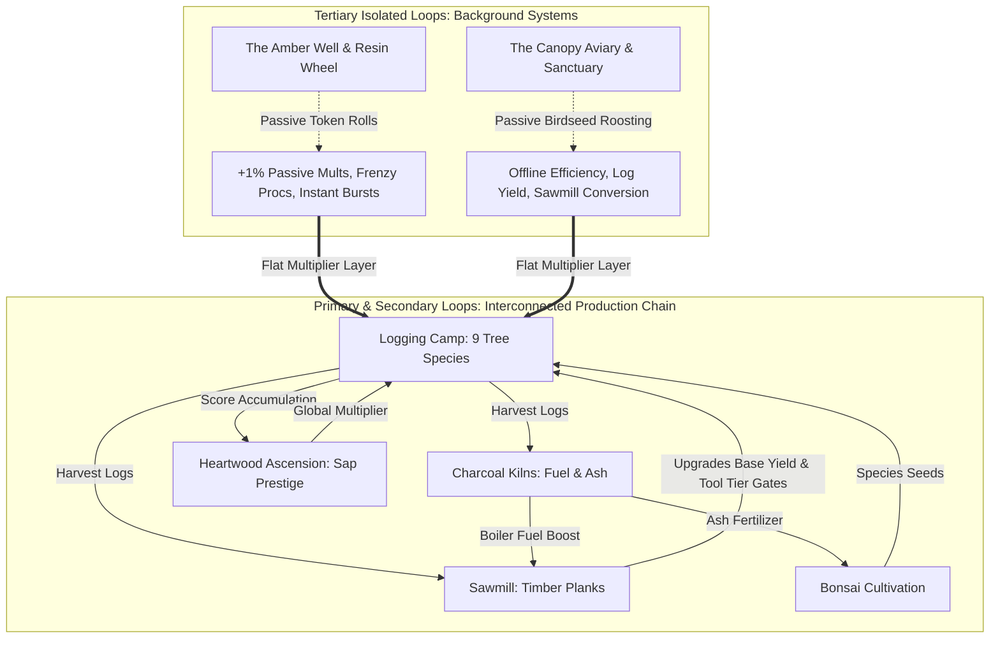

# Treecremental — Master Architecture, Systems & Math Planning Document (v0.2)

> [!NOTE]
> **Project Status:** Planning & Technical Design Stage.
> **Workspace Directory:** `C:\Users\MrSeb\GodotProjects\treecremental-game`
> **Target Engine:** Godot Engine 4.4+ (GL Compatibility renderer, 2D pixel-art).

---

## 1. Executive Summary & Design Pivot

| Design Dimension | Planned Specification | Rationale & Design Goal |
|---|---|---|
| **Roster Scope** | **9 Tree Species** (3 Acts × 3 Trees) | Scaled down from 17 to match *Minecremental* ore counts and *Gambler's Table* coin tiers. Tight, manageable pixel art scope where every tree feels distinct. |
| **Progression Model** | **Plateau-Curve Architecture** | Replaces infinite runaway exponential scaling with 3 structured phases per Act: **Climb → Cap Stabilization (Plateau) → Breakthrough Gate (Ascension)**. |
| **Target Pacing** | **~3 Hours Main / ~4 Hours 100%** | Simulator-verified: ~2.34 h for a perfect bot, **~2.90 h** for a standard player completing the campaign, and **~4.0 h** for a relaxed achievement completion run. |
| **Secondary Loops** | **Sawmill & Charcoal Kilns** | Interconnected physical processing: wood → planks (structural multipliers) and logs → charcoal (furnace heat / fuel). |
| **Tertiary Loops** | **Resin Wheel & Canopy Aviary** | **Isolated background systems** (inspired by the slot machine in *Gambler's Table*). They operate on their own plane, providing passive windfalls and multipliers without entangling crafting recipes. |
| **Architecture** | **Decoupled Event Bus + GameModules** | Zero direct node coupling. Zero hardcoded numerical values or math formulas. Everything lives in Godot `.tres` Resource files and curves. |
| **i18n & Steam** | **Native English (`en`) + Steam Mapping** | Built natively with `KEY_...` translation keys. Structured for instant drop-in of regional variants (`latam` / `es_419` and `spanish` / `es_ES`) via Steamworks API without code changes. |

---

## 2. Pacing & Progression: The Plateau-Curve Model

### 2.1 The Incremental Plateau Philosophy
Standard LLM-generated incremental models suffer from runaway exponential inflation, collapsing what should be a 3-hour journey into a 5-minute blur. Conversely, a flat grind creates stagnation.

*Treecremental* uses an **Act-based Plateau Curve**:
1. **The Climb Phase:** The player unlocks species within the Act, hires lumberjacks, upgrades tools, and builds sawmills. Income grows rapidly and player agency is high.
2. **The Plateau Phase (Cap Stabilization):** Upgrades hit the **Act Cap** (hard boundaries set by balance data). Marginal gains drop to zero; income stabilizes on a flat plateau. The player shifts focus to:
   - Engaging with **Tertiary Isolated Loops** (spinning the Amber Wheel, attracting birds to the Aviary).
   - Optimizing secondary fuel/plank conversion.
   - Chasing non-grindy Act achievements.
   - Watching the **Breakthrough Gate** fill up.
3. **The Breakthrough Jump (Heartwood Ascension):** The required run-lifetime logs for the Act's capstone tree are gathered. The player triggers a Breakthrough: the run resets, permanent **Sap** is banked, Act caps are raised, and the next Act's biome is unlocked.

```mermaid
graph LR
  subgraph Act I: Temperate Woods
    A1_Climb[Climb: Pine, Birch, Oak] --> A1_Cap[Act I Caps: 30 Workers, T3 Tools]
    A1_Cap --> A1_Plateau[Plateau Phase: Amber/Birds/Achievements]
    A1_Plateau --> A1_Gate[Breakthrough Gate: 247K Oak Logs]
  end
  subgraph Act II: Blossom & Boreal
    A2_Climb[Climb: Sakura, Maple, Fir] --> A2_Cap[Act II Caps: 50 Workers, T5 Tools]
    A2_Cap --> A2_Plateau[Plateau Phase: Secondary & Tertiary Scaling]
    A2_Plateau --> A2_Gate[Breakthrough Gate: 7.16M Fir Logs]
  end
  subgraph Act III: The Ancient Grove
    A3_Climb[Climb: Baobab, Dragon Tree, Sequoia] --> A3_Cap[Act III Caps: 70 Workers, T6 Tools]
    A3_Cap --> A3_Plateau[Plateau Phase: Final Buff Convergence]
    A3_Plateau --> A3_Finale[FINALE: The Great Felling - 46.2M Sequoia Logs]
  end

  A1_Gate -->|Heartwood Ascension: +38 Sap| A2_Climb
  A2_Gate -->|Heartwood Ascension: +721 Sap| A3_Climb
```



### 2.2 Numerical Tuning & Simulator Verification
The model was tested and verified with the custom design-time simulator (`tools/balance_sim/sim.py`):

| Pacing Metric | Perfect Bot (Lower Bound) | Human Player (~78% Efficiency) | Relaxed Player (~60% Efficiency) |
|---|---|---|---|
| **Act I Duration** | 31.6 min (18.1m climb / 13.4m plateau) | **39.6 min** (22.9m climb / 16.7m plateau) | 50.1 min (29.2m climb / 20.9m plateau) |
| **Act I Ascension** | +38 Sap | +38 Sap | +38 Sap |
| **Act II Duration** | 40.5 min (24.8m climb / 15.7m plateau) | **50.1 min** (30.8m climb / 19.4m plateau) | 62.6 min (38.4m climb / 24.2m plateau) |
| **Act II Ascension** | +721 Sap (759 total) | +722 Sap (760 total) | +722 Sap (760 total) |
| **Act III Duration** | 68.1 min (52.2m climb / 15.9m plateau) | **84.2 min** (64.5m climb / 19.7m plateau) | 105.9 min (81.0m climb / 24.9m plateau) |
| **Total Campaign Time** | **2.34 Hours** | **~2.90 Hours (~3h)** | **~3.64 Hours** |
| **100% Completion Run** | — | **~4.0 Hours** | **~4.8 Hours** |

---

## 3. Tree Species Roster (9 Species)

The roster is grouped into three distinct biomes that align with the 3 Acts:

| # | Species ID | Act / Biome | Base Chop Time | Unlock Cost (Previous Tree Logs) | Score Weight (Sap Valuation) | Visual & Silhouette Identity |
|---|---|---|---|---|---|---|
| **1** | `pine` | **Act I:** Meadow | 2.0 s | 0 (Free starter) | 1.00× | Triangular needle canopy, rugged reddish-brown trunk. |
| **2** | `birch` | **Act I:** Meadow | 3.1 s | 150 Pine Logs | 1.90× | Slender white trunk with dark lenticels, fluttering bright green leaves. |
| **3** | `oak` | **Act I:** Meadow | 4.8 s | 330 Birch Logs | 3.61× | Broad, gnarled canopy, massive trunk, acorns. Capstone of Act I. |
| **4** | `sakura` | **Act II:** Blossom Vale | 7.4 s | 726 Oak Logs | 6.86× | Spreading arching branches, vibrant pink foliage, drifting petals. |
| **5** | `canadian_maple` | **Act II:** Blossom Vale | 11.5 s | 1,597 Sakura Logs | 13.03× | Dense rounded crown, fiery crimson/orange autumn foliage. |
| **6** | `fir` | **Act II:** Boreal Slopes | 17.9 s | 3,514 Maple Logs | 24.76× | Steep conical spire, frosted deep emerald needles. Capstone of Act II. |
| **7** | `baobab` | **Act III:** Savanna | 27.7 s | 7,730 Fir Logs | 47.05× | Bulbous, colossal bottle trunk, sparse root-like crown. |
| **8** | `socotra_dragon_tree` | **Act III:** Desert Ridge | 43.0 s | 17,007 Baobab Logs | 89.39× | Flying-saucer / umbrella canopy, blood-red sap veins. |
| **9** | `giant_sequoia` | **Act III:** Ancient Grove | 66.6 s | 37,415 Dragon Logs | 169.84× | Towering mountain titan; trunk occupies double grid width. Finale tree. |

---

## 4. Sub-Loops Architecture: Core vs. Tertiary



### 4.1 Primary Loop: The Logging Camp
- Workers chop the active tree species.
- Production formula per tree:
  $$\text{rate}_i = \frac{w_i}{t_i} \cdot 2^{\text{tool}_i} \cdot M_{\text{mile}}(w_i) \cdot (1 + 0.20 \cdot L_i) \cdot E \cdot M_{\text{sap}} \cdot M_{\text{tert}}$$
- **Act Caps** strictly limit $w_i \le [30, 50, 70]$, $\text{tool}_i \le [3, 5, 6]$, and $L_i \le [4, 7, 10]$.

### 4.2 Secondary Loops: Sawmill, Kilns & Bonsai
1. **Sawmill (per species):** Workers convert `logs_i` into `planks_i`. Planks upgrade the base tree's yield and serve as a currency gate for unlocking next-tier tools.
2. **Charcoal Kilns:** Consumes excess logs to produce `charcoal` (fuel) and `ash` (by-product). Firing sawmills with charcoal boosts processing speed by 50% while fuel lasts.
3. **Bonsai Garden:** Cultivate miniaturized specimens using ash fertilizer and plank pots. Yields `seeds` that discount tree unlock costs and heirloom sap bonuses.

### 4.3 Tertiary Isolated Sub-Loops (Separate-Plane Systems)
Unlike secondary loops, tertiary loops **never require complex cross-crafting or recipe dependencies**. They operate in the background on their own timers, inspired by the slot machine in *Gambler's Table*:

#### Tertiary Loop 1: The Resin Well & Amber Wheel (`AmberWheelModule`)
- **Theme:** An ancient stone basin where amber resin slowly condenses.
- **Mechanic:** Generates 1 Amber Token every 60 seconds (up to a cap of 5). The player spends a token to pull the lever / spin the wheel:
  - **40% Amber Infusion:** Grants a permanent +1% passive harvest multiplier (soft-capped at +50%).
  - **30% Amber Frenzy:** Triggers a 60-second frenzy (+25% harvest speed).
  - **20% Resin Windfall:** Awards an instant bundle of the currently selected tree logs.
  - **10% Golden Amber:** Instantly awards +1 unspent Sap point directly to the player's bank.
- **Player Feel:** A fun, instant-gratification windfall button to press during the Plateau Phase.

#### Tertiary Loop 2: The Canopy Aviary & Bird Sanctuary (`CanopyAviaryModule`)
- **Theme:** Birdhouses and feeding perches mounted high in the forest canopy.
- **Mechanic:** Passive `birdseed` accumulates over time (1 seed every 4 seconds). Players spend seeds to permanently attract wild forest birds:
  - **Screech Owl (10 Seeds):** +15% Offline Progress Efficiency.
  - **Downy Woodpecker (25 Seeds):** +10% Base Log Yield.
  - **Cedar Waxwing (50 Seeds):** +10% Sawmill Plank Conversion.
  - **Peregrine Falcon (100 Seeds):** +15% Breakthrough Gate Progression Speed.
  - **Grove Phoenix (250 Seeds):** +25% Sap Multiplier Potency.
- **Player Feel:** A relaxing, charming collection system with clear milestones that naturally shorten the plateau without introducing complex gameplay friction.

---

## 5. Software Architecture & Zero-Hardcoded Data Layer

### 5.1 Project Layout (Godot 4, Code Root: `src/`)
```text
treecremental-game/
├── project.godot                  # Viewport 640x360, integer stretch, nearest texture filtering
├── data/                          # ZERO hardcoded values — all data resides here
│   ├── balance/
│   │   ├── balance_default.tres   # Master BalanceConfig (profile swappable)
│   │   └── curves/                # FormulaCurve resources (hire_cost, tool_cost, sawmill_cost)
│   ├── species/                   # 9 SpeciesData resources (pine.tres ... giant_sequoia.tres)
│   └── settings/                  # Notation configs, audio defaults, etc.
├── i18n/
│   ├── game_text.csv              # Native English master + es_419 and es_ES translation keys
│   └── ui_en.csv                  # Lightweight UI fallback table
├── src/
│   ├── core/                      # Engine core and autoloads
│   │   ├── event_bus.gd           # Decoupled global signal router
│   │   ├── balance.gd             # Balance singleton (discovers species & profile)
│   │   ├── game_module.gd         # Base class for all gameplay modules
│   │   ├── module_registry.gd     # Topological sorting & lifecycle manager
│   │   ├── locale_resolver.gd     # Steamworks API language mapping
│   │   ├── number_formatter.gd    # Standard / Scientific / Engineering notation
│   │   └── data/                  # Resource classes: FormulaCurve, CostBundle, SpeciesData, etc.
│   ├── features/                  # Plug-and-play GameModules
│   │   ├── economy/               # WalletModule (currencies & accounting)
│   │   └── tertiary/              # AmberWheelModule, CanopyAviaryModule
│   ├── ui/                        # Menus, HUD, settings (Display-only, listens to EventBus)
│   └── boot/                      # Startup & splash sequence
└── tests/
    └── smoke/                     # Headless verification suites (smoke_formulas, smoke_foundation)
```

### 5.2 Decoupled Data & Math Architecture
1. **`FormulaCurve` Resource:** Implements 9 modular mathematical behaviors (`CONSTANT`, `LINEAR`, `POLYNOMIAL`, `EXPONENTIAL`, `LOGARITHMIC`, `HYPERBOLIC_SOFTCAP`, `POWER_SOFTCAP`, `EXPRESSION`, `TABLE`).
   - Designers can change an exponential cost curve into a polynomial curve or tweak base/growth values directly in the Godot Inspector with **zero code modifications**.
   - Includes floating-point epsilon guards (`1e-9`) on rounding modes (`FLOOR`, `CEIL`) to prevent float-truncation bugs.
2. **`CostBundle` & `CostItem`:** Represents upgrade and purchase requirements as multi-currency bundles (e.g. 50 Pine Logs + 10 Pine Planks) evaluated dynamically through curves.
3. **`GameModule` & `ModuleRegistry`:** Modules declare their dependencies (`dependencies: Array[StringName]`). `ModuleRegistry` topologically sorts them on registration and handles unified serialization (`serialize_all` / `deserialize_all`) for save states.

---

## 6. Production Systems: Menus, Settings, Accessibility & i18n

### 6.1 Menu Flow & UI Architecture
- **Screen Stack Routing:** `UIRouter` manages screen transitions using a push/pop stack:
  `Splash → MainMenu → HUD (Game) ↔ PauseMenu ↔ SettingsMenu ↔ Credits`.
- **Display-Only UI Rule:** UI nodes never own or modify game state. UI elements read data from signals and dispatch user intent via `EventBus.request(command_name, payload)`.

### 6.2 Settings & Accessibility Specifications
- **Display Settings:**
  - **Window Mode:** Fullscreen (Borderless Fullscreen), Borderless Window, Windowed.
  - **VSync:** Enabled, Disabled, Adaptive.
  - **UI Scale:** Discrete integer divisors (640×360 = 3× at 1080p, 480×270 = 4× at 1080p, 384×216 = 5× at 1080p) to keep pixel art completely crisp without sub-pixel blurring.
- **Audio Channels (AudioServer Buses):**
  - Independent volume sliders (0–100%) and mute toggles for **Master**, **Music**, **SFX**, and **UI**.
- **Accessibility:**
  - **Reduce Motion:** Toggles screen shake and particle bursts off; shortens UI transitions.
  - **Colorblind Support:** Never rely on color alone. Statuses and tiers are reinforced with distinct shapes (1/2/3 pips, diamond/shield/circle silhouettes). Pre-exported alternate palette atlases for Deuteranopia/Protanopia/Tritanopia.
  - **Big Number Notation:** Standard (`1.5K`, `2.3M`, `4.8B`), Scientific (`1.50e6`), and Engineering (`15.00e6`) selectable at any time.

### 6.3 Internationalization (i18n) & Steam Language Mapping
- **Native English Base:** Every string key is defined with an English default in `i18n/game_text.csv` using the taxonomy `KEY_<DOMAIN>_<ID>_<PROPERTY>`.
- **Steamworks Integration:** `LocaleResolver` maps Steam client language codes to Godot locales:
  - `english` → `en`
  - `latam` → `es_419` (Latin American Spanish)
  - `spanish` → `es_ES` (European Spanish)
  - Fallback chain: `es_XX → es_419 → es → en`.
- Translators can drop in new CSV columns or PO catalogs without altering any GDScript.

---

## 7. Achievement System Blueprint (~80 Achievements)

Scaled appropriately for a 3–4 hour playthrough across Bronze, Silver, and Gold tiers:

| Category | Count | Example Achievements |
|---|---|---|
| **Species Mastery** (9 × 3 tiers) | 27 | *First Needle* (10 Pine Logs), *Pine Veteran* (1,000 Pine), *Pine Baron* (100,000 Pine). |
| **Worker Automation** | 10 | *First Hand* (1 lumberjack hired), *The Brigade* (30 workers), *Union Leader* (Cap all Act I workers). |
| **Secondary Processing** | 12 | *First Planks* (Sawmill activated), *Kiln Tender* (First charcoal batch), *Miniature Wonder* (First mature Bonsai). |
| **Tertiary Loops** | 10 | *Lucky Amber* (First wheel spin), *Frenzy Runner* (Activate 5 frenzies), *Aviary Welcome* (Attract all 5 bird species). |
| **Breakthroughs & Ascension** | 9 | *Pioneer's Leap* (Complete Act I), *Boreal Ascent* (Complete Act II), *The Great Felling* (Complete Act III). |
| **Secrets & Meta** | 12 | *Night Owl* (Play for 1 hour after midnight), *Efficiency Expert* (Reach Act II in < 35 min), *Botanist* (Read all tree descriptions). |

---

## 8. Verification & Test Evidence

All foundation components have been verified via Godot 4.7 headless test runs:
- `res://tests/smoke/smoke_formulas.tscn`: **PASS (28/28 assertions, 0 failures)**
  - Validates 9 species discovery, Act caps, breakthrough gate thresholds, FormulaCurve softcaps, and number formatting.
- `res://tests/smoke/smoke_foundation.tscn`: **PASS (28/28 assertions, 0 failures)**
  - Validates `CostBundle` multi-currency evaluation, `ModuleRegistry` topological sorting, `WalletModule` ledger integrity, `AmberWheelModule` & `CanopyAviaryModule` isolated scaling, and `LocaleResolver` Steam language mapping.
